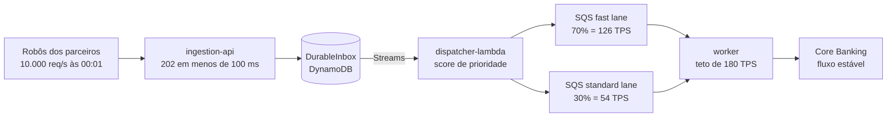

# Platform Engine — PoC de Crédito Consignado


**Absorver 10.000 propostas por segundo na borda enquanto o Core Banking recebe no máximo 180** — sem perder proposta e sem averbar nenhuma duas vezes.

<table>
<tr>
<td align="center"><strong>10.000</strong><br/>req/s na borda</td>
<td align="center"><strong>&lt; 100 ms</strong><br/>p95 do HTTP 202</td>
<td align="center"><strong>180</strong><br/>TPS no legado</td>
<td align="center"><strong>70/30</strong><br/>QoS fast/standard</td>
<td align="center"><strong>zero</strong><br/>averbação dupla</td>
</tr>
</table>

Prova de conceito de **ingestão massiva com proteção de sistema legado**.

> Contexto de negócio, números de mercado e critérios de homologação vêm de [sdd/narrativas/](sdd/narrativas/) — a narrativa executiva e o cenário real do "apagão das 00:01".
>
> Guias por público: [A jornada de uma proposta](docs/jornada-da-proposta.md) (negócio, passo a passo) · [Manual da API REST](docs/manual-api-rest.md) (como enviar propostas por Postman, Insomnia, curl ou PowerShell) · [Pattern: Borda de Absorção](docs/pattern-borda-de-absorcao.md) (a arquitetura como pattern reutilizável) · [Melhorias propostas](docs/melhoria-proposta.md) (revisão adversarial e plano M1 a M9).

---

## O que é este projeto

Uma PoC que demonstra uma arquitetura de **borda de absorção com desacoplamento temporal**. Ela não reescreve o Core Banking: coloca na frente dele uma camada que aceita todo o pico, garante durabilidade e idempotência, e depois alimenta o legado em ritmo seguro, priorizando o que tem mais valor de negócio.

O projeto entrega os quatro componentes dessa arquitetura, um legado simulado que serve de juiz do experimento, e as métricas que comprovam a tese.

## Por que existe: o paradoxo da virada de folha

O crédito consignado é a linha de crédito pessoal de menor risco e maior rentabilidade do mercado brasileiro. A carteira combinada passa de **R$ 484 bilhões**: mais de R$ 384 bilhões em INSS e setor público, e mais de R$ 100 bilhões no consignado privado, via eSocial e FGTS Digital. A disputa entre bancos tradicionais e plataformas digitais se decide em milissegundos.

A cada **virada de folha** — quando o INSS, o eSocial ou os governos estaduais liberam a margem consignável — bilhões em margem ficam disponíveis de uma só vez, às 00:01. É a maior janela de originação do mês.

E aqui está o paradoxo: **o evento mais lucrativo do mês é também o de maior risco operacional.**

### Quem age no minuto zero

| Ator | Comportamento |
|---|---|
| **Cliente final** (aposentado, trabalhador CLT) | simula o empréstimo na véspera e não tolera falha; se o sistema travar, o correspondente leva a proposta para o concorrente |
| **Correspondente bancário e fintechs parceiras** | não operam manualmente: usam robôs que disparam a **mesma proposta centenas de vezes por segundo**, no milissegundo em que a janela abre, para garantir a margem antes dos rivais |

O resultado é um salto de **50 requisições por segundo para 10.000**, de forma instantânea, contra um Core Banking projetado para **180**.

### O que acontece hoje, com arquitetura síncrona

- O pool de conexões do banco de dados se esgota em **menos de 3 segundos**.
- O sistema entra em timeout em cascata e cai, ficando fora do ar de **40 a 60 minutos**.
- A liderança de TI é convocada de madrugada para reiniciar servidores e limpar filas.
- Nesse intervalo, concorrentes resilientes absorvem a demanda. A perda de originação é irrecuperável, porque a margem do cliente já foi tomada.
- No caos dos retries dos robôs, requisições duplicadas criam condições de corrida e geram **averbação duplicada** no INSS ou no eSocial — litígio judicial e exposição às sanções da Autorregulação do Consignado (Febraban e ABBC), que já acumula mais de **2.260 medidas administrativas**.

Ineficiência na portabilidade agrava o quadro: com o Open Finance e a Resolução Conjunta CMN/BCB nº 15/2025, a demora do banco facilita a migração do próprio cliente para a concorrência.

## Objetivo

Provar, com código funcionando e métricas, que **não é preciso reescrever o Core Banking** para sobreviver à virada. A alternativa — expandir o legado para 10.000 TPS síncronos — custaria dezenas de milhões e anos de risco.

A PoC precisa demonstrar quatro coisas:

| Pilar | O que precisa ficar provado |
|---|---|
| **Absorção imediata** | a borda sustenta 10.000 req/s e responde `HTTP 202` com p95 abaixo de 100 ms, acalmando os robôs com um protocolo oficial |
| **Idempotência radical** | 500 disparos da mesma proposta no mesmo segundo gravam **um** registro e descartam os outros 499, sem custo e sem risco de averbação dupla |
| **Proteção física do legado** | o Core Banking recebe um fluxo estável travado em 180 TPS, trabalhando com eficiência e sem sobressalto |
| **Garantia de margem por QoS** | a capacidade escassa vai primeiro às operações mais rentáveis: alto valor, seguros acoplados e portabilidade |

### Ganhos que justificam o investimento

Disponibilidade no momento crítico protege e expande participação de mercado. A priorização 70/30 maximiza o VGV nos primeiros minutos, quando a margem mais valiosa está disponível. A idempotência na borda elimina o risco de duplicidade e atende Febraban, MTE e Banco Central. E o descarte das duplicatas na borda corta processamento inútil na nuvem, encerrando também os acionamentos de emergência de madrugada.

---

## A solução

Separar **aceitar** de **processar**.



A borda faz o mínimo para não perder a proposta — grava de forma durável e idempotente — e responde na hora. O Worker drena no ritmo que o legado suporta.

As duas filas existem porque, com fila única, uma proposta de alto valor entraria atrás de centenas de milhares de propostas pequenas. O orçamento é dividido com **piso** de 70% para a fast lane, e a lane ociosa empresta capacidade à outra: prioridade sem desperdício.

## As quatro garantias, no código

| Garantia | Como é obtida | Onde provar |
|---|---|---|
| Nenhuma proposta perdida | escrita durável antes do `202` | `ingestion-api` |
| Nenhuma averbação duplicada | escrita condicional atômica no DynamoDB + estados finais absorventes | `ingestion-api`, `worker` |
| Legado nunca acima de 180 TPS | orçamento de vazão por janela, com margem entre instâncias | `worker`, `mock-legacy` |
| Prioridade para o alto valor | duas filas com piso de 70/30 e empréstimo | `dispatcher-lambda`, `worker` |

## Como a PoC é homologada

O teste de carga precisa evidenciar, ao vivo:

- **Absorção na borda**: 10.000 TPS sustentados, mais de 99,9% de `202`, p95 abaixo de 100 ms.
- **Linha de proteção do legado**: vazão desenhando uma reta travada em 180 TPS. No legado simulado, `legacy_peak_window` deve ficar em 180 ou abaixo, e nenhum `503` por capacidade deve aparecer.
- **Integridade da idempotência**: injeção de requisições concorrentes com chaves duplicadas produzindo exatamente um registro por chave. `legacy_averbacoes_total{kind="duplicate"}` deve ser zero.
- **Effective drain time**: o tempo estimado para esvaziar o backlog acumulado após o pico, em tempo real.

Avaliação das métricas de negócio e de aplicação, com as consultas prontas: [docs/brainstorming/](docs/brainstorming/).

---

## Componentes

Cada módulo tem documentação própria com as decisões e os trade-offs:

| Módulo | O que faz |
|---|---|
| [ingestion-api](applications/ingestion-api/README.md) | borda de absorção: JWT, cota por parceiro, payload cifrado, `202` idempotente |
| [dispatcher-lambda](applications/dispatcher-lambda/README.md) | lê o Stream e roteia para a fila fast ou standard conforme o valor de negócio |
| [worker](applications/worker/README.md) | drena no teto de 180 TPS com QoS 70/30, circuit breaker e máquina de estados |
| [mock-legacy](applications/mock-legacy/README.md) | Core Banking simulado que **recusa** acima da capacidade — é o juiz do experimento |
| [shared](applications/shared/README.md) | value objects e contratos; CPF mascarado por padrão |
| [platform-starter](applications/platform-starter/README.md) | logs ECS, Actuator, sanitização de PII, erros fechados |
| [platform-aws](applications/platform-aws/README.md) | KMS com cache de chave de dados |
| [local-env](applications/local-env/README.md) | ferramenta só de desenvolvimento (não vai para a AWS): sobe, em uma única JVM e sem Docker, os serviços AWS de que a PoC depende — veja [Ambiente local](#ambiente-local) |

Visão do projeto Maven, build e convenções: [applications/README.md](applications/README.md).

## Stack técnica

| Camada | Tecnologia |
|---|---|
| Linguagem | Java 25 LTS, com threads virtuais |
| Framework | Spring Boot 4.1.1 (starters modulares), Spring Security 7 (JWT/JWKS) |
| Build | Maven 3.9+, Spotless, Enforcer, JaCoCo (mínimo 80%), CycloneDX SBOM |
| AWS | SDK v2 2.55.12 — DynamoDB (+ Streams), SQS, Lambda, KMS |
| Resiliência | Resilience4j 2.4.0 (circuit breaker, rate limiter) + orçamento de vazão próprio |
| API | springdoc-openapi 3.1.1 (Swagger UI), Problem Details RFC 7807 |
| Testes | JUnit 5, AssertJ, jqwik 1.10.1 (propriedades), ArchUnit 1.5.1 |
| Observabilidade | Micrometer, Prometheus, Grafana, Jaeger (OTLP), CloudWatch EMF |
| Dev local | DynamoDB Local e ElasticMQ embarcados na JVM — **sem Docker** |

## Começar

```bash
cd applications
mvn install -DskipTests     # publica os módulos no repositório local
```

```powershell
scripts\local-up.ps1        # sobe os 4 processos, sem Docker
```

Depois: Swagger da borda em `http://127.0.0.1:8080/swagger-ui.html`, token em `http://127.0.0.1:8082/token?tenant=banco-a`.

Pré-requisitos: **JDK 25** e Maven 3.9+. Docker não é necessário.

### Ambiente local

O módulo `local-env` substitui a AWS na máquina de desenvolvimento. Ele usa os emuladores **oficiais**, e não mocks, então a escrita condicional, o Stream e o redrive para a DLQ funcionam como na nuvem:

| No lugar de | `local-env` sobe | Porta |
|---|---|---|
| DynamoDB + Streams | DynamoDB Local, com a tabela `DurableInbox` e Streams habilitado | 8000 |
| SQS | ElasticMQ, com as filas fast, standard e DLQ (redrive após 3 tentativas) | 9324 |
| Provedor de identidade | Emissor de JWT local: JWKS e `GET /token?tenant=<id>` | 8082 |
| Gatilho Stream → Lambda | `LocalStreamDispatcher`: lê o stream e chama o **mesmo** `BatchDispatcher` do `dispatcher-lambda` | — |

As aplicações não sabem que estão rodando localmente: `ingestion-api` e `worker` usam os adaptadores AWS de produção, apontados para esses endpoints. O `scripts\local-up.ps1` sobe o `local-env` e depois o `mock-legacy` (8081), a `ingestion-api` (8080) e o `worker` (8083). O script também gera os segredos locais (chave do payload e API key do legado) e os repassa a cada processo. `scripts\local-down.ps1` encerra tudo.

Fica de fora do local: KMS (o payload usa chave AES local), CloudWatch/EMF e a stack de observabilidade.

## Decisões de contexto

Quatro restrições moldaram o desenho e explicam escolhas que de outro modo pareceriam estranhas:

- **Java 25**, não 21 como nas narrativas. O código conta com o comportamento do Java 25 em `synchronized` sob threads virtuais (JEP 491).
- **Sem Docker** na máquina de desenvolvimento. Daí os emuladores embarcados em vez de Testcontainers.
- **Persistência relacional em memória** nesta fase, no lugar do Aurora citado nas narrativas. O DurableInbox é DynamoDB de verdade, porque é dele que vem a garantia de idempotência.
- **Custo de nuvem sob controle.** Nada de NAT Gateway permanente; o ambiente é criado e destruído em volta dos testes.

## Observabilidade

Prometheus raspa `/actuator/prometheus` dos serviços; SQS, Lambda e DynamoDB vêm do **CloudWatch**, configurado como fonte de dados no mesmo Grafana. A stack (Prometheus, Grafana, Jaeger, Alertmanager) roda em EC2.

- Configuração do Grafana e mapa de métricas: [applications/observability/](applications/observability/)
- Stack e Terraform: [infrastructure/](infrastructure/)

## Privacidade (LGPD)

A telemetria é construída para não vazar dado pessoal, em duas camadas: **minimização** (handlers de erro não registram mensagem nem stack trace de exceção) e uma **rede de proteção** que mascara CPF, cartão, telefone e e-mail em todo valor de texto do JSON de log, nos quatro serviços. O CPF existe em um lugar só — cifrado no DurableInbox — e a mensagem de fila nunca o carrega.

Detalhes e a implementação única: [platform-starter](applications/platform-starter/README.md).

## Especificação e processo

| Pasta | Conteúdo |
|---|---|
| [sdd/](sdd/) | especificação de origem: SDD, blueprint e as narrativas de negócio |
| [aidlc-docs/](aidlc-docs/) | requisitos, design, estado do workflow (`aidlc-state.md`) e trilha de auditoria |
| [docs/](docs/) | material de apoio e avaliações de métricas |
| [.claude/skills/](.claude/skills/) | regras do projeto por tema (LGPD, logs, métricas, testes, arquitetura) |

O desenvolvimento segue o workflow AI-DLC Lite descrito em `CLAUDE.md`. O estado atual, os riscos registrados e as aprovações pendentes estão em [aidlc-docs/aidlc-state.md](aidlc-docs/aidlc-state.md).

## Estado atual

Aplicação construída e verde: `mvn verify` passa nos 9 módulos com 356 testes. O ambiente local sobe de ponta a ponta (`scripts\local-up.ps1`), com o fluxo proposta → fila → worker → legado verificado. Ajustes de desempenho e resiliência feitos em 09/10/2026: pool HTTP do DynamoDB, concorrência do worker, ZGC na borda e back-pressure com o circuito aberto. Pendentes: teste de carga com evidência medida, painéis do Grafana, Terraform e as melhorias M1 a M9 de [docs/melhoria-proposta.md](docs/melhoria-proposta.md).
