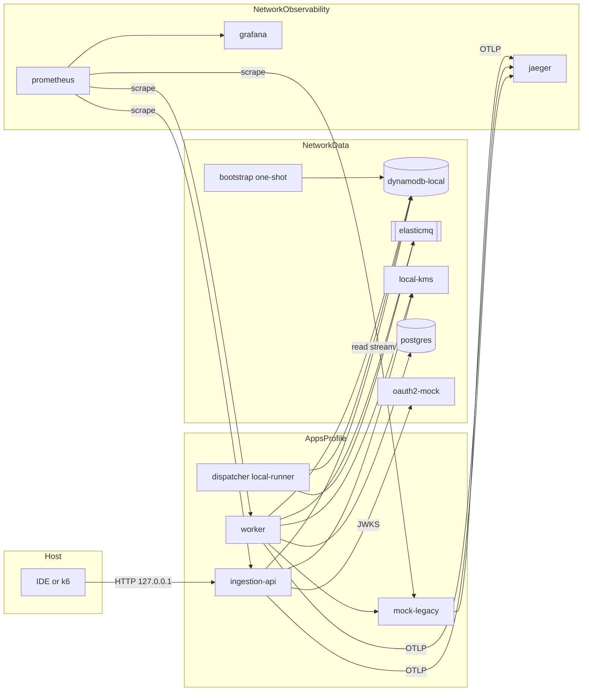

# Deployment Architecture - U1 platform-foundation

Topologia de execucao local (Compose) e de testes. A arquitetura AWS implantavel e detalhada em U6.

## 1. Topologia Local



Alternativa textual:

```
Host (IDE ou k6) -> ingestion-api -> dynamodb-local, local-kms, oauth2-mock (JWKS)
dispatcher local-runner -> dynamodb-local (stream) -> elasticmq
worker -> elasticmq, dynamodb-local, local-kms, postgres, mock-legacy
prometheus -> scrape (ingestion-api, worker, mock-legacy) -> grafana
servicos -> jaeger (OTLP)
```

Redes: `data` (dados e autenticacao) e `observability` (metricas e traces); aplicacoes participam de ambas. Todas as portas publicadas em `127.0.0.1`.

## 2. Ordem de Inicializacao

1. `dynamodb-local`, `elasticmq`, `local-kms`, `postgres`, `oauth2-mock` (healthchecks).
2. `bootstrap` (depende de `dynamodb-local` e `local-kms` saudaveis); cria tabela, valida filas e chave; termina com sucesso.
3. `prometheus`, `grafana`, `jaeger`.
4. (perfil `apps`) `mock-legacy` -> `worker` e `ingestion-api` -> `dispatcher local-runner`, cada um com `depends_on: condition: service_healthy` e, quando aplicavel, `service_completed_successfully` para o `bootstrap`.

## 3. Modos de Execucao

| Modo | Infra | Servicos | Uso |
|---|---|---|---|
| Desenvolvimento | Compose `infra` | Pela IDE (Spring Boot) apontando para `127.0.0.1` | Ciclo rapido |
| Integracao | Testcontainers (mesmas imagens: DynamoDB Local, ElasticMQ, local-kms, PostgreSQL) | Em teste | Perfil Maven `integration` |
| Carga | Compose `infra` + `apps` | Containers | k6 contra `127.0.0.1` |

As imagens dos testes de integracao e do Compose compartilham a mesma versao (propriedades do parent) para evitar divergencia.

## 4. Pipeline de Imagem e Execucao dos Servicos

```
mvn package (JDK 25)  ->  jar executavel  ->  Dockerfile multi-stage (Temurin 25 JRE, nao-root)
-> imagem com tag exata  ->  Compose (apps)  ->  [futuro] ECR + ECS Fargate (U6)
```

- Configuracao somente por variaveis de ambiente (Twelve-Factor); `.env` local.
- Shutdown graceful (30 s) e probes de liveness/readiness em todos os servicos.

## 5. Relacao com a Implantacao AWS (informativo, detalhado em U6)

| Local | AWS | Observacao |
|---|---|---|
| `dynamodb-local` | DynamoDB on-demand + Streams + TTL + SSE-KMS | Streams aciona o Lambda Dispatcher |
| `elasticmq` | SQS fast, standard, DLQ (14 dias) | Redrive apos 3 recebimentos |
| `local-kms` | KMS CMK dedicada | Chave por ambiente |
| `postgres` | Aurora PostgreSQL Serverless v2 | TLS e criptografia em repouso |
| `oauth2-mock` | IdP corporativo | URI do JWKS por configuracao |
| `local-runner` | Lambda + event source mapping | Mesmo `InboxStreamHandler` |
| Imagens Temurin | ECR + ECS Fargate | Tags imutaveis |
| (nao emulado) | WAF + ALB | Terraform validado, sem deploy |

## 6. Riscos Operacionais Locais

| Risco | Mitigacao |
|---|---|
| Docker nao instalado (R1) | Instalar antes de U2; testes unitarios/PBT independem |
| Memoria insuficiente | Perfis `infra`/`apps` separados; limites por servico; recomendacao >= 8 GB |
| Divergencia entre emuladores e AWS | Documentada (`infrastructure-design.md` secao 4); fidelidade final fora do escopo da PoC |
| `local-runner` divergir do comportamento do event source mapping (batching, retries) | Handler unico; semantica de falha parcial (`batchItemFailures`) testada no handler; diferencas listadas em U4 |
