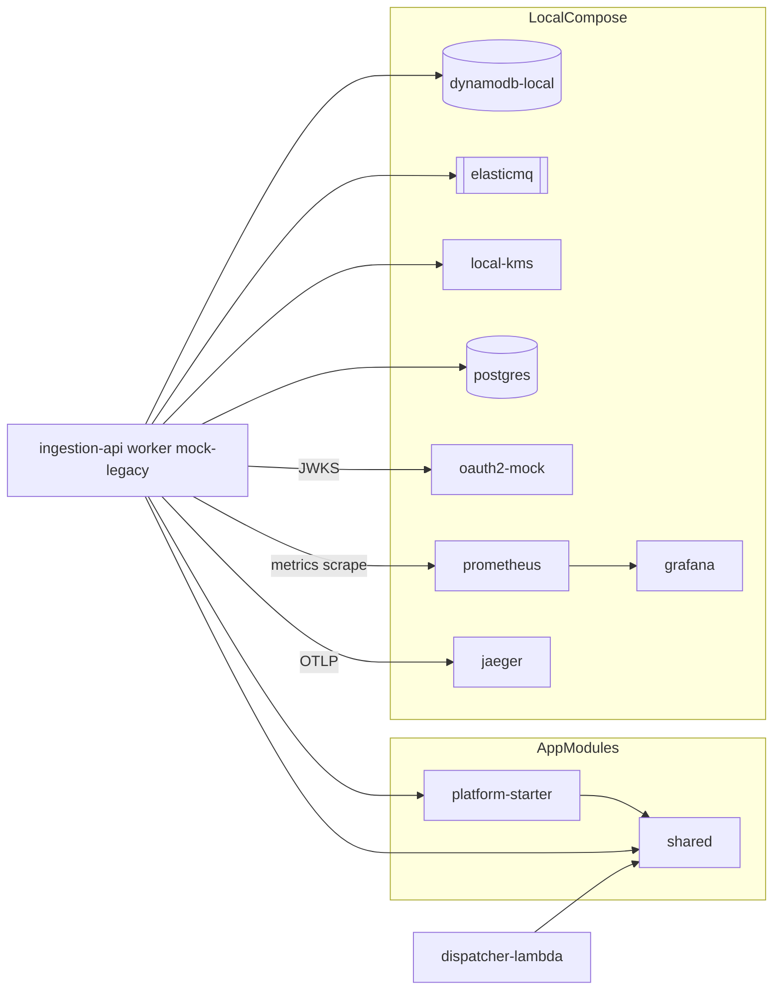

# Logical Components - U1 platform-foundation

## 1. Estrutura de Modulos (reactor Maven)

Ordem do reactor: `shared`, `platform-starter`, `mock-legacy`, `ingestion-api`, `dispatcher-lambda`, `worker`.

```
applications/
  pom.xml                       parent (BOMs, plugins, perfis)
  shared/                       value objects, contratos, test-jar com geradores jqwik
  platform-starter/             auto-configuracao Spring Boot (observabilidade, erros, hardening)
  mock-legacy/  ingestion-api/  dispatcher-lambda/  worker/
  compose.yaml  .env.example
  observability/prometheus/  observability/grafana/
```

`platform-starter` e um modulo novo, decidido neste NFR Design (Q1-A); passa a fazer parte da unidade U1.

## 2. Parent POM (`applications/pom.xml`)

| Elemento | Conteudo |
|---|---|
| Propriedades | `java.version=25`, versoes exatas: Spring Boot 4.1.1, AWS SDK 2.55.12, Resilience4j 2.4.0, springdoc 3.1.1, jqwik 1.10.1, ArchUnit 1.5.1, Testcontainers 2.0.5 |
| `dependencyManagement` | Import dos BOMs do Spring Boot e AWS SDK; entradas explicitas para as demais |
| `pluginManagement` | Enforcer, Spotless 3.10.3, Surefire, Failsafe, JaCoCo, CycloneDX 2.9.3, dependency-check 13.0.0 |
| Build padrao | Enforcer, Spotless check, compilador `--release 25`, Surefire, JaCoCo check, CycloneDX |
| Perfis | `integration` (Failsafe), `security` (Dependency-Check) |
| Repositorios | Somente Maven Central |

## 3. Modulo `shared`

| Componente | Responsabilidade |
|---|---|
| `Cpf`, `IdempotencyKey`, `TenantId`, `Money` | Value objects imutaveis com validacao e `toString` seguro (P2) |
| `ConvenioType`, `Lane` | Enums de contrato |
| `ProposalMessage` | Contrato Dispatcher -> Worker (`schemaVersion`) |
| `InboxAttributes` | Constantes com nomes dos atributos do item do `DurableInbox` |
| `HeaderNames`, `TraceKeys` | Constantes de headers e de propagacao de trace em mensagens |
| test-jar: `DomainArbitraries` | Geradores jqwik reutilizaveis (P8) |
| Testes | `*Test` (exemplos) e `*Properties` (round-trip e invariantes) |

Restricoes: sem Spring, sem AWS SDK, sem logica de negocio (NFR-U1-21).

## 4. Modulo `platform-starter`

| Componente | Responsabilidade |
|---|---|
| `PlatformDefaultsEnvironmentPostProcessor` | Registra propriedades padrao (logs ECS, Actuator minimo, graceful shutdown, Virtual Threads, probes) com menor precedencia, sobrescrevivel por env |
| `ObservabilityAutoConfiguration` | Tags comuns (`service`, `env`), registry Prometheus, ponte de tracing OTLP |
| `TenantTagPolicy` | Resolve tag `tenant` pela allowlist com teto (P4) |
| `PlatformProblemDetailAdvice` | Tratamento global de excecoes, resposta `ProblemDetail` generica, fail closed (P3) |
| `META-INF/spring/...AutoConfiguration.imports` | Registro das auto-configuracoes |
| Testes | Contexto minimo verificando defaults, politica de tags e ausencia de vazamento em erros |

Dependencias: `shared` (constantes), Spring Boot, Micrometer. Nao depende de AWS SDK nem de JPA.

## 5. Ambiente Local (`compose.yaml`)

| Servico | Funcao | Redes | Limites (CPU / memoria) | Healthcheck |
|---|---|---|---|---|
| `dynamodb-local` | DynamoDB com Streams | data | 0.5 / 512 MB | TCP/HTTP na porta 8000 |
| `elasticmq` | Filas SQS (fast, standard, DLQ) | data | 0.25 / 256 MB | endpoint de estatisticas |
| `local-kms` | KMS (chave do payload) | data | 0.25 / 128 MB | TCP na porta interna |
| `postgres` | Substitui Aurora em local | data | 0.5 / 512 MB | `pg_isready` |
| `oauth2-mock` | Emissor JWT (JWKS + tokens) | data | 0.25 / 256 MB | endpoint de discovery |
| `prometheus` | Coleta de metricas (scrape 5 s) | observability | 0.5 / 256 MB | `/-/ready` |
| `grafana` | Dashboards provisionados | observability | 0.5 / 256 MB | `/api/health` |
| `jaeger` | Traces via OTLP | observability | 0.5 / 256 MB | endpoint de saude |

- Portas publicadas em `127.0.0.1` apenas.
- Tags de imagem fixadas no Code Generation; sem `latest`.
- Servicos de aplicacao (U2 a U5) entram em perfis do Compose nas respectivas unidades.
- Execucao exige Docker (pendente de instalacao; ver R1).

## 6. Diagrama de Componentes Locais



Alternativa textual:

```
shared <- platform-starter <- (ingestion-api, worker, mock-legacy)
shared <- dispatcher-lambda (sem Spring)
servicos -> oauth2-mock (JWKS), prometheus (scrape), jaeger (OTLP), dynamodb-local, elasticmq, local-kms, postgres
prometheus -> grafana
```

## 7. Componentes de Configuracao Externalizada (Twelve-Factor)

| Variavel | Padrao | Uso |
|---|---|---|
| `PLATFORM_TRACING_SAMPLING` | `1.0` (local) | Amostragem de traces |
| `PLATFORM_METRICS_TENANT_ALLOWLIST` | vazia | Tenants com tag propria |
| `PLATFORM_METRICS_TENANT_MAX` | `50` | Teto da allowlist |
| `PLATFORM_JWT_JWKS_URI` | URL do `oauth2-mock` | JWKS do Resource Server |
| `OTEL_EXPORTER_OTLP_ENDPOINT` | `http://jaeger:4317` | Destino OTLP |
| `SERVER_PORT` | `8080` | Porta do servico |

## 8. Impacto em Artefatos Anteriores
- `unit-of-work.md`, `unit-of-work-dependency.md` e `components.md` atualizados para incluir `platform-starter`.
- Os servicos de emulacao AWS desta tabela substituem o LocalStack previsto antes; a versao final dos servicos e o detalhe (portas, volumes, bootstrap) estao em `infrastructure-design/infrastructure-design.md`, que prevalece em caso de divergencia.
