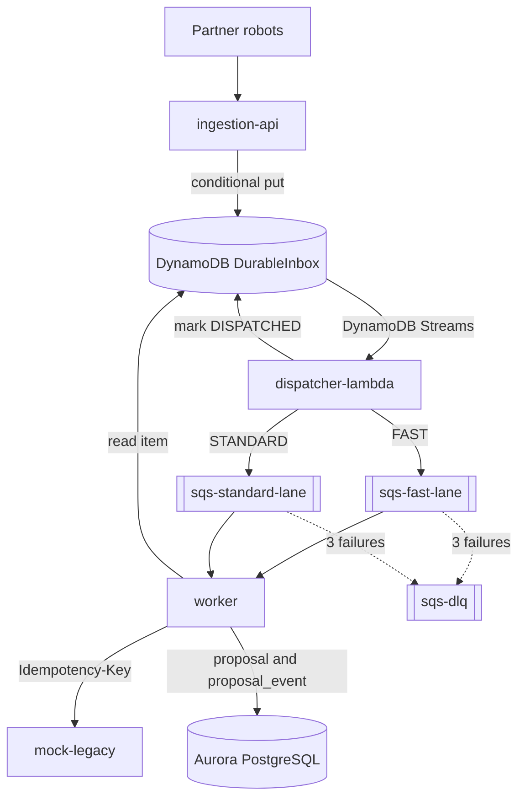

# Component Dependencies

## Matriz de Dependencias (compile-time)

| Modulo \ depende de | shared | AWS SDK | Spring | JPA/Flyway | Resilience4j |
|---|---|---|---|---|---|
| shared | - | nao | nao | nao | nao |
| ingestion-api (domain, application) | sim | nao | nao | nao | nao |
| ingestion-api (infrastructure) | sim | sim | sim | nao | sim |
| dispatcher-lambda | sim | sim | nao (Lambda puro) | nao | nao |
| worker (domain, application) | sim | nao | nao | nao | nao |
| worker (infrastructure) | sim | sim | sim | sim | sim |
| mock-legacy | nao | nao | sim | nao | nao |

Regras:
- `domain` e `application` nunca importam Spring, JPA, AWS SDK ou HTTP; ArchUnit falha o build se violado.
- Nenhum servico depende de outro servico em tempo de compilacao; so de `shared`.
- Mock Legacy nao depende de `shared` (simula um sistema externo).

## Dependencias entre Componentes (runtime)

| Origem | Destino | Padrao | Protocolo |
|---|---|---|---|
| Parceiros | ingestion-api | Requisicao/resposta | HTTPS REST (WAF -> ALB) |
| ingestion-api | DynamoDB `DurableInbox` | Escrita condicional | AWS SDK |
| DynamoDB Streams | dispatcher-lambda | Evento assincrono | Event source mapping |
| dispatcher-lambda | SQS (fast/standard) | Publicacao de mensagem | AWS SDK |
| dispatcher-lambda | DynamoDB `DurableInbox` | Atualizacao condicional | AWS SDK |
| SQS | worker | Polling | AWS SDK (Virtual Threads) |
| worker | DynamoDB `DurableInbox` | Leitura | AWS SDK |
| worker | mock-legacy | Requisicao/resposta com circuit breaker | HTTP REST |
| worker | Aurora PostgreSQL | Transacao local | JDBC (JPA) |
| Todos | Prometheus | Scrape | HTTP `/actuator/prometheus` |
| Todos | Jaeger | Export | OTLP |

## Fluxo de Dados



**Alternativa textual**

```
Parceiros -> ingestion-api -> DurableInbox (DynamoDB)
DurableInbox -> (Streams) -> dispatcher-lambda -> sqs-fast-lane | sqs-standard-lane
sqs-* -> worker -> mock-legacy (com Idempotency-Key)
worker -> Aurora (proposal + proposal_event)
sqs-* --(3 falhas)--> sqs-dlq
```

## Sequencia Principal (caminho feliz)

```
Parceiro      Ingestion     Inbox      Dispatcher    SQS      Worker     Legacy    Aurora
   |  POST        |           |            |          |         |          |         |
   |------------->| quota+protect          |          |         |          |         |
   |              |--putIfAbsent->|        |          |         |          |         |
   |<--202 RECEIVED--|           |         |          |         |          |         |
   |              |           |--stream--->|          |         |          |         |
   |              |           |            |--msg---->|         |          |         |
   |              |           |<-DISPATCHED-|         |         |          |         |
   |              |           |            |          |--poll-->|          |         |
   |              |           |<------------read item--|         |          |         |
   |              |           |            |          |         |--PENDING------------>|
   |              |           |            |          |         |--submit->|         |
   |              |           |            |          |         |<-200-----|         |
   |              |           |            |          |         |--CONFIRMED+event--->|
```

## Sequencia de Duplicidade

```
Parceiro --POST (mesma Idempotency-Key)--> Ingestion --putIfAbsent--> Inbox (ALREADY_EXISTS)
Parceiro <--202 DUPLICATE_ACCEPTED (mesmo tracingId)-- Ingestion      (nada enfileirado)
```

## Pontos de Acoplamento e Mitigacoes

| Ponto | Risco | Mitigacao |
|---|---|---|
| Contrato `ProposalMessage` | Quebra entre Dispatcher e Worker | Vive em `shared` com `schemaVersion`; mudanca aditiva |
| Item do inbox lido por tres servicos | Divergencia de atributos | Nomes de atributos em constantes de `shared`; teste de contrato |
| Worker depende de leitura do inbox | Item expirado por TTL antes de processar | TTL de 7 dias >> tempo de drenagem; ausente -> DLQ com alerta de metrica |
| Orcamento por tarefa (180 / N) | Desvio se N real difere do configurado | Documentado; Mock Legacy mede o pico real; evolucao via `ThroughputBudgetPort` |
| Dispatcher publica duplicado | Mensagem repetida | Worker idempotente (`createPendingIfAbsent`, estado final -> `COMPLETED`) |

## Rastreabilidade (requisitos -> componentes)

| Requisito | Componentes |
|---|---|
| FR-1 (Ingestion) | C2, S1 |
| FR-2 (Inbox) | C2, C3 |
| FR-3 (Dispatcher) | C3, S2 |
| FR-4 (Worker) | C4, S3, S4 |
| FR-5 (Mock Legacy) | C5, S5 |
| FR-6 (Aurora) | C4 (`JpaProposalRepository`, Flyway) |
| FR-7 (Observabilidade) | metricas e tracing em todos os componentes |
| FR-8, FR-9 (IaC, local, k6) | C6 |
| NFR-12 (ArchUnit) | C2 e C4 |
