# Execution Plan - PoC Credito Consignado

## 1. Detailed Analysis Summary

### Transformation Scope
Greenfield: nao se aplica analise de transformacao brownfield.

### Change Impact Assessment
- **User-facing changes**: Sim, para parceiros/correspondentes (contrato `POST /v1/proposals`, codigos 202/429).
- **Structural changes**: Sim, arquitetura nova (borda, inbox, dispatcher, workers, estado relacional).
- **Data model changes**: Sim, `DurableInbox` (DynamoDB) e `proposal`/`proposal_event` (PostgreSQL).
- **API changes**: Sim, contrato OpenAPI novo e consolidado.
- **NFR impact**: Critico (10.000 TPS, p95 < 100 ms, teto de 180 TPS, idempotencia, seguranca, LGPD).
- **Application layer**: 5 modulos Java 25 (Maven multi-modulo).
- **Infrastructure layer**: Terraform (WAF, ALB, ECS, DynamoDB, Lambda, SQS, Aurora, KMS, IAM) e Docker Compose.
- **Operations layer**: Prometheus, Grafana, OpenTelemetry/Jaeger, health probes.

### Risk Assessment
- **Risk Level**: High
- **Principais riscos**: averbacao duplicada (idempotencia ponta a ponta), teto global de 180 TPS com varios workers (limiter local por instancia), fidelidade do ambiente local (emuladores DynamoDB Local, ElasticMQ, local-kms) vs AWS, compatibilidade Spring Boot / Lambda com Java 25.
- **Rollback**: simples (greenfield, sem deploy nesta entrega).
- **Testing complexity**: Alta (carga, concorrencia, falha, replay).

## 2. Workflow Visualization

```mermaid
flowchart TD
    Start([Start]) --> WD[Workspace Detection - COMPLETED]
    WD --> RE[Reverse Engineering - SKIP]
    RE --> RA[Requirements Analysis - COMPLETED]
    RA --> US[User Stories - SKIP]
    US --> WP[Workflow Planning - IN PROGRESS]
    WP --> AD[Application Design - EXECUTE]
    AD --> UG[Units Generation - EXECUTE]
    UG --> FD[Functional Design - EXECUTE per unit]
    FD --> NR[NFR Requirements - EXECUTE per unit]
    NR --> ND[NFR Design - EXECUTE per unit]
    ND --> ID[Infrastructure Design - EXECUTE per unit]
    ID --> CG[Code Generation - EXECUTE per unit]
    CG --> BT[Build and Test - EXECUTE]
    BT --> OP[Operations - PLACEHOLDER]
    OP --> End([End])

    style WD fill:#4CAF50,stroke:#1B5E20,color:#fff
    style RA fill:#4CAF50,stroke:#1B5E20,color:#fff
    style WP fill:#4CAF50,stroke:#1B5E20,color:#fff
    style CG fill:#4CAF50,stroke:#1B5E20,color:#fff
    style BT fill:#4CAF50,stroke:#1B5E20,color:#fff
    style AD fill:#FFA726,stroke:#E65100,stroke-width:2px,stroke-dasharray: 5 5,color:#000
    style UG fill:#FFA726,stroke:#E65100,stroke-width:2px,stroke-dasharray: 5 5,color:#000
    style FD fill:#FFA726,stroke:#E65100,stroke-width:2px,stroke-dasharray: 5 5,color:#000
    style NR fill:#FFA726,stroke:#E65100,stroke-width:2px,stroke-dasharray: 5 5,color:#000
    style ND fill:#FFA726,stroke:#E65100,stroke-width:2px,stroke-dasharray: 5 5,color:#000
    style ID fill:#FFA726,stroke:#E65100,stroke-width:2px,stroke-dasharray: 5 5,color:#000
    style RE fill:#BDBDBD,stroke:#616161,stroke-width:2px,stroke-dasharray: 5 5,color:#000
    style US fill:#BDBDBD,stroke:#616161,stroke-width:2px,stroke-dasharray: 5 5,color:#000
    style OP fill:#FFF59D,stroke:#F9A825,color:#000
    style Start fill:#CE93D8,stroke:#6A1B9A,color:#000
    style End fill:#CE93D8,stroke:#6A1B9A,color:#000
```



**Text alternative**

```
INCEPTION
- Workspace Detection ........ COMPLETED
- Reverse Engineering ........ SKIP (greenfield)
- Requirements Analysis ...... COMPLETED
- User Stories ............... SKIP
- Workflow Planning .......... IN PROGRESS
- Application Design ......... EXECUTE
- Units Generation ........... EXECUTE
CONSTRUCTION (por unidade)
- Functional Design .......... EXECUTE (conforme unidade)
- NFR Requirements ........... EXECUTE (conforme unidade)
- NFR Design ................. EXECUTE (conforme unidade)
- Infrastructure Design ...... EXECUTE (conforme unidade)
- Code Generation ............ EXECUTE
- Build and Test ............. EXECUTE
OPERATIONS
- Operations ................. PLACEHOLDER
```

## 3. Phases to Execute

### INCEPTION PHASE
- [x] Workspace Detection (COMPLETED)
- [x] Reverse Engineering (SKIP) - greenfield, sem codigo existente
- [x] Requirements Analysis (COMPLETED, aprovado)
- [x] User Stories (SKIP) - os requisitos ja derivam do SDD com criterios de aceite (DoD) mensuraveis e rastreabilidade FR/NFR; os "usuarios" sao sistemas (robos, parceiros) e a equipe de SRE, sem jornadas de UI. Pode ser incluido sob demanda.
- [ ] Workflow Planning (IN PROGRESS)
- [ ] Application Design (EXECUTE) - componentes novos, portas/adaptadores, regras de negocio (idempotencia, prioridade, orcamento 70/30, maquina de estados) e dependencias precisam de definicao
- [ ] Units Generation (EXECUTE) - 5 modulos e infraestrutura com dependencias claras pedem decomposicao em unidades

### CONSTRUCTION PHASE (unidades propostas, ordem de dependencia)

| # | Unidade | Conteudo | Functional | NFR Req | NFR Design | Infra Design | Code |
|---|---|---|---|---|---|---|---|
| U1 | `platform-foundation` | Parent Maven (Java 25, Spotless, JaCoCo, Enforcer, ArchUnit), modulo `shared`, `compose.yaml`, observabilidade local | SKIP | EXECUTE | EXECUTE | EXECUTE | EXECUTE |
| U2 | `mock-legacy` | Core Banking simulado (180 TPS, falhas, dedup) | EXECUTE | SKIP (coberto por U1) | SKIP | SKIP | EXECUTE |
| U3 | `ingestion-api` | Borda, JWT, cota por tenant, escrita condicional | EXECUTE | EXECUTE | EXECUTE | EXECUTE | EXECUTE |
| U4 | `dispatcher-lambda` | Streams, prioridade, roteamento SQS | EXECUTE | EXECUTE | EXECUTE | EXECUTE | EXECUTE |
| U5 | `worker` | Consumo SQS, orcamento 70/30, circuit breaker, Aurora, outbox | EXECUTE | EXECUTE | EXECUTE | EXECUTE | EXECUTE |
| U6 | `infrastructure-terraform` | Modulos Terraform (WAF, ALB, ECS, DynamoDB, Lambda, SQS, Aurora, KMS, IAM) | SKIP | SKIP | SKIP | EXECUTE | EXECUTE |
| U7 | `load-tests-and-dashboards` | k6 (4 cenarios), dashboards Grafana | EXECUTE | SKIP | SKIP | SKIP | EXECUTE |

A lista final de unidades e confirmada em Units Generation. Cada unidade conclui design e codigo antes da proxima.

Rationale das etapas por unidade:
- **Functional Design**: unidades com regra de negocio ou contrato (U2, U3, U4, U5, U7).
- **NFR Requirements / Design**: unidades com meta de desempenho, seguranca ou resiliencia (U3, U4, U5) e a fundacao (U1: versao Spring Boot/Java 25, padroes de observabilidade).
- **Infrastructure Design**: mapeamento a servicos AWS e ao Compose (U1, U3, U4, U5, U6).

- [ ] Build and Test (EXECUTE) - sempre; build multi-modulo, testes unitarios/integracao, k6, ArchUnit, validacao Terraform

### OPERATIONS PHASE
- [ ] Operations (PLACEHOLDER)

## 4. Estimated Timeline
- **Estagios de Inception restantes**: 2 (Application Design, Units Generation)
- **Unidades de Construction**: 7, com ate 5 estagios cada; checkpoint de aprovacao por estagio
- **Duracao estimada**: 7 a 10 sessoes de trabalho com revisao (sem deploy na AWS)

## 5. Success Criteria
- **Objetivo principal**: Provar, em ambiente local reproduzivel, a Borda de Absorcao com Desacoplamento Temporal e a protecao do legado a 180 TPS, com artefatos de IaC prontos para a AWS.
- **Entregaveis**: 5 modulos Java 25, Terraform validado, `compose.yaml`, script k6, dashboards Grafana, OpenAPI unico, README e ADRs, instrucoes de build e teste.
- **Quality gates**:
  - Build com Spotless, ArchUnit, JaCoCo (>= 80% domain/application, >= 50% infrastructure) e Maven Enforcer (Java 25).
  - Regras SECURITY bloqueantes (extensao ativa) e regras PBT em modo parcial.
  - Sem PII em logs/metricas/traces; sem segredos no codigo.
  - DoD do SDD verificavel via k6 e SQL (escala configuravel).
  - `terraform validate` e `plan` sem erros.

## 6. Pontos de Decisao Antecipados
- Versao exata do Spring Boot com suporte a Java 25 (NFR Requirements, U1).
- Runtime Lambda: Java 25 gerenciado ou imagem de container (Infrastructure Design, U4).
- Estrategia do teto global de 180 TPS com varios workers (NFR Design, U5).
- Estados e transicoes de `proposal` (Functional Design, U5).
