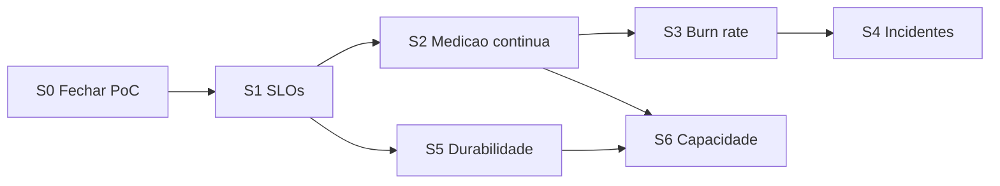

# Plano de workflow — evolução de SRE

Status: **aprovado; S0–S4 aprovadas, S5 validada e S6 com homologação pendente** (ver `aidlc-docs/aidlc-state.md` e `aidlc-docs/audit.md`). Profundidade: Standard.

## Situação das etapas — 23/10/2026

| Etapa | Situação | Evidência / pendência |
|---|---|---|
| S0 — Fechar pendências da PoC | Aprovada | Detector corrigido; L2 encerrado como INCOMPLETE |
| S1 — SLOs formais | Aprovada | Contrato J1/J2 e política de error budget |
| S2 — Medição contínua | Aprovada | Índice de prazos, avaliador, regras e dashboard; limites registrados na validação da unidade |
| S3 — Alertas por burn rate | Aprovada | Regras e testes promtool |
| S4 — Resposta a incidentes | Aprovada | Game day local e postmortem |
| S5 — Durabilidade | Validada | Build com integração: 473 testes; reinício real do worker sem nova averbação para replay terminal |
| S6 — Capacidade | Ensaios entregues; homologação pendente | Quatro rodadas; p99 no servidor ≈ 245 ms, acima de 200 ms |
| S7 — Plataforma | Fora do escopo | Sem execução ou recursos AWS |

Organização do repositório concluída: sete logs de build em `logs/`, com regras no `.gitignore` e nenhum log rastreado pelo Git.

Próxima ação: investigar o custo do aceite e os recursos do host, corrigir o pacing do gerador e repetir a qualificação da S6. Manter os SLOs atuais. Ambiente local encerrado; não há ensaio em execução.

| Estágio | Decisão | Motivo |
|---|---|---|
| User Stories | Pular | Mudança operacional/interna, sem nova jornada de usuário |
| Application Design | Executar (mínimo) | Novos componentes: consumidor de incidentes, Sweeper, repositório DynamoDB do worker |
| Units Generation | Executar | Uma unidade por onda |
| Functional Design | S2, S4, S5 | Avaliador de prazos, dedup de episódio, outbox/Sweeper |
| NFR Req/Design | S5, S6 | Durabilidade e capacidade |
| Infrastructure Design | S4, S6 | ElasticMQ e ensaio em processos locais; AWS fora deste incremento |
| Code Generation | Todas | — |
| Build and Test | Ao fim | — |

## Sequência

Texto: S0 → S1 → S2 → S3 → S4; S5 em paralelo após S1; S6 depende de S2 e S5.

Primeira unidade: **S0** — local, sem ligar a EC2.
