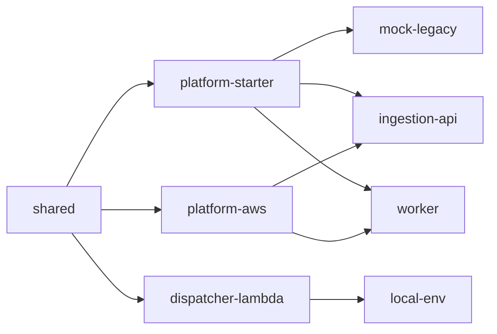

# applications — projeto Maven multi-módulo

Código da PoC. Java 25, Maven 3.9+, Spring Boot 4.1.1. Veja o [contexto de negócio](../docs/narrativas/contexto-e-objetivos.md), a [visão técnica](../docs/manuais/visao-tecnica.md) e o [guia do ambiente local](../docs/manuais/ambiente-local.md).

## Módulos

| Módulo | Papel | Documentação |
|---|---|---|
| `shared` | value objects e contratos; sem Spring e sem AWS | [README](shared/README.md) |
| `platform-telemetry` | contexto W3C, spans de infraestrutura e SDK do dispatcher | [README](platform-telemetry/README.md) |
| `platform-starter` | auto-configuração comum: logs ECS, Actuator, LGPD, erros | [README](platform-starter/README.md) |
| `platform-aws` | adaptadores AWS reutilizáveis (KMS com cache) | [README](platform-aws/README.md) |
| `mock-legacy` | Core Banking simulado que recusa acima de 180 TPS | [README](mock-legacy/README.md) |
| `ingestion-api` | borda de absorção; responde `202` com idempotência | [README](ingestion-api/README.md) |
| `dispatcher-lambda` | roteamento QoS: Streams → SQS fast/standard | [README](dispatcher-lambda/README.md) |
| `worker` | drena no teto de 180 TPS, com QoS 70/30 | [README](worker/README.md) |
| `local-env` | emuladores embarcados, sem Docker (dev) | [README](local-env/README.md) |

Dependências entre eles:



## Pré-requisitos

| Item | Versão | Observação |
|---|---|---|
| JDK | 25 | o Enforcer exige ≥ 25; o código depende do comportamento do Java 25 (JEP 491) |
| Maven | ≥ 3.9 | testado com 3.9.11 |

**Docker não é necessário.** Os testes de integração usam emuladores embarcados na JVM (ver `local-env`).

## Build

```bash
mvn verify                      # padrão: Enforcer, Spotless, testes, JaCoCo (80%), ArchUnit, SBOM
mvn spotless:apply              # formata (google-java-format) — rode antes de commitar
mvn verify -Pintegration        # inclui os *IT (DynamoDB Local e ElasticMQ embarcados)
mvn verify -Psecurity           # OWASP Dependency-Check (pode exigir -Dnvd.api.key)
mvn install -DskipTests         # necessário para rodar módulos isolados (ver abaixo)
```

O build falha em violação de formatação, de cobertura ou de regra de arquitetura. Isso é proposital: as regras só valem se bloquearem.

## Rodar os serviços

Os três serviços Spring Boot aceitam `spring-boot:run`, e o `local-env` roda com `exec:java`:

```bash
mvn install -DskipTests                     # uma vez: publica os módulos no repositório local
mvn -pl local-env exec:java                 # emuladores + emissor de token + dispatcher
mvn -pl mock-legacy spring-boot:run         # exige LEGACY_API_KEY
mvn -pl ingestion-api spring-boot:run
mvn -pl worker spring-boot:run
```

Dois detalhes que custam tempo se você não souber:

**`mvn install` primeiro.** Sem ele, rodar um módulo isolado falha ao resolver os irmãos (`Could not find artifact ... shared`), porque `mvn verify` não publica nada no repositório local.

**As variáveis obrigatórias não têm valor padrão.** Os serviços falham na partida sem elas, de propósito — nenhuma credencial embutida. A chave AES do payload precisa ser **a mesma** na ingestion e no worker, senão o worker não decifra o que a borda cifrou.

Como cada comando ocupa um terminal e os segredos precisam combinar entre processos, o caminho prático é:

```powershell
scripts\local-up.ps1     # sobe os 4 processos, gera e propaga os segredos
scripts\local-down.ps1   # encerra
```

| Serviço | Porta | Útil |
|---|---|---|
| ingestion-api | 8080 | `/swagger-ui.html`, `/actuator/prometheus` |
| mock-legacy | 8081 | `/swagger-ui.html` |
| worker | 8083 | `/actuator/prometheus` |
| emissor JWT | 8082 | `/token?tenant=banco-a` |
| DynamoDB Local | 8000 | |
| SQS (ElasticMQ) | 9324 | |

## Convenções

- **Testes**: `should_<resultado>_when_<condição>`, em snake_case. Testes de propriedade terminam em `Properties`, de arquitetura em `ArchTest`, de integração em `IT`.
- **Arquitetura**: hexagonal nos serviços (`domain` ← `application` ← `infrastructure`), validada por ArchUnit.
- **Logs**: SLF4J com `addKeyValue`; nunca `System.out`, nunca PII na mensagem.
- **Métricas**: medidores registrados no construtor, tags de baixa cardinalidade, nenhuma tag com dado pessoal.

As regras detalhadas estão nas skills em `../.claude/skills/` — carregue a do tema antes de alterar log, métrica, trace ou teste.

## Observabilidade local

Não há stack local. Os serviços expõem `/actuator/prometheus` para raspagem; a instrumentação W3C e o SDK estão disponíveis localmente, com exportação opcional; a entrega no Jaeger ainda precisa de validação. A configuração do Grafana e do CloudWatch está em [observability/](observability/) e a stack roda no EC2 (ver [infrastructure/](../infrastructure/)).
