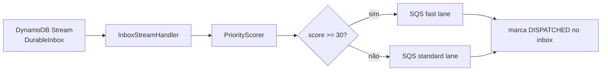

# dispatcher-lambda

Roteia as propostas aceitas para a fila certa: lê o DynamoDB Stream do DurableInbox e publica na fila **fast** ou **standard**. Sem Spring.

## Por que é uma Lambda sem Spring

A função roda por evento do stream e precisa de partida rápida. Spring Boot adicionaria segundos de inicialização a frio e dezenas de megabytes ao pacote, sem nada em troca: aqui não há endpoint HTTP, injeção complexa nem configuração dinâmica. A configuração vem de variáveis de ambiente lidas uma vez.

## Por que duas filas

O legado só aceita 180 por segundo. Durante a virada, o backlog pode chegar a milhões. Se houvesse uma fila única, uma proposta de alto valor entraria atrás de centenas de milhares de propostas pequenas e levaria horas.

Com duas filas, o Worker divide o orçamento: **70% para a fast lane** e 30% para a standard. O que tem mais valor de negócio é averbado primeiro, e o restante não fica parado, porque a lane ociosa empresta orçamento à outra.

## Como decide a lane

`PriorityScorer` soma pesos e `LaneRouter` compara com o limite:

| Critério | Peso |
|---|---|
| Tenant VIP (`DISPATCHER_VIP_TENANTS`) | 60 |
| Valor acima do limite (`DISPATCHER_AMOUNT_THRESHOLD`) | 40 |
| Portabilidade | 30 |

Score maior ou igual a `DISPATCHER_FAST_THRESHOLD` (padrão 30) vai para a fast lane.

A portabilidade pontua porque é a operação que tira carteira do concorrente — e tem prazo regulatório. Perder a janela significa perder o cliente.

## Fluxo



A marcação de `DISPATCHED` é condicional: se o registro já foi despachado, não publica de novo. Uma reentrega do stream não gera mensagem duplicada.

## Configuração

| Variável | Padrão |
|---|---|
| `DISPATCHER_FAST_QUEUE_URL` | — |
| `DISPATCHER_STANDARD_QUEUE_URL` | — |
| `DISPATCHER_INBOX_TABLE` | `DurableInbox` |
| `DISPATCHER_VIP_TENANTS` | vazio |
| `DISPATCHER_AMOUNT_THRESHOLD` | — |
| `DISPATCHER_FAST_THRESHOLD` | 30 |

## Métricas

Emite **EMF** (CloudWatch Embedded Metric Format) em stdout, no namespace `ConsignadoPoc/Dispatcher`: `RecordsDispatched` por `Lane`, `RecordsSkipped` e `RecordsFailed`. Uma linha JSON no log vira métrica sem chamada de API, o que evita latência e custo de `PutMetricData` no caminho do evento.

Essas métricas **não aparecem no Prometheus** — vêm do CloudWatch, que está configurado como fonte de dados no Grafana.

## Pacote

```bash
mvn -pl dispatcher-lambda package   # gera o jar sombreado com classificador "aws"
```

## No ambiente local

Não há Lambda local. O módulo `local-env` usa `LocalStreamDispatcher`, que faz polling do stream do DynamoDB Local e chama o mesmo `BatchDispatcher`. A lógica exercitada é a mesma; só o acionamento muda.

## Testes

```bash
mvn -pl dispatcher-lambda test
```
