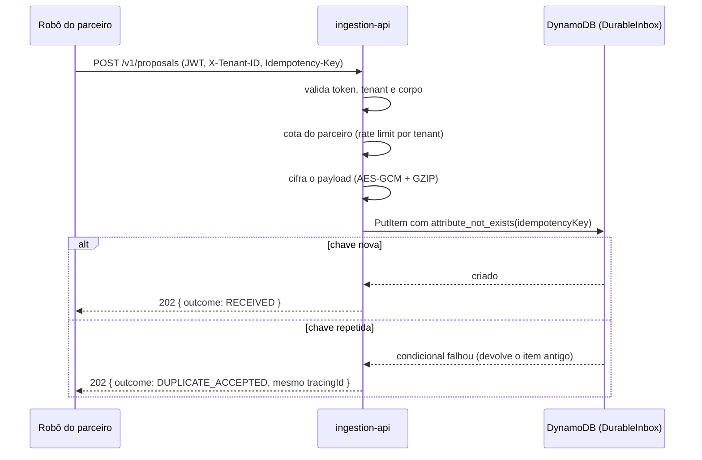

# ingestion-api

A borda de absorção. Aceita a proposta com durabilidade e idempotência e responde `202 Accepted` **sem esperar o legado**.

## O problema que resolve

Na virada da folha, robôs de correspondentes disparam cerca de 10.000 propostas por segundo. O Core Banking aguenta 180 por segundo. Se a borda chamasse o legado de forma síncrona, ele cairia nos primeiros segundos e o cliente iria para o concorrente.

A borda então faz o mínimo necessário para **não perder a proposta** e devolve na hora. O trabalho pesado acontece depois, no ritmo que o legado suporta.

## Fluxo de uma requisição



O p95 alvo é **menor que 100 ms**, e nada no caminho crítico chama o legado ou um banco relacional.

## Idempotência: por que a escrita condicional

A duplicata é descartada pelo próprio DynamoDB, com `attribute_not_exists(idempotencyKey)` em uma única operação atômica. Não há leitura antes da escrita, então não existe janela de corrida entre dois robôs enviando a mesma chave ao mesmo tempo. Isso impede uma segunda inclusão para a mesma chave técnica enquanto o registro existe. Não basta para garantir exatamente uma averbação entre réplicas ou reinícios do worker; consulte a [auditoria de idempotência](../../docs/auditoria-idempotencia.md).

Na falha condicional, o adaptador pede `ALL_OLD` e devolve o `tracingId` e o instante da **primeira** aceitação. O robô que repetiu recebe a mesma resposta da primeira vez, o que torna a repetição segura e barata.

## API

`POST /v1/proposals`

| Header | Obrigatório | Observação |
|---|---|---|
| `Authorization: Bearer <jwt>` | sim | validado por JWKS; a claim de tenant precisa bater com o header |
| `X-Tenant-ID` | sim | divergência do token resulta em `403` |
| `Idempotency-Key` | sim | UUID estrito |

| Status | Quando |
|---|---|
| `202` | aceita (`RECEIVED`) ou repetida (`DUPLICATE_ACCEPTED`) |
| `400` | corpo ou headers inválidos |
| `401` / `403` | token ausente ou tenant divergente |
| `413` | corpo acima do limite |
| `429` | cota do parceiro excedida (com `Retry-After`) |
| `503` | DurableInbox indisponível |

Todos os erros são `application/problem+json` (RFC 7807) sem detalhe interno. Nenhuma resposta devolve o CPF, e há teste garantindo isso.

## Configuração

Sem valor padrão (o serviço não sobe sem elas):

| Variável | Para quê |
|---|---|
| `INGESTION_JWT_JWK_SET_URI` | JWKS do emissor |
| `INGESTION_PAYLOAD_LOCAL_KEY` | chave AES-256 em Base64 (modo local) — a **mesma** do worker |

Principais opcionais: `INGESTION_INBOX_TYPE` (`dynamodb` ou `memory`), `INGESTION_INBOX_TABLE`, `INGESTION_QUOTA_DEFAULT_PER_SECOND`, `INGESTION_MAX_BODY_BYTES`, `INGESTION_PAYLOAD_MODE` (`local` ou `kms`), `INGESTION_API_DOCS_ENABLED`, `INGESTION_INBOX_MAX_CONNECTIONS` (padrão 200).

### Dimensionamento para o pico

- **Pool HTTP do DynamoDB.** O padrão do SDK é 50 conexões. Pela Lei de Little, 10.000 req/s com o DynamoDB a ~20 ms exigem ~200 em uso. Com menos, as requisições esperam por conexão, estouram o timeout de 500 ms e viram `503`. Ajuste `INGESTION_INBOX_MAX_CONNECTIONS` se a latência medida for outra.
- **JVM.** O `local-up.ps1` sobe a borda com ZGC (pausas abaixo de 1 ms, para o p95 abaixo de 100 ms), heap fixo (`-Xms` igual a `-Xmx`, padrão 1 GB, parâmetro `-IngestionHeap`) e `AlwaysPreTouch`. Use as mesmas flags no ambiente do teste de carga.
- **Primeira chamada após a subida.** Com o DynamoDB ainda frio, a primeira gravação pode passar do timeout e responder `503` mesmo tendo gravado. O reenvio com a mesma `Idempotency-Key` responde `202 DUPLICATE_ACCEPTED`.

## Documentação interativa

Desligada por padrão, de propósito: uma implantação que esqueça a variável **não** expõe a documentação. O ambiente local liga com `INGESTION_API_DOCS_ENABLED=true` e serve em `/swagger-ui.html`.

## Como rodar

```bash
# com o ambiente local no ar (ver ../local-env)
mvn -pl ingestion-api spring-boot:run
```

Precisa de `mvn install -DskipTests` antes, para os módulos irmãos estarem no repositório local.

## Testes

```bash
mvn -pl ingestion-api test                  # 47 testes
mvn -pl ingestion-api verify -Pintegration  # + ITs contra DynamoDB Local embarcado
```

Os `*IT` só compilam no perfil `integration`, porque dependem do módulo `local-env`.

## Arquitetura

Hexagonal: `domain` (sem dependências) ← `application` (casos de uso e portas) ← `infrastructure` (adaptadores). Um teste ArchUnit falha o build se a direcao se inverter.
