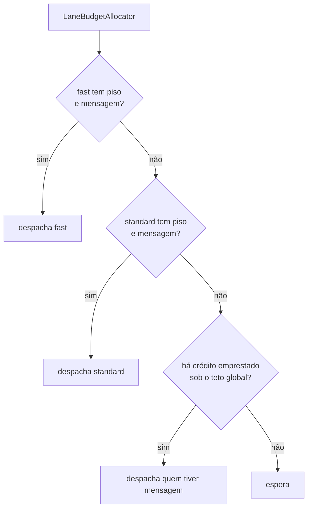
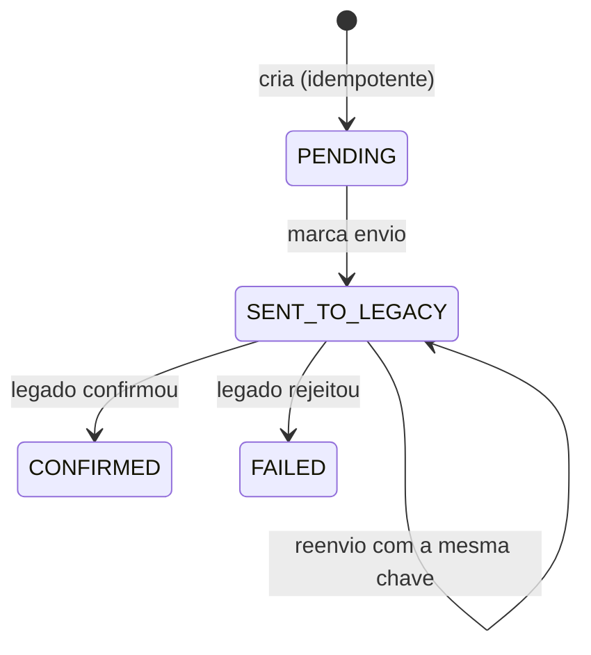

# worker

Drena as filas no ritmo que o legado suporta. É o componente que **protege o Core Banking** e leva cada proposta a um estado final sem averbação duplicada.

## O que ele garante

1. Nunca passa de **180 chamadas por segundo** ao legado, somando todas as instâncias.
2. Respeita o QoS: piso de **70% para a fast lane** e 30% para a standard, com empréstimo quando uma está vazia.
3. Nenhuma proposta é averbada duas vezes, mesmo com reentrega de mensagem ou queda no meio do processamento.

## Orçamento de vazão



O teto global é `WORKER_BUDGET_TOTAL_TPS × margem ÷ instâncias`. A margem de 0,98 existe porque o relógio de cada instância não é perfeitamente sincronizado: sem folga, a soma das instâncias pode encostar em 180 e estourar.

**O 70/30 é um piso sob contenção, não uma cota fixa.** Se a standard está vazia, a fast usa todo o orçamento. Ao avaliar o painel, só cobre a proporção quando as duas filas têm backlog — caso contrário, a "violação" é o comportamento correto.

## Idempotência de ponta a ponta



`CONFIRMED` e `FAILED` são absorventes: uma proposta em estado final **nunca** volta a chamar o legado. Se a mensagem for reentregue, o Worker vê o estado final e apenas confirma a mensagem. Como a chamada ao legado usa a mesma `Idempotency-Key`, mesmo um reenvio devolve o resultado original em vez de averbar de novo.

A gravação de estado e de eventos é atômica, o que dá o rastro completo (outbox) sem transação distribuída.

## Resiliência

Circuit breaker em volta do cliente HTTP do legado. Falha transitória não vira erro de negócio: a mensagem volta à fila com backoff, e o redrive do SQS a envia para a DLQ depois do limite de tentativas. Assim uma indisponibilidade do legado não transforma propostas válidas em propostas falhadas.

## Configuração

| Variável | Padrão | Observação |
|---|---|---|
| `WORKER_LEGACY_BASE_URL` | — | obrigatória |
| `WORKER_LEGACY_API_KEY` | — | obrigatória |
| `WORKER_PAYLOAD_LOCAL_KEY` | — | a **mesma** chave AES da ingestion |
| `WORKER_QUEUE_FAST_URL` / `_STANDARD_URL` | — | URLs das filas |
| `WORKER_BUDGET_TOTAL_TPS` | 180 | teto do legado |
| `WORKER_BUDGET_INSTANCES` | 1 | divide o teto entre as instâncias |
| `WORKER_BUDGET_FAST_SHARE` | 0.70 | piso da fast lane |
| `WORKER_MAX_IN_FLIGHT` | 64 | concorrência — **ver o alerta abaixo** |
| `WORKER_QUEUE_TYPE` | sqs | `memory` nos testes |

### Atenção ao `WORKER_MAX_IN_FLIGHT`

Pela Lei de Little, sustentar `λ` mensagens por segundo com latência `W` exige `λ × W` em processamento simultâneo. Com 180 por segundo e 1 s de latência do legado, são **180 em voo**. O padrão de 64 limita a vazão a `64 ÷ W`: com 500 ms, o máximo é 128 por segundo, abaixo do teto que a PoC quer provar.

Antes do teste de carga, compare `worker_in_flight` com `worker_in_flight_max`. Se encostar no limite, o gargalo é a concorrência, não o orçamento. Threads virtuais tornam barato elevar esse número.

## Métricas

| Métrica | Para quê |
|---|---|
| `worker_dispatched_total{lane}`, `worker_processed_total{lane,outcome}` | tráfego e erros por lane |
| `worker_proposals{status}` | propostas por estado (evidência de idempotência) |
| `worker_legacy_call_seconds` | latência do legado vista pelo Worker |
| `worker_legacy_circuit_state` | **0 fechado, 1 semi-aberto, 2 aberto** |
| `net_backlog_growth`, `effective_drain_time` | acúmulo e previsão de drenagem |
| `worker_in_flight`, `worker_in_flight_max` | saturação da concorrência |
| `business_vgv`, `business_time_to_settle` | VGV finalizado e SLA da virada |

A codificação do circuit breaker difere da convenção do Resilience4j. Alertas devem usar `== 2` para aberto.

## Como rodar

```bash
mvn -pl worker spring-boot:run
```

As variáveis obrigatórias precisam estar no ambiente; o `scripts/local-up.ps1` já as monta.

## Testes

```bash
mvn -pl worker test   # 129 testes
```

Dois merecem destaque: `BudgetSimulationTest` prova que nenhuma janela de 1 s passa de 180 e que a proporção fica perto de 70/30; `WorkerEndToEndTest` processa 400 propostas com duplicatas, uma falha transitória e uma mensagem órfã, verificando que cada chave é averbada exatamente uma vez.

> `WorkerEndToEndTest` depende de tempo de parede e já falhou uma vez com a máquina sob carga. Se repetir, o certo é tornar a condição independente de tempo, não aumentar o prazo.

## Arquitetura

Hexagonal, com o orçamento e a máquina de estados no `domain` — sem Spring e sem SQS. É o que permite provar o comportamento de vazão por simulação, sem subir infraestrutura.
