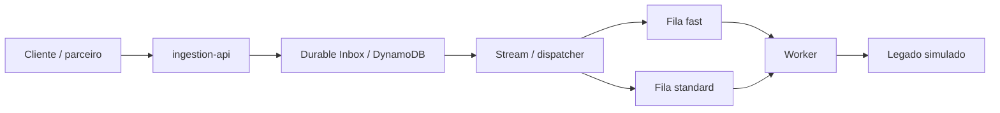
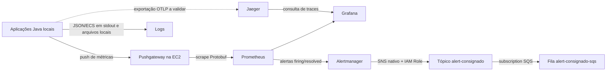

# Base factual para artigo: SRE, observabilidade e métricas na plataforma de consignado

> **Nota de atualização — 18/10/2026:** este documento nasceu como fotografia de uma etapa anterior. Depois desse corte, a jornada local `ingestion-api → dispatcher → worker → mock-legacy` foi observada no Jaeger. Isso comprova o caminho local exercitado, mas não valida o runtime Lambda/AWS nem todos os caminhos de erro. Para o estado final da PoC, use também o [relatório de fechamento](../sre/fechamento-poc-sre-observabilidade.md) e o [guia de tracing local](../manuais/tracing-local.md).

**Data de referência:** 16 de outubro de 2026, America/Sao_Paulo.  
**Natureza:** documento de apoio técnico e editorial; não é o artigo final.  
**Escopo:** aplicação Java de crédito consignado, ambiente local de testes e stack de observabilidade em EC2.  
**Fontes:** código e configurações do repositório, consultas à stack durante a preparação e testes realizados nesta sessão.

> Instrução para a ferramenta que produzirá o artigo: diferencie implementação, configuração, evidência de teste e proposta futura. Não transforme uma intenção arquitetural em uma funcionalidade comprovada. Não atribua a este projeto números de produção, disponibilidade contratual, tracing distribuído completo ou automação de incidentes que não tenham sido demonstrados.

Identificadores da conta AWS, IP público, chaves, tokens, senhas e endereços privados foram omitidos deste documento de publicação. Os nomes lógicos dos serviços e recursos foram mantidos para facilitar a explicação.

## 1. Contexto e problema de engenharia

A PoC explora uma borda capaz de receber propostas de crédito e processá-las de forma assíncrona, respeitando a capacidade de um sistema legado. O aceite HTTP e a confirmação da operação são etapas diferentes.

A API recebe `POST /v1/proposals`, valida identidade e entrada, protege o payload e tenta persistir a proposta em um Durable Inbox. O processamento posterior passa por um dispatcher, filas e um Worker que chama o legado. Há preocupação com idempotência, limites de capacidade, tentativas de recuperação e visibilidade do backlog.

O problema de observabilidade não é apenas responder se a API está no ar. É responder, por exemplo:

- A proposta foi aceita de forma durável ou a resposta apenas aparentou sucesso?
- Ela está aguardando na fila, sendo processada ou finalizada?
- Uma indisponibilidade do legado está se convertendo em backlog?
- O número de tentativas está sendo confundido com o número de propostas?
- As métricas exibidas são recentes ou são snapshots antigos no Pushgateway?
- Quanto valor solicitado entrou e quanto valor foi efetivamente confirmado?
- Quando um alerta chega, há informação suficiente para uma ação operacional?

### 1.1 Fluxo funcional



No ambiente local, DynamoDB Local, ElasticMQ, emissor JWT e dispatcher são disponibilizados pelo módulo `local-env`. Existe um módulo chamado `dispatcher-lambda`, mas o dispatcher local reutiliza código de negócio sem exigir uma Lambda implantada na AWS. Isso deve ser distinguido do fluxo de notificações, que usa SNS e SQS sem Lambda.

### 1.2 Vocabulário de negócio

| Termo | Significado nesta aplicação |
|---|---|
| Proposta nova recebida | A entrada retornou o resultado `RECEIVED` após o fluxo de persistência |
| Duplicata aceita | A mesma chave foi reconhecida e a resposta informa `DUPLICATE_ACCEPTED` |
| Aceite HTTP | Resposta 202; não é a confirmação final no legado |
| Confirmada | Resultado final confirmado pelo legado |
| Rejeitada | Resultado final de rejeição de negócio no legado |
| Falha transitória | Problema técnico que pode levar a retry; não significa rejeição de negócio |
| VGV recebido | Soma dos valores das propostas novas aceitas na entrada |
| VGV confirmado | Soma dos valores das propostas confirmadas no legado |
| Ticket médio | Soma dos valores dividida pela quantidade da mesma população e período |

## 2. O que está implementado e o que ainda não está comprovado

| Capacidade | Estado factual |
|---|---|
| Métricas da aplicação com Micrometer e Prometheus | Implementadas, com dados consultados na stack |
| Envio local de métricas ao Pushgateway da EC2 | Configurado e testado |
| Dashboards técnicos no Grafana | Três dashboards provisionados por arquivo |
| Dashboard de negócio | Provisionado; consultas validadas pelo próprio Grafana |
| Logs estruturados JSON/ECS | Configurados no starter comum; registros reais inspecionados |
| Sanitização de dados pessoais em logs | Implementada como proteção adicional; não equivale a certificação de conformidade |
| Backend de traces Jaeger | Implantado, com OTLP e armazenamento Badger configurados |
| Serviços no Jaeger | Na preparação inicial apareceram apenas `jaeger` e `teste-conectividade`; uma rodada posterior comprovou a jornada local de quatro serviços |
| Tracing distribuído da proposta | Comprovado no caminho local exercitado; runtime Lambda/AWS e demais caminhos permanecem sem validação completa |
| Sete alertas SRE | Publicados e avaliados pelo Prometheus, sem erros de regra na consulta realizada |
| Testes das regras | 14 cenários simulados, com 98 verificações, aprovados no `promtool` |
| Alertmanager → SNS | Testes de disparo e recuperação publicados sem falhas de integração |
| SNS → SQS | Publicação de três testes, mensagens do lote conferidas no SQS e recebimento confirmado pelo usuário |
| Consumidor operacional dos alertas SQS | Não validado nesta entrega |
| Correção autônoma de incidentes | Há rota legada para orquestrador; o ciclo de remediação não foi validado |
| Centralização e busca de logs | Não demonstradas na stack ativa sem Elasticsearch |
| SLOs formais e orçamento de erro | Ainda precisam de definição e acordo |
| Infraestrutura integral sob Terraform | Trabalho de codificação iniciado; não declarar adoção/importação/apply concluídos |
| Alta disponibilidade da observabilidade | Não demonstrada; a stack observada está concentrada em uma EC2 |

## 3. Relação com SRE

### 3.1 SRE é mais amplo que instalar ferramentas

Neste material, SRE é tratado como engenharia para tornar a confiabilidade mensurável, operável e sustentável. A stack fornece parte da base técnica; ela não comprova, sozinha, a existência de uma prática organizacional completa de SRE.

Os quatro sinais de referência usados para organizar o diagnóstico são latência, tráfego, erros e saturação. A aplicação adiciona sinais de negócio e de processamento assíncrono. [Referência conceitual: Google SRE, monitoramento de sistemas distribuídos](https://sre.google/sre-book/monitoring-distributed-systems/).

| Área de SRE | Como aparece no projeto | Limite ou próximo passo |
|---|---|---|
| Indicadores de serviço | Métricas HTTP, filas, chamadas ao legado, resultados finais | Formalizar quais eventos são bons e quais são elegíveis |
| Objetivos de confiabilidade | Existem limites técnicos e hipóteses de alerta | Ainda não há SLO contratual acordado |
| Alertas acionáveis | Regras com persistência, contexto e ações sugeridas | Calibrar com tráfego e operação real |
| Resiliência | Inbox, idempotência, retries, circuit breaker e limitação de capacidade | Validar falhas distribuídas e recuperação sob carga |
| Capacidade | Vazão, orçamento de despacho, em voo, backlog e drenagem | Separar gerador e serviços antes de homologar capacidade |
| Resposta a incidentes | Runbooks e encaminhamento de eventos a uma fila | Definir responsável, escalonamento e prazos de atendimento |
| Aprendizado | Registro das falhas de coleta, testes e timeouts encontrados | Instituir revisão de incidentes e ações acompanhadas |
| Redução de trabalho manual | Provisionamento de dashboards e testes automatizados | Concluir IaC e procedimentos repetíveis de implantação |
| Mudanças seguras | Configurações versionadas e validação antes do reload | Consolidar CI/CD, revisão e rollback automatizado |
| Recuperação de desastre | Volumes e persistência locais na observabilidade | Definir backups, restauração testada, RPO e RTO |
| Segurança da telemetria | Sanitização, cardinalidade controlada e role IAM | Validar exposição de rede, autorização, TLS e retenção |

### 3.2 SLI, SLO, SLA e orçamento de erro

- **SLI:** indicador que mede o comportamento observado, como a proporção de propostas elegíveis aceitas de forma durável.
- **SLO:** objetivo para esse indicador em uma janela, acordado com quem usa e opera o serviço.
- **SLA:** compromisso formal com consequências acordadas; não deve ser inferido a partir de um dashboard.
- **Orçamento de erro:** fração de falhas permitida por um SLO; pode orientar decisões de mudança e prioridade.

Exemplo puramente didático: um SLO de 99,9% permite 0,1% de eventos ruins na população elegível. **Esse percentual não foi adotado como SLO do projeto.** Para serviços assíncronos, o SLO da resposta de entrada deve ser separado do SLO de finalização.

### 3.3 SLIs candidatos para esta arquitetura

| Jornada | SLI candidato | Decisão que falta |
|---|---|---|
| Receber propostas | Aceites duráveis / requisições elegíveis | Definir tratamento de autenticação, validação, cotas e duplicatas |
| Responder com rapidez | Requisições elegíveis concluídas até um limite / total elegível | Definir limite, população e janela |
| Finalizar no prazo | Propostas finalizadas até X segundos / propostas da população definida | Contabilizar também pendências vencidas, não só operações já finalizadas |
| Preservar idempotência | Operações únicas sem efeitos duplicados | Definir fonte de verdade e teste de concorrência |
| Observar o serviço | Serviços esperados com telemetria recente / serviços esperados | Manter inventário de instâncias esperadas |

Um histograma alimentado apenas na finalização não revela, sozinho, propostas que nunca finalizaram. Esse é um limite importante para qualquer narrativa sobre SLO de ponta a ponta.

## 4. Arquitetura de observabilidade



A linha tracejada representa uma integração que precisa de evidência adicional na aplicação. O diagrama não afirma que todos os traces já percorrem esse caminho.

### 4.1 Inventário de ferramentas

| Ferramenta | Versão observada ou declarada | Papel |
|---|---|---|
| Java | 25 no projeto | Runtime das aplicações; virtual threads habilitadas por padrão no starter |
| Spring Boot | 4.1.1 no POM pai | Aplicação, Actuator, configuração, logs e instrumentação |
| Micrometer | Dependências gerenciadas pelo projeto/Spring Boot | API para métricas técnicas e de negócio |
| Spring Boot Actuator | Dependência do projeto | Endpoints de saúde e exposição Prometheus |
| Prometheus | v3.5.0 na EC2 | Coleta, armazenamento de séries, PromQL e avaliação de regras |
| Pushgateway | v1.11.1 na EC2 | Ponte usada no cenário de aplicação local enviando para a EC2 |
| Grafana | 12.1.1 na EC2 | Dashboards e consultas às fontes de dados |
| Alertmanager | v0.28.1 na EC2 | Agrupamento, deduplicação, inibição e notificações |
| Jaeger | 2.10.0 na EC2 | Recepção OTLP, armazenamento e consulta de traces |
| Badger | Backend configurado no Jaeger | Persistência local de traces, sem Elasticsearch |
| Docker Compose | Usado para a stack | Containers, rede, volumes e configuração operacional |
| Amazon SNS | Serviço AWS gerenciado | Publicação e distribuição das notificações |
| Amazon SQS | Serviço AWS gerenciado | Armazenamento das notificações para consumo desacoplado |
| IAM / Instance Profile / IMDSv2 | Mecanismo AWS | Credenciais temporárias para publicação no SNS |
| Apache JMeter | 5.6.3 | Fumaça, carga, duplicatas e teste controlado de negócio |
| Java do JMeter | 21 no wrapper de teste | Compatibilidade com o Groovy embarcado no JMeter utilizado |
| Groovy | 3.0.20 no JMeter inspecionado | Geração de propostas e validação das respostas |
| promtool / amtool | Ferramentas das imagens em uso | Validação de regras, configuração, rotas e templates |
| DynamoDB Local | 2.6.1 declarada | Inbox no ambiente local de testes |
| ElasticMQ | 1.7.1 declarada | Emulação local de SQS |
| Resilience4j | 2.4.0 declarada | Proteções de resiliência da aplicação |
| Terraform | Configuração em elaboração | Adoção dos recursos criados manualmente e manutenção como código |

Versões são um retrato do ambiente e do repositório, não uma recomendação de atualização. Não confundir a versão declarada de uma dependência com um inventário transitivo completo do runtime.

### 4.2 Portas e finalidade

| Porta | Componente | Uso |
|---|---|---|
| 8080 | ingestion-api local | Recebimento de propostas e Actuator |
| 8081 | mock-legacy local | Legado simulado e Actuator |
| 8082 | local-env | Emissor JWT/JWKS de desenvolvimento |
| 8083 | Worker local | Actuator e métricas |
| 8000 | DynamoDB Local | Persistência local de teste |
| 9324 | ElasticMQ | Filas locais |
| 9091 | Pushgateway | Recepção e exposição de métricas |
| 9090 | Prometheus | API, consultas, regras e targets |
| 3000 | Grafana | Dashboards |
| 9093 | Alertmanager | API e acompanhamento de alertas |
| 4317 | Jaeger | OTLP gRPC |
| 4318 | Jaeger | OTLP HTTP, incluindo `/v1/traces` |
| 16686 | Jaeger | Interface e consultas |
| 8888 | Jaeger, na rede da stack | Métricas internas coletadas pelo Prometheus |

Expor uma porta em Docker não prova que ela está acessível externamente nem que está protegida. Security Groups, bind addresses, firewall, TLS e autenticação devem ser verificados por ambiente. O Compose permite acesso administrativo por loopback/túnel; não se deve apresentar interfaces abertas à internet como padrão recomendado.

## 5. Métricas: coleta, semântica e qualidade do sinal

### 5.1 Instrumentação comum

O `platform-starter` registra defaults de menor precedência, permitindo sobrescrita por configuração externa. Ele define:

- `service`: derivado de `spring.application.name`;
- `env`: derivado de `PLATFORM_ENV`, padrão `local`;
- exposição Actuator de `health`, `info`, `metrics` e `prometheus`;
- probes de saúde habilitadas e detalhes de saúde ocultos por padrão;
- Pushgateway desligado até `PLATFORM_PUSHGATEWAY_ENABLED=true`;
- job do push igual ao nome do serviço;
- grouping key `instance`, configurável;
- intervalo padrão de push de 10 segundos;
- operação PUT no desligamento, que preserva a última leitura no gateway.

Na execução local por script, `instance` foi identificado pelo nome da máquina. Esse label é uma dimensão operacional, não uma identificação de cliente.

### 5.2 Coleta no Prometheus

A configuração em uso possui scrape e avaliação a cada 15 segundos, com timeout de scrape de 10 segundos. Os alvos observados foram `pushgateway`, `prometheus`, `alertmanager`, `grafana` e `jaeger`, todos UP na consulta realizada para este documento.

O job do Pushgateway usa:

```yaml
- job_name: pushgateway
  honor_labels: true
  scrape_protocols: [PrometheusProto]
  static_configs:
    - targets: ["pushgateway:9091"]
```

`honor_labels` preserva `job` e `instance` informados pelas aplicações. O protocolo Protobuf foi necessário para contornar uma incompatibilidade observada na serialização textual de uma métrica do tipo `GAUGE_HISTOGRAM`.

Push a cada 10 s, scrape a cada 15 s, avaliação e espera de agrupamento adicionam atraso entre evento e visualização/notificação. Esses intervalos não constituem um prazo máximo garantido de entrega.

### 5.3 Por que há Pushgateway neste ambiente

O uso foi uma adaptação para testes locais enviando métricas à EC2. Não deve ser generalizado como padrão para todos os serviços persistentes: o gateway retém séries de processos encerrados e separa a saúde do gateway da saúde da aplicação. Para produção, é necessário reavaliar scrape direto e descoberta de serviços. Essa cautela segue a [orientação oficial do Prometheus sobre Pushgateway](https://prometheus.io/docs/practices/pushing/).

Por isso, `up{job="pushgateway"}=1` significa que o scrape do gateway funcionou. A idade de `push_time_seconds` é usada separadamente para detectar aplicações sem envio recente.

### 5.4 Tipos usados

| Tipo | Uso no projeto | Interpretação |
|---|---|---|
| Counter | Recebimentos, tentativas, resultados e falhas | Acumula no processo e reinicia quando a JVM reinicia |
| Gauge | Fila, em voo, estado do circuit breaker, vazões amostradas | Retrato/amostragem que pode subir ou cair |
| Timer | Latência HTTP, chamada ao legado e tempo para finalizar | Contagem, soma de duração e, quando configurados, buckets |
| DistributionSummary | Valores de propostas | Contagem e soma dos valores; unidade BRL |
| Histogram | Distribuições e limites de tempo | Permite estimar percentis e proporções por bucket |

Nomes com pontos na instrumentação são exportados com convenções Prometheus, incluindo underscores e sufixos de unidade/tipo. A forma exposta deve ser conferida no endpoint real antes de escrever consultas.

## 6. Catálogo das métricas da aplicação

O catálogo abaixo cobre as famílias customizadas identificadas no código e as principais famílias técnicas usadas nos painéis. Não é uma enumeração congelada de todas as séries automáticas de JVM/Spring: elas dependem de binders, dependências e runtime.

### 6.1 Ingestão e negócio na entrada

| Nome exposto | Tipo / unidade | Dimensões relevantes | Pergunta respondida |
|---|---|---|---|
| `ingestion_accepted_total` | Counter | `outcome=received` ou `duplicate_accepted` | Quantas chamadas retornaram cada resultado do caso de uso? |
| `ingestion_throttled_tenant_total` | Counter | `tenant` controlado | Quantas chamadas foram barradas pela cota do parceiro? |
| `business_vgv_received_brl_count` | Contagem da summary | `convenio`, `portability` | Quantas propostas novas foram aceitas? |
| `business_vgv_received_brl_sum` | Soma em BRL | `convenio`, `portability` | Qual valor solicitado entrou em propostas novas? |
| `business_vgv_received_brl_max` | Máximo exportado | Mesmas dimensões, quando disponível | Qual foi o maior valor observado na janela do medidor? |
| `business_partner_received_total` | Counter | `tenant` controlado | Como os recebimentos se distribuem por parceiros permitidos? |

`business.vgv.received` é registrado somente para `RECEIVED`. Um replay aceito não deve incrementar seu valor nem sua contagem. A tag `lane` não existe nessa família da entrada; não se deve aplicar um filtro de lane fingindo que ele é suportado em todos os cards.

As métricas do caso de uso não cobrem automaticamente todo erro anterior ao caso de uso. Validação, autenticação, autorização e outras recusas devem ser observadas também pelas métricas HTTP e por instrumentação específica quando necessário.

### 6.2 Worker e fluxo assíncrono

| Nome exposto | Tipo / unidade | Dimensões / valores | Finalidade |
|---|---|---|---|
| `worker_queue_depth` | Gauge, mensagens | `lane=fast` ou `standard` | Profundidade aproximada amostrada |
| `worker_dispatched_total` | Counter | `lane` | Trabalho despachado; não é total de negócios confirmados |
| `worker_processed_total` | Counter | `lane`, `outcome` | Resultado do processamento de tentativas |
| `worker_processing_failed_total` | Counter | `lane` | Falhas observadas no processamento |
| `worker_processing_rate` | Gauge, conclusões/s | Serviço/instância | Vazão de conclusão estimada por amostragem |
| `worker_arrival_rate` | Gauge, mensagens/s | Serviço/instância | Taxa estimada de chegada |
| `net_backlog_growth` | Gauge, mensagens/s | Serviço/instância | Diferença entre chegada e processamento |
| `effective_drain_time_seconds` | Gauge, segundos | Serviço/instância | Profundidade dividida pela taxa de processamento |
| `worker_in_flight` | Gauge | Serviço/instância | Trabalho simultaneamente em andamento |
| `worker_in_flight_max` | Gauge | Serviço/instância | Limite configurado de trabalho em voo |
| `worker_legacy_circuit_state` | Gauge enumerado | 0 fechado, 1 meio-aberto, 2 aberto, 3 outros | Estado da proteção do legado |
| `worker_proposals` | Gauge | `status` | Estados mantidos pelo repositório em memória do Worker |
| `worker_legacy_call_seconds_count` | Timer, contagem | `outcome` | Quantidade de chamadas ao legado |
| `worker_legacy_call_seconds_sum` | Timer, segundos | `outcome` | Soma de duração das chamadas |
| `worker_legacy_call_seconds_bucket` | Histograma | `outcome`, `le` | Distribuição da duração das chamadas |

Os outcomes do timer do legado são `confirmed`, `rejected`, `transient_failure` e `error`. Uma tentativa transitória não deve ser confundida com uma nova proposta.

`worker_proposals` não é, por definição, um extrato financeiro persistente: é um gauge sobre estados em memória na implementação inspecionada. Reinícios e múltiplas instâncias exigem interpretação cuidadosa.

### 6.2.1 Parâmetros de resiliência que ajudam a interpretar as métricas

Valores abaixo são **padrões declarados no código/configuração**, sujeitos a sobrescrita por ambiente. Não representam uma medição de capacidade nem uma recomendação universal.

| Parâmetro | Padrão declarado | Relação com a operação |
|---|---|---|
| Orçamento total do Worker | 180 TPS | Proteção da capacidade do legado |
| Instâncias consideradas no orçamento | 1 | A divisão do orçamento precisa refletir o número real de Workers |
| Participação da fast lane | 0,70 | Distribuição de orçamento entre lanes |
| Margem de segurança | 0,98 | Folga configurada no orçamento |
| Trabalho máximo em voo | 360 | Limite de concorrência, observado por gauges |
| Amostragem de métricas de fila | 5 s | Granularidade dos gauges de profundidade e estimador |
| Timeout de chamada ao legado | 3 s | Limite configurado para comunicação com o downstream |
| Limite de chamada lenta | 2 s | Configuração de resiliência do legado |
| Taxa de falha configurada | 10% | Parâmetro da proteção do legado |
| Chamadas mínimas / janela | 20 / 100 | Base configurada para avaliação da proteção |
| Espera no estado aberto | 10 s | Intervalo configurado antes da tentativa de recuperação |
| Prefetch de fila | 20 | Influencia quantidade de trabalho trazido ao consumidor |
| Espera de polling | 5 s | Configuração de consulta às filas de negócio |
| Visibilidade da mensagem | 30 s | Janela de processamento antes de nova elegibilidade da mensagem |
| Retry: atraso inicial / máximo | 5 s / 60 s | Limita o ritmo de novas tentativas |
| Inbox: timeout total / tentativa | 500 ms / 150 ms | Pode explicar 503 quando o armazenamento está lento |
| Inbox: conexões máximas | 200 | Capacidade configurada do pool HTTP |
| Memória curta de chaves recentes | 60 s, até 100.000 entradas | Coalescência e reconhecimento local de duplicatas |
| Cota padrão por parceiro | 100 requisições/s | Excesso pode retornar 429, sem ser rejeição de negócio |

Ajustar um desses valores muda o comportamento observado pelos indicadores. Por exemplo, aumentar concorrência não aumenta automaticamente a capacidade do legado, e um timeout de consumo precisa ser compatível com visibilidade e política de retries. Alterações devem ser medidas e acompanhadas por testes.

### 6.3 Métricas de resultado do negócio

| Nome exposto | Unidade / semântica | Dimensões |
|---|---|---|
| `business_vgv_brl_count` | Propostas finalizadas | `outcome`, `convenio`, `lane`, `portability` |
| `business_vgv_brl_sum` | Valor solicitado dessas propostas, em BRL | Mesmas dimensões |
| `business_vgv_brl_max` | Máximo observado pelo medidor, quando disponível | Mesmas dimensões |
| `business_partner_settled_total` | Finalizações por parceiro | `tenant` controlado, `outcome` |
| `business_first_pass_total` | Confirmações na primeira tentativa ou após retries | `result=first_attempt` ou `retried` |
| `business_time_to_settle_seconds_count` | Quantidade de durações registradas | `lane` |
| `business_time_to_settle_seconds_sum` | Soma dos tempos até finalização | `lane` |
| `business_time_to_settle_seconds_bucket` | Distribuição do tempo até finalização | `lane`, `le` |

`outcome` diferencia `confirmed` e `rejected`. A summary de VGV possui 24 combinações fixas de resultado, convênio, lane e portabilidade: 2 × 3 × 2 × 2. As séries são pré-registradas para essas combinações, evitando recriar medidores a cada evento.

O timer de finalização possui limites explícitos de 30, 60, 300, 900 e 1.800 segundos. Os valores de `le` expostos devem ser conferidos na coleta; no ambiente Prometheus consultado apareceram formas como `30.0` e `60.0`.

O registro ocorre após o Worker persistir o resultado final. A proteção contra reprocessar propostas finais existe no fluxo, mas um contador local não constitui uma garantia transacional de exactly-once entre persistência e telemetria.

### 6.4 Legado simulado

| Família | Semântica |
|---|---|
| `legacy_request_throughput` | Requisições aceitas na janela atual de um segundo |
| `legacy_peak_window` | Maior quantidade aceita em uma janela de um segundo |
| `legacy_ledger_size` | Tamanho do ledger em memória |
| `legacy_requests_total{outcome="accepted"}` | Requisições aceitas pelo mock |
| `legacy_requests_total{outcome="rejected_capacity"}` | Recusas técnicas por capacidade |
| `legacy_requests_total{outcome="failed_chaos"}` | Falhas técnicas simuladas |
| `legacy_averbacoes_total{kind="unique"}` | Averbações únicas registradas |
| `legacy_averbacoes_total{kind="duplicate"}` | Chamadas repetidas reconhecidas pelo mock |
| `legacy_request_latency_seconds_*` | Timer/histograma de latência interna do mock |

O teto usado na PoC é 180 TPS. A distribuição de orçamento do Worker declara participação inicial de 70% para a lane fast, mas isso não deve ser apresentado como vazão garantida em qualquer condição.

**Limite do mock:** o endpoint inspecionado confirma propostas válidas. Capacidade e caos retornam indisponibilidade técnica e exercitam retry. Não há evidência de um cenário configurado que gere uma rejeição de negócio válida para popular o indicador `rejected`.

### 6.5 Famílias técnicas e da própria observabilidade

| Família / nome | Papel |
|---|---|
| `http_server_requests_seconds_count` | Tráfego e resultados HTTP, por método, rota, status etc. |
| `http_server_requests_seconds_sum` | Duração acumulada HTTP |
| `http_server_requests_seconds_bucket` | Percentis e limites de latência, quando histograma habilitado |
| `http_server_requests_active_seconds*` | Trabalho HTTP ativo; formato depende do exportador/protocolo |
| `jvm_memory_used_bytes`, `jvm_memory_max_bytes` | Consumo e limites de memória da JVM |
| `jvm_gc_pause_seconds_*` | Pausas e tempo de GC, quando disponível |
| `process_cpu_usage` | Fração de CPU observada no processo |
| `process_uptime_seconds` | Tempo de vida do processo |
| `process_start_time_seconds` | Instante de início do processo |
| `application_started_time_seconds`, `application_ready_time_seconds` | Tempo de inicialização/prontidão |
| `up` | Sucesso de scrape de cada alvo, gerado pelo Prometheus |
| `push_time_seconds` | Instante do último push bem-sucedido por grupo no Pushgateway |
| `alertmanager_notifications_total{integration="sns"}` | Contador de tentativas de notificação SNS |
| `alertmanager_notifications_failed_total{integration="sns",reason="..."}` | Falhas de notificação SNS por motivo |

O contador de tentativas SNS, isolado, não prova sucesso: nos testes foi acompanhado pela ausência de incremento de falhas. Entrega à fila foi verificada separadamente. Não foi implantado Node Exporter nesta stack observada; métricas de processo/JVM não substituem todo o monitoramento do host.

### 6.6 Cardinalidade e privacidade

As dimensões devem ser limitadas e úteis para agregação. `service`, `env`, `lane`, `outcome`, `convenio` e `portability` são exemplos adequados neste domínio.

`TenantTagPolicy` permite tags individuais somente para uma allowlist limitada. Os demais parceiros são agregados em `other`; a cardinalidade máxima é o tamanho da allowlist mais um.

Não usar CPF, token, chave de idempotência, trace ID ou identificador de cada proposta como label de métrica. Esses identificadores multiplicariam séries e poderiam expor dados. Correlação individual, quando necessária, pertence a logs/traces apropriados e protegidos.

## 7. Consultas e interpretação dos indicadores

### 7.1 Vazão HTTP da rota de propostas

```promql
sum by (status) (
  rate(http_server_requests_seconds_count{
    service="ingestion-api", method="POST", uri="/v1/proposals"
  }[5m])
)
```

### 7.2 p95 de latência

```promql
histogram_quantile(0.95,
  sum by (le) (
    rate(http_server_requests_seconds_bucket{
      service="ingestion-api", method="POST", uri="/v1/proposals"
    }[5m])
  )
)
```

Somar os buckets antes de calcular o quantil. Não calcular a média dos p95 de instâncias para representar o p95 global. O quantil de histograma é uma estimativa; sem observações suficientes pode não produzir um número útil.

### 7.3 Quantidade e valor recebidos no período do Grafana

```promql
sum(increase(business_vgv_received_brl_count{
  service="ingestion-api", env=~"$env", instance=~"$instance",
  convenio=~"$convenio", portability=~"$portability"
}[$__range]))
```

```promql
sum(increase(business_vgv_received_brl_sum{
  service="ingestion-api", env=~"$env", instance=~"$instance",
  convenio=~"$convenio", portability=~"$portability"
}[$__range]))
```

As variáveis `$env`, `$instance`, `$convenio`, `$portability` e `$__range` são expandidas pelo Grafana. Não colar essas consultas diretamente na UI do Prometheus sem substituí-las por valores concretos.

### 7.4 Confirmações e rejeições

```promql
sum by (outcome) (
  increase(business_vgv_brl_count{service="worker"}[1h])
)
```

### 7.5 Ticket médio e taxa de confirmação

```text
ticket médio recebido = valor recebido / quantidade de propostas novas
ticket médio confirmado = valor confirmado / quantidade confirmada
taxa de confirmação = confirmadas / (confirmadas + rejeitadas)
```

O painel soma valores e quantidades antes da divisão: trata-se de média ponderada por proposta. Não usa a média dos tickets das instâncias. O denominador é filtrado por `> 0`, deixando ausência de resultado quando não há população, em vez de inventar um ticket de R$ 0 ou exibir uma divisão por zero.

Não somar VGV recebido com VGV confirmado: são etapas da mesma proposta. Recebimento e finalização também podem cair em períodos diferentes; por isso, o denominador da taxa é o total finalizado, não o total recebido na janela.

### 7.6 Backlog e drenagem

```text
lambda = taxa estimada de chegada
mu = taxa estimada de processamento
crescimento líquido = lambda - mu
tempo de drenagem = profundidade / mu
```

Sem fila, a estimativa é zero. Com fila e processamento zero, ela pode ser infinita. Não representa a idade da mensagem mais antiga e não projeta a continuidade de novas chegadas. Se chegada superar processamento de forma sustentada, a fila não converge para vazia sob a mesma carga.

Em várias réplicas, cada Worker pode enxergar a mesma fila. Somar a profundidade de todas as réplicas duplicaria o backlog; o modelo deve ser revisto antes de usar a soma global para capacity planning.

### 7.7 Limites dos totais em métricas

- `increase` trata resets por série e extrapola entre amostras; o resultado pode ser fracionário mesmo para contagens de eventos.
- Fazer `sum(increase(...))`, tratando resets antes da agregação.
- Eventos antes da primeira amostra, lacunas de coleta e reinícios podem comprometer a reconstrução do total.
- Os valores monetários passam por representação numérica de telemetria; não substituem precisão e reconciliação do registro transacional.
- Um timeout pode ocorrer depois da persistência. Há, portanto, diferença entre operações duráveis e operações cuja resposta de aceite foi observada e contabilizada na borda.

## 8. Dashboards do Grafana

| Dashboard | Objetivo e conteúdo principal |
|---|---|
| Consignado - Saúde da Ingestão | Tráfego, p50/p95/p99, aceites por resultado, respostas de proteção, erros, VGV recebido e JVM |
| Consignado - Proteção Downstream | Vazão do legado e teto, despachos por lane, chamadas por resultado, latências, circuit breaker, em voo e duplicadas |
| Consignado - Backlog e Drenagem | Profundidade, chegada/processamento, crescimento, estimativa de drenagem, estados, resultados e duração até finalizar |
| Consignado - Negócio | Quantidades novas/confirmadas/rejeitadas, valores, tickets, taxa de confirmação e evolução |

O dashboard de negócio tem 14 painéis, incluindo nove indicadores, quatro gráficos e um bloco explicativo. Filtros: ambiente, instância, convênio e portabilidade. A lane aparece na segmentação dos resultados finais.

Os dashboards são arquivos JSON versionados, usam a fonte Prometheus com UID `prometheus` e não dependem de edição manual na UI. O provider da EC2 relê a pasta de dashboards a cada 30 s. O painel de negócio tem atualização de 10 s e intervalo inicial de uma hora.

### 8.1 Zero, ausência de dados e histórico não são equivalentes

- **Zero:** existe série e não houve incremento ou há valor zero.
- **Sem dados:** não há série compatível, não há amostras suficientes, o denominador é zero ou a consulta não possui resultado.
- **Valor antigo:** o dashboard pode estar exibindo uma janela histórica ou um snapshot retido.
- **Linha fixa:** uma consulta como `vector(180)` desenha um teto mesmo sem métricas novas da aplicação.

Durante a investigação, alguns gráficos continuavam aparecendo apesar de a coleta do Pushgateway estar falhando. O motivo não era uma garantia de funcionamento parcial da aplicação: havia métricas da stack, dados históricos e constantes que independiam da coleta corrente das propostas.

## 9. Logs: estrutura, uso e limites

### 9.1 Produção de logs

O starter configura logs estruturados no formato ECS/JSON em stdout. O script local redireciona stdout e stderr para arquivos por serviço em `applications/.local/logs/`.

Campos observados incluem `@timestamp`, `log.level`, `log.logger`, `process.pid`, nome da thread, `service.name`, `message` e `ecs.version`. Campos como `event` e `root_cause` são acrescentados em eventos específicos.

ECS aqui significa **Elastic Common Schema**, não Amazon ECS. Usar o formato ECS não significa que Elasticsearch ou uma plataforma central de logs esteja implantada.

### 9.2 Exemplo baseado em evento real, com valores de publicação simplificados

```json
{
  "@timestamp": "2026-10-16T17:05:10Z",
  "log": { "level": "ERROR", "logger": "IngestionExceptionHandler" },
  "service": { "name": "ingestion-api" },
  "message": "inbox_unavailable",
  "event": "inbox_unavailable",
  "root_cause": "software.amazon.awssdk.core.exception.ApiCallTimeoutException"
}
```

O exemplo ilustra o esquema; não é uma reprodução integral de um registro de produção.

### 9.3 Tratamento de erros e dados pessoais

`IngestionExceptionHandler` registra o tipo da causa da indisponibilidade da Inbox e responde com Problem Details e HTTP 503, incluindo `Retry-After: 1`. Evita registrar a mensagem integral do SDK nesse caminho porque ela pode carregar dados da requisição.

`PiiRedactingJsonMembersCustomizer` aplica `LogSanitizer` a valores textuais dos logs estruturados, incluindo mensagem, MDC, pares chave-valor e stack traces. Essa proteção deve ser descrita como sanitização implementada, não como prova de que todo dado sensível possível é detectado.

Também há hardening de respostas para não expor detalhes de exceção e stack trace ao cliente. O pipeline deve ser revisto continuamente para não registrar tokens, credenciais, payloads completos ou informações pessoais em novos campos.

### 9.4 Correlação

Quando tracing estiver ativo, `traceId` e `spanId` no contexto de execução podem correlacionar eventos. Sem instrumentação e propagação, esses campos podem não existir. O identificador de negócio `tracingId` possui uma estratégia de fallback própria e não deve ser confundido automaticamente com um trace exportado.

Uma investigação útil combina: instante, serviço/instância, evento, tipo de causa, chave de correlação segura e contexto da operação. Evitar registrar um log repetitivo de sucesso por proposta em alta carga sem avaliar custo e utilidade.

### 9.5 Retenção e centralização

Na EC2, os containers inspecionados usam o driver Docker `json-file`, com arquivos de até `10m` e até três arquivos por container. Isso é rotação local; não é armazenamento centralizado, backup ou garantia de retenção por dias.

Os arquivos das aplicações locais possuem outro ciclo de vida e não herdam automaticamente a rotação do Docker. A stack ativa usa a variante sem Elasticsearch. Loki, Elasticsearch, CloudWatch Logs ou outra solução não devem ser apresentados como centralização já validada neste trabalho.

Evoluções possíveis: coletor de logs, armazenamento pesquisável, retenção por classe de dado, controle de acesso, correlação com traces, limites de volume, amostragem de eventos repetitivos e testes de redaction. A escolha da ferramenta depende de requisitos que ainda precisam ser definidos.

## 10. Traces: backend pronto e instrumentação a completar

### 10.1 O que um trace acrescenta

Métricas agregam comportamento, logs registram eventos e traces organizam a duração e relação causal entre operações. Um trace é composto por spans; propagação de contexto permite associar etapas que atravessam processos. A referência conceitual é a documentação de [traces](https://opentelemetry.io/docs/concepts/signals/traces/) e [propagação de contexto](https://opentelemetry.io/docs/concepts/context-propagation/) do OpenTelemetry.

### 10.2 Jaeger implantado

A variante ativa configura Jaeger v2 com:

- receivers OTLP gRPC e HTTP;
- processor `batch`;
- exporter para o armazenamento do Jaeger;
- armazenamento Badger em volume persistente, `ephemeral: false`;
- TTL configurado de 72 horas para spans;
- UI de consulta e endpoint de saúde;
- métricas internas Prometheus na porta 8888.

Persistir em volume local permite sobreviver a reinícios de container, mas não demonstra tolerância à perda da EC2 ou do volume. Não há evidência de um backend de traces altamente disponível.

### 10.3 Estado da instrumentação das aplicações

Há configuração `management.tracing.sampling.probability`, padrão 1.0, e constantes para headers W3C. Entretanto, nas dependências/configurações inspecionadas não foi comprovado um caminho completo com bridge de tracing, exportador OTLP e contexto propagado de ponta a ponta.

`SystemTracingIdAdapter` tenta usar `traceId` do MDC se ele tiver 32 caracteres hexadecimais, formatando-o como UUID para a resposta. Se não houver um trace válido, gera UUID aleatório. Logo, a presença de `X-Trace-ID` ou `tracingId` não comprova a existência de um trace no Jaeger.

O dispatcher inspecionado publica o identificador como atributo SQS chamado `tracingId`. Ter constantes `traceparent`/`tracestate` não demonstra que o contexto W3C completo é injetado, extraído e ativado no consumidor.

Na consulta ao Jaeger durante a preparação, apareceram `jaeger` e `teste-conectividade`. Não apareceram os três serviços de aplicação nessa lista. Isso sustenta a separação entre backend acessível e jornada distribuída efetivamente instrumentada; não prova que nunca houve spans em outro período ou ambiente.

### 10.4 Jornada desejada para instrumentar

| Etapa | Span ou observação desejada | Informação operacional |
|---|---|---|
| Entrada HTTP | Span servidor da rota de propostas | Método, rota normalizada, status e duração |
| Persistência | Span cliente de DynamoDB | Operação e duração, sem payload sensível |
| Dispatcher | Span de processamento/publicação | Lane e resultado de despacho |
| Publicação SQS | Span produtor | Destino lógico e contexto propagado |
| Consumo SQS | Span consumidor/processamento | Tentativa, lane e relação com a publicação |
| Chamada ao legado | Span cliente HTTP | Duração, resultado e erro técnico |
| Finalização | Evento ou span de conclusão | Resultado final e relação com a proposta |

Em mensageria, é necessário decidir explicitamente como modelar tempo de fila, processamento, retry e relações entre tentativas. Essas decisões não são resolvidas apenas por reutilizar uma string como identificador.

### 10.5 Checklist de comprovação futura

1. Confirmar a instrumentação/bridge e exportador compatíveis com o runtime escolhido.
2. Configurar o endpoint OTLP correto e testar acesso da aplicação, não apenas do host.
3. Validar injeção e extração do contexto em HTTP e mensagens.
4. Executar uma proposta conhecida e localizar seus spans na entrada, dispatcher, Worker e legado.
5. Conferir correlação com logs e comportamento em retries e execução assíncrona.
6. Definir amostragem e retenção pelo volume/custo; a propriedade com valor 1.0 não comprova que 100% dos spans estão sendo exportados.

## 11. Alertas e resposta operacional

### 11.1 Responsabilidades das ferramentas

O Prometheus avalia as expressões das regras. O Alertmanager recebe os alertas e aplica roteamento, agrupamento, deduplicação, inibições e silêncios. O SNS distribui a notificação; o SQS a armazena para um consumidor. [Referência: configuração e responsabilidades do Alertmanager](https://prometheus.io/docs/alerting/0.28/configuration/).

Uma fila com mensagens não equivale a uma pessoa avisada. Para uma operação completa, é preciso um consumidor ou uma integração adicional que atribua, escale e acompanhe os incidentes.

### 11.2 Sete regras SRE publicadas

| Regra | Condição principal | Persistência | Severidade |
|---|---|---|---|
| `ConsignadoScrapeDown` | `up=0` para alvo da stack | 2 min | critical |
| `ConsignadoPushMissing` | Último push >120 s ou job esperado ausente, com gateway UP | 1 min | critical |
| `ConsignadoIngestionErrors` | 5xx >5% e pelo menos 100 POSTs na janela de 5 min | 5 min | critical |
| `ConsignadoIngestionLatency` | p95 >500 ms e pelo menos 100 POSTs na janela de 5 min | 10 min | warning |
| `ConsignadoWorkerStalled` | Fila >0 e taxa de processamento zero | 5 min | critical |
| `ConsignadoBacklogDelayed` | Drenagem estimada >300 s e fila >0 | 10 min | warning |
| `ConsignadoLegacyUnavailable` | Circuit breaker=2 e fila >0 | 2 min | critical |

Os alertas de erro, latência e Worker exigem push recente. O alerta de push verifica `ingestion-api`, `worker` e `mock-legacy`. `push_time_seconds` não traz `env` na configuração observada; sua regra preserva job/instance e deriva service do job.

O tempo desde a última atualização até notificação inclui o limiar, o `for`, avaliação e agrupamento. Para um push antigo, o critério de 120 s mais um minuto de persistência leva a aproximadamente três minutos antes das demais esperas.

### 11.3 Política de ruído

- Ausência de tráfego, isoladamente, não dispara alerta.
- Erros e latência exigem volume mínimo; uma fumaça de dez propostas não atende ao mínimo de 100.
- Fila vazia não representa processamento parado ou legado impactando trabalho pendente.
- Os limites são iniciais e não substituem SLOs acordados.
- CPU e heap são sinais de diagnóstico, não gatilhos isolados da nova política SRE.
- Existe uma exceção histórica: duas regras legadas de CPU e p99 continuam configuradas para uma rota de orquestração separada.

### 11.4 Roteamento e inibição

Os novos alertas usam `notification="sre"` e não usam `action="trigger_agentic_loop"`. Eles seguem para o receiver `consignado-sns`.

Configuração atual:

| Parâmetro | Valor |
|---|---|
| Agrupamento | `alertname`, `env`, `service`, `job` |
| `group_wait` | 30 s |
| `group_interval` | 5 min |
| Repetição de critical | 1 h |
| Repetição de warning | 4 h |
| Recuperação | `send_resolved: true` |

Inibições principais: erros críticos na ingestão suprimem o aviso de latência da mesma instância; legado aberto suprime avisos redundantes de Worker parado/backlog; Worker parado suprime backlog atrasado da mesma instância. As comparações incluem `env`, `service` e `instance`.

Silêncios são apropriados para paradas planejadas e testes locais, com escopo e expiração. Não devem mascarar indefinidamente uma aplicação sem telemetria.

### 11.5 Integração AWS validada

```text
Prometheus → Alertmanager → SNS alert-consignado → SQS alert-consignado-sqs
```

O Alertmanager v0.28.1 possui receiver SNS nativo. Não possui receiver SQS nativo equivalente; a subscription SNS faz a entrega ao SQS. Não há Lambda ou relay próprio nesse caminho.

A publicação usa SigV4 na região `sa-east-1` e credenciais temporárias do role da EC2. Foi verificado acesso IMDSv2 pela rede do container. A policy do publicador limita `sns:Publish` ao tópico. Não foi necessário colocar access key/secret key no YAML.

A policy da fila permite `sqs:SendMessage` ao principal `sns.amazonaws.com`, restringindo a origem ao ARN do tópico. A subscription SQS foi encontrada confirmada. Nas mensagens lidas no teste, o JSON chegou diretamente no corpo, compatível com raw delivery habilitado.

Com raw delivery desabilitado, o consumidor recebe um envelope SNS e precisa interpretar seu campo `Message`. Com raw delivery habilitado, recebe o conteúdo publicado. Essa distinção deve ser explicitada na implementação do consumidor. [Referência AWS: raw message delivery](https://docs.aws.amazon.com/sns/latest/dg/sns-large-payload-raw-message-delivery.html).

### 11.6 Contrato de mensagem

O template customizado produz JSON com `schemaVersion`, `receiver`, `status`, `groupLabels` e `alerts[]`. Cada alerta inclui status individual, fingerprint, início, fim, URL geradora, labels e annotations.

Exemplo didático reduzido:

```json
{
  "schemaVersion": "1",
  "receiver": "consignado-sns",
  "status": "firing",
  "groupLabels": { "alertname": "ConsignadoIngestionErrors" },
  "alerts": [
    {
      "status": "firing",
      "fingerprint": "<fingerprint>",
      "startsAt": "2026-10-16T17:00:00Z",
      "endsAt": "2026-10-16T17:05:00Z",
      "generatorURL": "<URL_PROMETHEUS>",
      "labels": {
        "alertname": "ConsignadoIngestionErrors",
        "severity": "critical",
        "service": "ingestion-api",
        "notification": "sre"
      },
      "annotations": {
        "summary": "Erros 5xx elevados na entrada de propostas"
      }
    }
  ]
}
```

Um grupo pode conter alertas em estados diferentes; o consumidor deve ler o status individual. Não tratar `endsAt` de um alerta firing como confirmação de resolução: produtores também o usam como prazo de validade atualizado. Não há garantia de exactly-once ou ordem global no fluxo Standard. Deduplicação do Alertmanager não elimina a necessidade de idempotência no consumidor SQS.

### 11.7 Limites do monitoramento

- Prometheus não consegue avisar sobre a própria morte quando ele deixou de avaliar regras; falta monitor externo/heartbeat independente.
- Ausência total de um job é detectada, mas uma réplica que nunca enviou métricas pode ser invisível se outra réplica do mesmo job existir.
- Push recente não comprova que o amostrador interno de fila está saudável.
- Não foi demonstrado alerta baseado na idade real da mensagem mais antiga nem instrumentação operacional completa de DLQ.
- Rejeições de negócio não devem ser tratadas automaticamente como incidentes técnicos.
- A rota legada para um webhook de orquestração existe, mas não comprova self-healing funcional ou seguro.

### 11.8 Evolução para orçamento de erro

A próxima etapa é definir SLOs e então avaliar alertas de consumo de orçamento de erro, combinando janela curta e longa. Isso evita escolher limiares apenas por conveniência. A técnica e seus cuidados com baixo tráfego são descritos pelo [SRE Workbook](https://sre.google/workbook/alerting-on-slos/). Essa evolução ainda não está implementada nas sete regras atuais.

## 12. Testes e evidências obtidas

### 12.1 Validação das configurações

- `promtool check rules`: sete regras reconhecidas.
- `promtool test rules`: 14 cenários e 98 verificações aprovados.
- `promtool check config`: validação da configuração completa antes do reload.
- `amtool check-config`: validação de receivers, inibições e templates.
- `amtool config routes test`: confirmação de que SRE vai ao SNS e a rota legada permanece separada.
- `amtool template render` e parser JSON: firing/resolved, labels, horários, aspas, acentos e controles preservados.

Os testes de regra são simulações de séries, não falhas injetadas nos serviços reais. Não equivalem a um exercício completo de incidente.

### 12.2 Cenários JMeter

| Cenário | O que verifica |
|---|---|
| Fumaça | 202, JSON válido, `RECEIVED`, chave devolvida, tracingId e timestamp |
| Carga | Aceite e validações de resposta, taxa-alvo e limite por requisição |
| Tempestade de duplicatas | Uma chave/payload simultâneos; exatamente uma nova e N−1 duplicatas |
| Negócio controlado | N propostas de valor fixo, cada uma seguida de replay idêntico |
| Validação sem HTTP | Carregamento do plano e inicialização |
| Fixture local | Exercita o JMeter real contra um servidor simulado, incluindo erros deliberados |

No cenário de negócio padrão, dez propostas de R$ 1.000 e dez replays devem produzir dez propostas novas, R$ 10.000 recebidos e ticket de R$ 1.000. A verificação na entrada não comprova finalização no legado.

O wrapper seleciona Java 21, usa nomes únicos para JTL/log, valida falhas e rejeita execução sem amostras/POSTs. Os resultados de teste registram campos como chave e valor, mas não token ou CPF. O limite `MaxMs` por resposta não é equivalente a um SLO de p95.

### 12.3 Evidências de envio

1. O role foi associado à EC2 e acessado via IMDSv2 pela rede do container.
2. O Alertmanager publicou alerta de teste firing no SNS sem falhas de integração.
3. Um teste de ciclo confirmou publicação de firing e resolved, com rota temporária restrita ao teste e removida ao final.
4. Após criar a subscription, foram publicadas três mensagens de teste diretamente no SNS, todas com HTTP 200 e MessageId.
5. A fila reportou aproximadamente três mensagens disponíveis; mensagens do lote foram lidas e correlacionadas pelo identificador de teste.
6. As mensagens não foram excluídas; a visibilidade temporária usada na conferência foi restaurada.
7. O usuário confirmou o recebimento no SQS.

O teste direto de publicação SNS → SQS e o teste Alertmanager → SNS são evidências complementares. Não houve simulação completa de cada um dos sete incidentes reais até a atuação de um consumidor de incidentes.

## 13. Casos reais de diagnóstico que podem sustentar a narrativa

### 13.1 Métricas presentes no gateway, mas ausentes no Grafana

**Sintoma:** alguns gráficos apareciam; métricas atuais da aplicação não eram coletadas.

**Evidência:** target Pushgateway DOWN no Prometheus, com `invalid metric type ""`. O Pushgateway registrava `unknown metric type GAUGE_HISTOGRAM`, e a saída textual era interrompida na família `http_server_requests_active_seconds`.

**Correção aplicada:** configurar `scrape_protocols: [PrometheusProto]` apenas no job do Pushgateway, validar com promtool e recarregar. Os alvos voltaram a UP e consultas pelo Grafana retornaram valores.

**Aprendizado:** presença de métricas na origem e existência de um gráfico não demonstram integridade de todo o pipeline. Verificar origem, frescor, formato, scrape, série consultável e consulta do painel.

### 13.2 Fumaça sem dados de negócio

**Sintoma:** execução no JMeter, mas indicadores de negócio permaneciam zero.

**Evidência:** a versão antiga do plano não encontrava `gera-proposta.groovy`, pois o caminho relativo era resolvido a partir da pasta de execução do JMeter. Houve também incompatibilidade do Groovy embarcado com Java 25.

**Correção aplicada:** resolver scripts em relação à base do JMX, adicionar validações de resposta e usar Java 21 no wrapper. O JDK da aplicação não precisou ser alterado.

**Aprendizado:** o gerador de carga também precisa ser observado. Um teste que foi iniciado não é necessariamente um teste que produziu propostas válidas.

### 13.3 Timeouts na Inbox local

**Evidência:** logs de `ApiCallTimeoutException` e `ApiCallAttemptTimeoutException`; configuração de 150 ms por tentativa e 500 ms por operação completa.

Sondagens locais de DescribeTable levaram inicialmente 507 e 824 ms e depois caíram para 55–82 ms. Uma nova fumaça passou com dez respostas 202, com mínimo de 52 ms, mediana observada de 92 ms e máximo de 536 ms no JMeter.

Essas medições são evidência de lentidão transitória compatível com aquecimento; não isolam sua causa exata. Não são benchmark de produção, não são latência exclusiva da escrita DynamoDB e não comprovam estabilidade sob carga.

Foi confirmado que uma requisição anterior que respondeu 503 tinha item persistido. Isso explica por que resultados finais podem superar aceites observados na borda. O comportamento operacional correto é repetir a mesma Idempotency-Key após timeout/503, em vez de gerar uma chave nova para a mesma operação.

### 13.4 Gateway saudável e aplicação sem atualização

Uma das primeiras avaliações da nova regra detectou `mock-legacy` sem push recente, enquanto o gateway continuava UP e outros serviços enviavam métricas. Isso demonstrou, no ambiente, a diferença entre saúde da coleta do gateway e frescor de cada aplicação.

### 13.5 Controle de carga e rajadas

Na fixture de validação, o timer anterior produziu uma rajada de recuperação após preparação lenta. Foi substituído por Constant Throughput Timer compartilhado pelo grupo. Um teste curto de alvo 2 req/s por 5 s produziu oito propostas e passou no limite de segurança do cenário.

Isso não garante vazão exata em qualquer ambiente. O número obtido depende de threads disponíveis, latência, rampa, overhead e duração. Teste de capacidade deve medir a taxa atingida, não apenas informar a taxa configurada.

## 14. Persistência, disponibilidade, custo e segurança

| Item | Configuração ou situação observada | Implicação |
|---|---|---|
| Prometheus | Retenção configurada de 15 dias, TSDB em volume | Histórico local finito; backup/HA não demonstrados |
| Pushgateway | Persistência em arquivo, intervalo de 1 min | Retém estado; requer política de limpeza e frescor |
| Jaeger | Badger persistente, TTL configurado de 72 h | Adequado ao escopo local/PoC; não prova durabilidade distribuída |
| Grafana | Dados em volume e dashboards provisionados | Reprodutibilidade dos painéis separada do estado de usuários/configurações |
| Alertmanager | Estado em volume | Preserva seu estado operacional local; não substitui HA |
| Logs Docker | 10 MB × até três arquivos por container | Limite por container; não é retenção centralizada |
| Aplicação local | DynamoDB Local e outros componentes em memória | Encerrar o ambiente pode perder dados de desenvolvimento |
| Conta/segredos | IAM Role para SNS, segredo de Grafana por arquivo | Evita credenciais AWS estáticas na configuração SNS; não resolve toda a segurança da stack |
| Observabilidade | Concentrada em uma EC2 | Há ponto único de falha e competição por recursos |

Dimensões importantes de custo: quantidade de séries, frequência de coleta, retenção, buckets de histogramas, tamanho de logs, taxa/amostragem de spans e volume de mensagens/consumo AWS. Não há levantamento financeiro ou estimativa monetária validada neste material.

Não apresentar mascaramento e criptografia como afirmação de conformidade integral com LGPD. A governança inclui finalidade, acesso, retenção, descarte, auditoria e testes específicos que ultrapassam os mecanismos de código descritos.

## 15. Runbook resumido de investigação

1. **Delimitar o sintoma:** serviço, instância, período, rota, lane e impacto no negócio.
2. **Verificar o observador:** targets, erros de scrape e idade do último push.
3. **Checar o painel:** filtros, intervalo e distinção entre zero, ausência e histórico.
4. **Comparar etapas:** entrada, fila, chamadas, retries e finalização, sem somar a mesma proposta em fases diferentes.
5. **Consultar logs:** procurar eventos e tipos de erro, com cuidado para dados pessoais.
6. **Usar traces quando comprovados:** não presumir existência de um trace por haver tracingId na resposta.
7. **Validar persistência em falhas ambíguas:** preservar idempotência e não duplicar operações.
8. **Tratar a causa provável:** coletar evidência antes de reiniciar ou aumentar limites.
9. **Verificar recuperação:** métrica, resultado de negócio e resolução do alerta, não apenas container UP.
10. **Registrar o aprendizado:** hipótese, evidência, ação, resultado, limitações e follow-up.

O runbook detalhado das sete regras está em `infrastructure/Configuration/observability/ALERTAS.md`.

## 16. Próximas evoluções, sem confundir com entrega atual

| Prioridade | Evolução | Critério de comprovação sugerido |
|---|---|---|
| Alta | Tracing completo entre HTTP, persistência, mensageria e legado | Uma proposta conhecida reconstruída em spans correlacionados |
| Alta | SLOs de entrada e finalização | População, eventos bons, janela e responsáveis documentados |
| Alta | Consumidor de alertas SQS | Incidente de teste atribuído, deduplicado, recuperado e auditado |
| Alta | Monitor externo da stack | Aviso recebido mesmo com EC2/Prometheus indisponível |
| Alta | Centralização de logs | Pesquisa e correlação com retenção e acesso testados |
| Alta | Instrumentar idade de pendências e frescor do amostrador | Proposta atrasada e amostrador parado geram sinal verificável |
| Média | Concluir Terraform e adoção dos recursos | Imports revisados e plano sem recriações indevidas |
| Média | Testar rejeição de negócio no mock | Resultado rejected legítimo no teste e no painel |
| Média | Testar DLQ/redelivery | Mensagem problemática isolada e recuperável sem perda de mensagens reais |
| Média | Alertas por orçamento de erro | Multiwindow/burn rate derivados de SLO acordado |
| Média | Capacity planning em ambiente separado | Gerador e serviços separados, carga atingida e cauda de latência medidas |
| Média | Backups e recuperação | Restore exercitado, RPO/RTO definidos |
| Contínua | Segurança e custo da telemetria | Revisões de acesso, redaction, cardinalidade e retenção |

## 17. Guia editorial para a ferramenta que escreverá o artigo

### 17.1 Possível tese

Uma arquitetura assíncrona precisa observar a jornada do negócio e a qualidade do próprio pipeline de telemetria. Só olhar HTTP 202, CPU ou um dashboard preenchido deixa pontos cegos entre aceite, persistência, fila e confirmação.

### 17.2 Estrutura possível do texto

1. Apresentar o desafio: receber rapidamente sem sobrecarregar o legado.
2. Separar aceite de entrada e resultado final.
3. Explicar a arquitetura de métricas, logs e traces, com o estado real de cada pilar.
4. Mostrar como métricas técnicas e de negócio se complementam.
5. Usar a falha de scrape como caso de observabilidade da observabilidade.
6. Usar o timeout com persistência como caso de idempotência e interpretação de métricas.
7. Explicar critérios de alerta, ruído e encaminhamento SNS/SQS.
8. Encerrar com evidências, limites da PoC e próximos passos.

### 17.3 Afirmações sustentadas

- Foram criados e consultados dashboards técnicos e de negócio.
- Um erro de serialização/coleta foi identificado e contornado com Protobuf no job do Pushgateway.
- O teste de carga também apresentou problemas de ambiente e geração, que precisaram de diagnóstico.
- A diferença entre 202, rejeição de negócio e falha técnica é relevante para interpretar os gráficos.
- Regras de alerta foram validadas por testes de séries e publicadas.
- Alertas de disparo/recuperação foram publicados ao SNS.
- Mensagens publicadas ao SNS chegaram à fila SQS configurada.

### 17.4 Afirmações que o artigo não deve fazer

- Que foram comprovados 10.000 req/s em produção.
- Que a stack tem alta disponibilidade ou recuperação de desastre demonstrada.
- Que três ferramentas implantadas equivalem a três pilares completamente integrados.
- Que todos os spans das aplicações estão no Jaeger.
- Que tracingId aleatório é prova de trace distribuído.
- Que métricas de VGV são conciliação financeira exata e persistente.
- Que toda resposta 503 significa ausência de gravação.
- Que todas as rejeições de negócio são falhas técnicas.
- Que a fila SQS já é um processo completo de atendimento de incidentes.
- Que SLO, SLA, error budget, pós-incidente e plantão estão formalizados.
- Que o Terraform já foi aplicado/importado com sucesso.
- Que os testes realizados equivalem a um benchmark ou a um exercício de caos completo.

### 17.5 Evidências visuais que podem ser coletadas depois

- Dashboard de negócio após teste controlado, com período e filtros visíveis.
- Dashboard de backlog durante chegada superior à drenagem, se esse teste for executado.
- Tela de targets mostrando o erro de coleta e a recuperação, se houver registro disponível.
- JSON sanitizado de log de timeout.
- Alerta no Prometheus e mensagem correspondente no SQS, com identificadores mascarados.
- Trace completo da proposta somente depois de instrumentado e comprovado.

Este documento não contém screenshots nem deve ser interpretado como autorização para inventar figuras ou resultados ausentes.

## 18. Referências internas para rastreabilidade

Caminhos relativos à raiz do repositório:

| Fonte | Conteúdo principal |
|---|---|
| `applications/pom.xml` | Versões declaradas e módulos |
| `applications/platform-starter/src/main/java/br/com/consignado/platform/starter/PlatformDefaultsEnvironmentPostProcessor.java` | Logs, Actuator, tags, push e amostragem configurável |
| `applications/platform-starter/src/main/java/br/com/consignado/platform/starter/TenantTagPolicy.java` | Controle de cardinalidade de parceiro |
| `applications/platform-starter/src/main/java/br/com/consignado/platform/starter/PiiRedactingJsonMembersCustomizer.java` | Sanitização dos valores textuais dos logs |
| `applications/ingestion-api/src/main/java/br/com/consignado/platform/ingestion/infrastructure/adapter/in/web/MeteredAcceptProposalUseCase.java` | Contadores e VGV na entrada |
| `applications/ingestion-api/src/main/java/br/com/consignado/platform/ingestion/infrastructure/adapter/in/web/IngestionExceptionHandler.java` | Eventos de erro e respostas HTTP |
| `applications/ingestion-api/src/main/java/br/com/consignado/platform/ingestion/infrastructure/adapter/out/support/SystemTracingIdAdapter.java` | Correlação e fallback de tracingId |
| `applications/worker/src/main/java/br/com/consignado/platform/worker/infrastructure/metrics/WorkerMetrics.java` | Despacho, resultado, estados e taxas |
| `applications/worker/src/main/java/br/com/consignado/platform/worker/infrastructure/metrics/BusinessMetrics.java` | Resultado financeiro e duração até finalizar |
| `applications/worker/src/main/java/br/com/consignado/platform/worker/infrastructure/metrics/QueueDepthSampler.java` | Amostragem das filas |
| `applications/worker/src/main/java/br/com/consignado/platform/worker/infrastructure/metrics/BacklogEstimator.java` | Fórmulas de chegada, processamento e drenagem |
| `applications/worker/src/main/java/br/com/consignado/platform/worker/infrastructure/adapter/out/legacy/MeteredLegacyCorePort.java` | Timer das chamadas ao legado |
| `applications/mock-legacy/src/main/java/br/com/consignado/platform/legacy/config/LegacyMetrics.java` | Instrumentação do mock |
| `applications/dispatcher-lambda/src/main/java/br/com/consignado/platform/dispatcher/aws/SqsQueuePublisher.java` | Atributo de correlação na mensagem |
| `applications/observability/grafana/dashboards/` | Quatro dashboards JSON e documentação |
| `infrastructure/Configuration/observability/compose.sem-elasticsearch.yaml` | Variante ativa da stack e volumes |
| `infrastructure/Configuration/observability/config/prometheus/prometheus.yml` | Scrape, avaliação e retenção por configuração complementar |
| `infrastructure/Configuration/observability/config/prometheus/rules/consignado-sre.yml` | Sete regras SRE |
| `infrastructure/Configuration/observability/config/prometheus/tests/consignado-sre.test.yml` | Simulações das regras |
| `infrastructure/Configuration/observability/config/alertmanager/alertmanager.yml` | Rotas, receiver SNS e inibições |
| `infrastructure/Configuration/observability/config/alertmanager/templates/consignado-sns.tmpl` | Serialização do payload |
| `infrastructure/Configuration/observability/config/alertmanager/tests/sns-template-data.json` | Fixture do template |
| `infrastructure/Configuration/observability/config/jaeger/config-badger.yaml` | OTLP, métricas internas e armazenamento de traces |
| `infrastructure/Configuration/observability/ALERTAS.md` | Runbooks e limitações dos alertas |
| `jMetter/consignado/` | Plano, scripts, wrapper e verificações de teste |
| `infrastructure/environments/observability-alerting/` | Terraform e trabalho de adoção da integração |

Há documentos históricos no repositório que se referem a outros nomes de aplicação, endereços e configurações. Para escrever sobre a entrega atual, priorizar o código, os arquivos acima e as evidências explicitamente descritas neste documento.

## 19. Referências externas primárias

- [Google SRE — Monitoring Distributed Systems](https://sre.google/sre-book/monitoring-distributed-systems/): fundamentos dos sinais de monitoramento.
- [Google SRE Workbook — Alerting on SLOs](https://sre.google/workbook/alerting-on-slos/): alertas orientados a objetivos, orçamento e baixo tráfego.
- [Prometheus — When to use the Pushgateway](https://prometheus.io/docs/practices/pushing/): limitações e uso recomendado do gateway.
- [Prometheus — Unit testing for rules](https://prometheus.io/docs/prometheus/latest/configuration/unit_testing_rules/): validação com séries simuladas.
- [Alertmanager 0.28 — Configuration](https://prometheus.io/docs/alerting/0.28/configuration/): receiver SNS, rotas e inibições.
- [OpenTelemetry — Traces](https://opentelemetry.io/docs/concepts/signals/traces/): conceitos de spans e traces.
- [OpenTelemetry — Context propagation](https://opentelemetry.io/docs/concepts/context-propagation/): transporte de contexto entre processos.
- [AWS SDK Java — Timeouts](https://docs.aws.amazon.com/sdk-for-java/latest/developer-guide/timeouts.html): diferença entre prazo por tentativa e operação.
- [AWS SNS — Subscription SQS](https://docs.aws.amazon.com/sns/latest/dg/subscribe-sqs-queue-to-sns-topic.html): assinatura e policy da fila.
- [AWS SNS — Raw message delivery](https://docs.aws.amazon.com/sns/latest/dg/sns-large-payload-raw-message-delivery.html): envelope versus corpo original.
- [Apache JMeter — Component reference](https://jmeter.apache.org/usermanual/component_reference.html): timers, scripts e asserções.

Os links explicam conceitos e comportamentos das ferramentas. A evidência de que algo aconteceu nesta PoC vem dos arquivos e testes internos, não apenas da existência de uma capacidade na documentação do fornecedor.

## Atualização documental em 16/10/2026

As consultas originais deste documento registram evidências históricas. Depois delas, houve limpeza explícita de métricas, traces e filas para novos testes, seguida por desligamento da EC2. A lista de serviços no Jaeger e os valores dos painéis não representam estado atual permanente.

O dashboard de negócio passou a exibir valores monetários completos com duas casas decimais. Confirmados são comparados a recebidos (quantidade, valor e ticket): menor fica laranja; igual ou maior, verde. A comparação arredonda na precisão exibida. A diferença pode refletir rejeições e janelas de recebimento/finalização distintas, e não equivale a backlog ou conciliação financeira. Configuração atual: [README dos dashboards](../../applications/observability/grafana/dashboards/README.md).

Business Fingerprint v2 foi acrescentado ao código como opt-in, com flag desligada e provisionamento AWS pendente; consultar [implementação](../business-fingerprint-v2-implementacao.md). O tracing local de quatro serviços foi comprovado posteriormente; runtime Lambda/AWS e cobertura integral permanecem pendentes.
