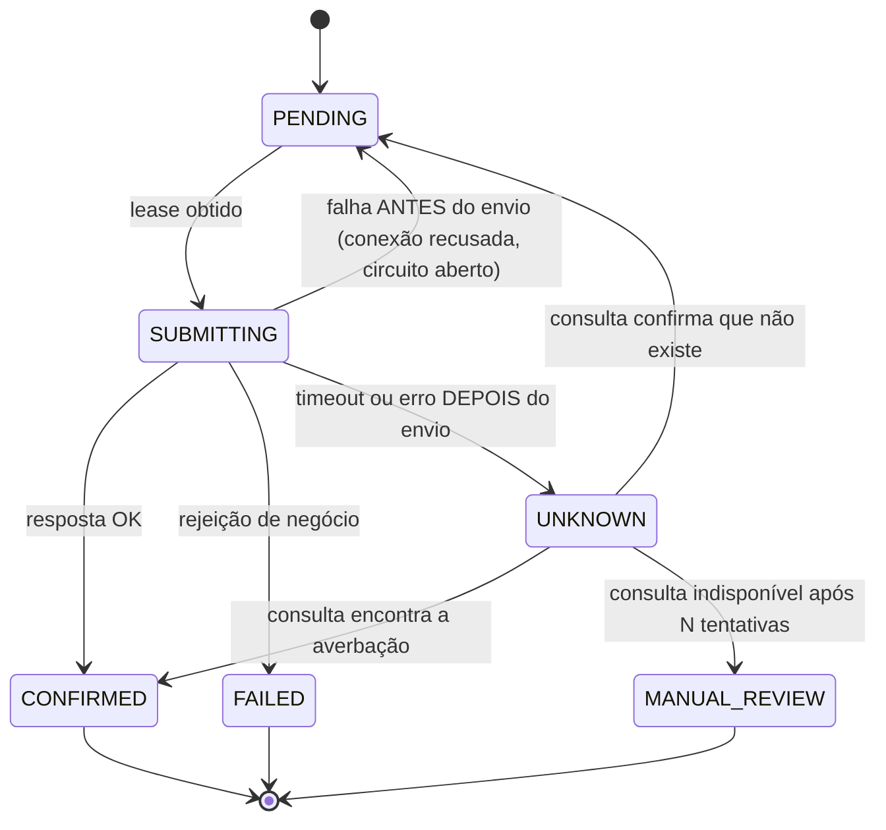

# Melhoria proposta: fechar a garantia de "zero averbação dupla" e provar os números

> **Status:** proposta, ainda não implementada
> **Data:** 09/10/2026
> **Escopo:** `ingestion-api`, `worker`, `mock-legacy`, `dispatcher-lambda`, testes de carga e documentação
> **Público:** quem implementa e quem avalia a PoC (banca técnica de nível Staff/Principal)

---

## 0. Decisão final da revisão (09/10/2026)

Esta seção registra o resultado da revisão adversarial feita em três rodadas com o notebook de preparação, sobre a PoC **e** sobre o [pattern](../patterns/pattern-borda-de-absorcao.md). As decisões abaixo prevalecem sobre qualquer sugestão anterior.

### Aceito

| Decisão | Onde fica registrada |
|---|---|
| Manter **DynamoDB + Streams**. É escrita única + log de mudanças, então não existe dual-write na borda e Outbox + Debezium/Kafka seria redundante | pattern, regra 1; ADR na seção 10 |
| **Dois guarda-corpos:** guarda de **efetivação** no worker, que decide e falha fechada; guarda de **ingestão** na borda só como variante opcional, heurística e que falha aberta | pattern, regra 4 e "Variantes"; M5 |
| **Auditoria no ponto de efeito:** a borda registra o contexto da intenção e a guarda de efetivação registra a decisão com o snapshot dos insumos (envelope de proveniência). O `202` e a mensagem da fila **não** carregam decisão | pattern, regra 9; M5 |
| **Idempotência em duas identidades** (técnica com escopo de tenant + negócio por HMAC); conteúdo divergente sob a mesma chave → `422` | pattern, regra 2; M1 |
| **Resultado desconhecido não é falha transitória:** consultar o destino antes de reenviar | pattern, regra 5; M2 |
| **Contrato mínimo do destino** (idempotente **ou** consultável). Sem ele, efeito único é impossível e o caminho é revisão manual. É pré-condição de uma garantia, não do pattern inteiro | pattern, seção própria; M2 |
| **O resultado sai do log de estado,** nunca de chamada direta do worker, para não criar dual-write na saída | pattern, regra 7; M9 |
| **`Retry-After` dinâmico + status com cota + notificação ativa**, contra o polling em massa. Contribuição do notebook | pattern, regra 8; M9 |
| **Forças novas:** frescor contra absorção; prioridade contra equidade | pattern, "Forças" |
| **Sinais invariantes** no lugar de ferramentas, incluindo a aderência ao teto | pattern, "Sinais invariantes" |
| **Status de pattern candidato** até cumprir a regra de três; a Sala de Espera Virtual é descrita como pattern irmão | pattern, cabeçalho, "Patterns irmãos" e "Usos conhecidos" |

### Rejeitado

| Sugestão | Motivo |
|---|---|
| Trocar a borda por PostgreSQL + Outbox + Debezium + Kafka | não fecha nenhuma lacuna e só adiciona operação (acúmulo de WAL, Kafka Connect, Schema Registry) |
| Trava síncrona na borda como garantia | não enxerga eventos que acontecem durante a espera (TOCTOU) e põe uma dependência síncrona no caminho de 10k req/s |
| `reason_codes` no `202` ou snapshot na mensagem do SQS | `202` significa "ainda não decidido"; a mensagem da fila não carrega PII por desenho |
| Tirar Prometheus/Grafana por FinOps | a premissa de "borda serverless" é falsa (só o dispatcher é Lambda). Para o pattern, ferramenta é detalhe: o que importa são os sinais |
| Chamar a solução de Strangler Fig | é Queue-Based Load Leveling com aceite durável; Strangler é complementar |
| Usos conhecidos sugeridos pelo notebook (AWS QBLL, Nubank/HDATF, Stripe) | o primeiro é uma entrada de catálogo, o segundo é outro problema (fraude) e o terceiro foi atribuído a um texto que não descreve aceite durável com drenagem protegida |

### Referências

As referências verificadas estão na seção "Referências" do pattern e foram adicionadas como fontes ao notebook de preparação em 09/10/2026. A página da Virtual Waiting Room on AWS falhou na importação e deve ser adicionada de novo.

---

## 1. Resumo

A PoC já demonstra bem a tese "aceitar 10.000 req/s e entregar no máximo 180 TPS ao legado". A arquitetura de borda de absorção, a QoS com piso e empréstimo, a sanitização de PII e a suíte de testes estão acima da média.

Uma revisão adversarial, no estilo de uma entrevista de System Design, encontra **três furos na garantia principal** (nenhuma averbação duplicada) e **uma lacuna de evidência** (os números do README ainda não foram medidos):

| # | Problema | Severidade | Onde |
|---|---|---|---|
| M1 | A idempotência depende só da chave enviada pelo parceiro, sem escopo de tenant, sem verificação do payload e sem chave de negócio | **Alta** | `ingestion-api`, `shared` |
| M2 | O legado simulado é idempotente por construção, então o "juiz" não testa a garantia da plataforma | **Alta** | `mock-legacy`, `worker` |
| M3 | O estado do worker fica em memória, sem exclusão entre instâncias | **Alta** | `worker` |
| M4 | O teto de 180 TPS é dividido estaticamente pelo número de instâncias | Média | `worker` |
| M5 | Não há revalidação de negócio antes de enviar ao legado (a proposta fica na fila e pode envelhecer) | Média | `worker` |
| M6 | Os números do README são metas, mas aparecem como resultados, e a conta da drenagem não está explícita | Média | `README.md`, k6 |
| M7 | Lacunas em relação à vaga-alvo: Kubernetes + Terraform obrigatórios e domínio de Crédito PJ | Média | infraestrutura, narrativa |
| M8 | Ajustes menores: checkpoint do Stream, scripts só em PowerShell, histórico de commits | Baixa | diversos |
| M9 | O `202` não anuncia a espera e não há canal de resultado; o polling dos clientes pode virar um segundo pico | Média | `ingestion-api`, `worker` |

A ordem sugerida de execução está na seção 12.

### Já corrigido (09/10/2026)

Dois problemas não estavam nesta revisão. Apareceram ao **medir**, na primeira subida completa do ambiente local e ao dimensionar a concorrência:

| Problema | Correção | Onde |
|---|---|---|
| O pool HTTP padrão do SDK da AWS tem **50 conexões**. A 10.000 req/s, com o DynamoDB a ~20 ms, a borda precisa de ~200 (Lei de Little). Sob carga, as requisições esperariam por conexão e virariam `503` por timeout, não por falta de banco | pool de 200 na `ingestion-api` (`INGESTION_INBOX_MAX_CONNECTIONS`) e, no `worker`, uma conexão por mensagem em voo. Cliente trocado para `apache5-client` | `ingestion-api`, `worker` |
| Com o circuit breaker **aberto**, o worker continuava retirando mensagens da fila. Cada recusa local contava como tentativa de entrega, e em menos de 5 s **90 propostas válidas foram para a DLQ** sem chegar ao legado. A regra 10 do pattern não era verdade na implementação | back-pressure: com o circuito aberto nada sai da fila; semi-aberto, uma chamada de prova por vez (`LegacyAvailabilityPort`). A fila em memória passou a respeitar o atraso de reentrega, como o SQS | `worker` |

Também foram ajustados o `worker.max-in-flight` (64 → 360, ou seja, 180 TPS × 2 s do limite de chamada lenta) e o GC da `ingestion-api` (ZGC com heap fixo) para o teste de carga.

A lição reforça a seção 12: **medição achou o que a revisão no papel não achou.**

---

## 2. M1: Idempotência em três camadas

### 2.1 Problema

`DynamoDbInboxAdapter.putIfAbsent` usa `attribute_not_exists(idempotencyKey)`, e a chave é o UUID enviado pelo parceiro (`IdempotencyKey`). Isso gera três falhas:

1. **A chave não tem escopo de tenant.** Se o parceiro B enviar o mesmo UUID que o parceiro A:
   - a proposta de B é descartada em silêncio como `DUPLICATE_ACCEPTED`;
   - B recebe na resposta o `tracingId` e o `receivedAt` da proposta de A.

   É vazamento de dado entre tenants e perda silenciosa de proposta.
2. **A mesma chave com payload diferente é aceita como duplicata.** Um parceiro que reaproveita a chave por bug recebe `202` e a segunda proposta some.
3. **Não existe chave de negócio.** A própria narrativa diz que os robôs disparam *a mesma proposta* centenas de vezes, mas nada garante que reutilizam o mesmo UUID. Um robô que gera um UUID novo a cada disparo passa por toda a proteção, e o risco de averbação dupla volta.

Há também uma correção no texto: o README diz que as duplicatas são descartadas "sem custo". **Uma escrita condicional que falha também consome capacidade de escrita no DynamoDB.** O custo é baixo, mas não é zero, e entra no dimensionamento (seção 7.3).

### 2.2 Proposta

Três camadas, cada uma com um papel:

| Camada | Chave | Detecta | Resposta |
|---|---|---|---|
| **Técnica** | `TENANT#{tenant}#KEY#{uuid}` | retry do mesmo cliente | `202 DUPLICATE_ACCEPTED` com o protocolo original |
| **Integridade** | `payloadHash` gravado junto | mesma chave com conteúdo diferente | `422 Unprocessable Content` (Problem Details) |
| **Negócio** | `FP#{HMAC(cpf, convênio, valor, parcelas)}` com janela configurável | mesma proposta com UUID novo | `202 DUPLICATE_ACCEPTED` apontando para o protocolo original |

Decisões de desenho:

- **Fingerprint com HMAC, não hash simples.** O espaço de CPFs é pequeno (cerca de 10¹¹ valores), então um SHA-256 puro do CPF pode ser revertido por força bruta e continua sendo dado pessoal pela LGPD. Use HMAC com chave guardada no KMS: o mesmo `DataKeyProvider` que já existe, com uma chave separada para o fingerprint.
- **Atomicidade entre as duas chaves.** Use `TransactWriteItems` com dois `Put` condicionais: o item técnico e o item de fingerprint. Ou os dois entram, ou nenhum entra.
  - Trade-off: transações custam o dobro de capacidade. Isso é documentado e dimensionado na seção 7.3.
  - Alternativa avaliada: gravar só pelo fingerprint e guardar a chave técnica como atributo. É mais barato, mas perde a resposta `422` por chave reutilizada. Fica registrada no ADR.
- **O Stream passa a ter dois tipos de item.** O `dispatcher-lambda` precisa ignorar itens `FP#`. O melhor lugar para isso é um *filter criteria* no event source mapping da Lambda, que evita até a invocação.
- **Janela do fingerprint.** O item `FP#` tem TTL próprio, por exemplo 24h, configurável por convênio. Depois da janela, uma nova proposta idêntica é legítima: o cliente pode realmente contratar de novo.
- **Escopo do fingerprint.** Começar por tenant. Avaliar com o negócio o escopo global (o mesmo CPF vindo de dois correspondentes) e registrar a decisão como ADR, porque isso muda o comportamento comercial.

### 2.3 Critérios de aceite

- [ ] Teste de propriedade (jqwik): para quaisquer dois tenants distintos com o mesmo UUID, as duas propostas são gravadas e nenhuma resposta contém dados da outra.
- [ ] Mesma chave com payload diferente → `422`, nenhum item novo e métrica `ingestion.idempotency.payload_mismatch`.
- [ ] Mesma proposta com 500 UUIDs distintos no mesmo segundo → **um** item técnico, **um** fingerprint e 499 `DUPLICATE_ACCEPTED`.
- [ ] `PiiNeverReachesTheConsoleTest` continua verde: o fingerprint não aparece em log.
- [ ] O dispatcher não recebe itens `FP#` (teste do filtro).

---

## 3. M2: Legado adversarial e o estado "resultado desconhecido"

### 3.1 Problema

O `AverbacaoLedger` do `mock-legacy` deduplica pela mesma chave de idempotência que a plataforma envia. Por isso, `legacy_averbacoes_total{kind="duplicate"} = 0` prova a idempotência **do legado**, não a da plataforma.

Dois agravantes:

- O ledger **esquece chaves antigas** (FIFO). O juiz não detecta duplicatas que chegam depois da janela.
- O worker reenvia a partir de `SENT_TO_LEGACY` confiando que o legado devolve o mesmo resultado (`Proposal.markSentToLegacy` permite `SENT_TO_LEGACY → SENT_TO_LEGACY`).
- O worker marca `SENT_TO_LEGACY` e conta a tentativa **antes** de chamar o legado. Se o circuito abre entre o despacho e o envio, a recusa local conta como tentativa sem que nada tenha saído. Observado em 09/10/2026 no `WorkerEndToEndTest` sob carga da máquina. É o mesmo problema da distinção "antes do envio" da seção 3.3.

Core banking real muitas vezes **não** é idempotente. O cenário perigoso é exatamente o que a PoC não testa:

> O legado grava a averbação → a resposta se perde (timeout ou queda de rede) → o worker trata como falha transitória → reenvia → **averbação dupla**.

### 3.2 Proposta: o juiz precisa ser adversarial

No `mock-legacy`:

| Mudança | Para quê |
|---|---|
| Modo `legacy.idempotent=false` (padrão nos testes de homologação) | simular um core que não deduplica |
| Caos `commit-then-timeout` com taxa configurável | gravar e não responder: o caso que gera duplicata |
| Detecção de duplicata por **chave de negócio** (CPF + convênio + valor + parcelas), sem evicção durante o teste | o juiz mede o que importa para o regulador |
| Endpoint de consulta `GET /averbacoes?idempotencyKey=` | dar ao worker um caminho de reconciliação |

### 3.3 Proposta: máquina de estados com "resultado desconhecido"



A regra central é **não reenviar a partir de `UNKNOWN` sem antes consultar**.

A distinção entre "falhou antes de enviar" e "não sei se chegou" precisa vir do adaptador HTTP:
- falha de conexão e circuito aberto → é seguro repetir;
- timeout de leitura e `5xx` depois de o corpo ser enviado → `UNKNOWN`.

### 3.4 Pré-condição a negociar com o dono do legado

Contra um destino que não é idempotente e não tem consulta, é **impossível** garantir efeito único. Isso precisa constar no documento do pattern como **contrato mínimo exigido do legado**: idempotência por chave **ou** consulta por chave. Se nenhum dos dois existir, o caminho é `MANUAL_REVIEW` com reconciliação diária.

Esse é o tipo de conclusão que diferencia uma resposta de nível Staff: o limite não é técnico, é contratual.

### 3.5 Critérios de aceite

- [ ] Com `idempotent=false` e `commit-then-timeout` a 5%, um teste de 10.000 propostas termina com **zero** duplicatas por chave de negócio no juiz.
- [ ] O mesmo teste com a reconciliação desligada **falha** e mostra duplicatas. Esse teste negativo prova que o mecanismo é necessário.
- [ ] Métricas: `worker.outcome.unknown`, `worker.reconciliation{result}` e `worker.manual_review`.

---

## 4. M3: Lease no DynamoDB no lugar do estado em memória

### 4.1 Problema

`InMemoryProposalRepository` guarda o estado da proposta no processo. Com duas ou mais instâncias do worker, o `createPendingIfAbsent` não protege uma instância da outra. O SQS entrega **pelo menos uma vez**: se o legado ficar lento além do visibility timeout (30s), a mesma mensagem fica visível para outro worker, e as duas instâncias chamam o legado. Além disso, um restart do worker perde todo o histórico de tentativas.

### 4.2 Proposta

O próprio item do DurableInbox vira a fonte de verdade do estado. Não é preciso trazer um banco relacional nesta fase.

```text
UpdateItem  (obter lease)
  SET status = SUBMITTING, leaseOwner = :worker, leaseUntil = :now + L, version = version + 1
  IF  status = PENDING
   OR (status = SUBMITTING AND leaseUntil < :now)
```

- **`L` maior que** o timeout do legado mais uma margem. O worker renova o lease junto com o `ChangeMessageVisibility` enquanto a chamada está em curso.
- **Fencing token:** todas as escritas de resultado exigem `version = :versionDoLease`. Um worker "zumbi", que perdeu o lease, não consegue sobrescrever o resultado. Ele ainda pode ter chamado o legado, e esse caso é coberto pela M2.
- `ProposalRepositoryPort` ganha um adaptador DynamoDB, e o adaptador em memória fica restrito aos testes unitários.
- Os eventos da proposta (`ProposalEvent`) vão para itens filhos `PK=TENANT#…#KEY#…, SK=EVT#{ts}`, formando a trilha de auditoria.

### 4.3 Critérios de aceite

- [ ] Teste com duas instâncias do worker, visibility timeout de 2s e legado com latência de 5s: zero chamadas concorrentes ao legado para a mesma chave.
- [ ] Matar o worker no meio da chamada e reiniciar: a proposta conclui sem duplicata, passando por `UNKNOWN` e consulta.
- [ ] Teste de propriedade: nenhuma sequência de eventos com versões fora de ordem altera um estado terminal.

---

## 5. M4: Teto de 180 TPS sem depender do número de instâncias

### 5.1 Problema

`FixedPerTaskBudgetAdapter` divide `180 × 0,98` por `worker.budget.instances`, uma configuração estática. Se o autoscaling, um deploy ou uma falha mudar o número real de instâncias, o teto efetivo muda junto. O próprio Javadoc já reconhece esse limite.

### 5.2 Opções

| Opção | Prós | Contras |
|---|---|---|
| **A. Drenador único ativo + standby com lease** | o mais simples; 180 TPS × ~1s de latência ≈ 180 em voo, trivial para uma JVM com threads virtuais | failover de alguns segundos |
| B. Token bucket distribuído (DynamoDB ou Redis) | escala horizontal | uma chamada remota por permissão e mais um ponto de falha |
| C. Limite adaptativo (AIMD sobre latência e `503`) com 180 como teto rígido | acompanha a capacidade **real** do legado, que varia | tuning; precisa de teste de caos |

**Recomendação: A + C.** Um único drenador ativo, eleito por lease no DynamoDB, elimina o problema de coordenação. O limite adaptativo protege o legado nos dias em que ele aguenta menos que 180.

A lição para a entrevista: **a solução distribuída não era necessária, porque o throughput alvo cabe em uma instância.**

### 5.3 Critérios de aceite

- [ ] Subir três réplicas do worker: o legado continua com `legacy_peak_window ≤ 180`.
- [ ] Matar o drenador ativo: o standby assume em menos de 10s sem duplicata.
- [ ] Reduzir a capacidade do mock para 120 TPS durante o teste: o limite adaptativo converge para ≤ 120 sem gerar `503` em cascata.

---

## 6. M5: Revalidação antes do legado

### 6.1 Problema

A proposta aceita às 00:01 pode ser drenada 30 ou 40 minutos depois (seção 7.2). Nesse intervalo:
- a margem consignável pode ter sido tomada por outro banco;
- o cliente pode ter sofrido bloqueio ou restrição;
- a proposta pode ter perdido a validade comercial.

Hoje o worker envia ao legado sem revalidar nada.

### 6.2 Proposta

- Criar a porta `EligibilityPort` no worker, chamada **imediatamente antes** do `legacy.submit`.
- Implementação inicial: um mock com flags de restrição alimentadas por evento. Essa peça é o elo com o domínio de Crédito PJ (seção 9).
- Criar dois estados terminais novos:
  - `EXPIRED`: a proposta passou da validade de negócio configurada por convênio;
  - `REJECTED_PRE_LEGACY`: a revalidação negou a proposta.
- Toda decisão grava um evento com `reason_code`, versão da regra, instante da verificação e o snapshot dos insumos consultados. Junto com o contexto de intenção que a borda já grava (tenant, `receivedAt`, `tracingId` e versão do contrato), forma o envelope de proveniência (pattern, regra 9). É a trilha para explicar a decisão depois (LGPD Art. 20).
- **Não** colocar a decisão no `202` nem na mensagem do SQS (seção 0, "Rejeitado").
- **Opcional:** uma guarda de ingestão na borda, que recusa no clique clientes já bloqueados. Ela é heurística, falha aberta (deixa passar se não conseguir checar) e nunca substitui esta guarda (pattern, "Variantes").
- O parceiro é notificado do resultado final pela M9.

### 6.3 Critérios de aceite

- [ ] Uma restrição injetada depois do `202` e antes da drenagem resulta em `REJECTED_PRE_LEGACY`, com zero chamadas ao legado para aquela proposta.
- [ ] Propostas mais antigas que a validade resultam em `EXPIRED`, com métrica por lane.

---

## 7. M6: Evidência medida e a conta da drenagem

### 7.1 Problema

O README mostra "10.000 req/s", "p95 < 100 ms" e "354 testes passando" como badges de resultado. Os scripts k6 ainda não existem. O `local-up` completou a primeira subida em 09/10/2026, com o fluxo ponta a ponta verificado manualmente, mas sem carga. Para uma banca técnica, um número apresentado como resultado sem medição reprodutível reduz a credibilidade do resto.

### 7.2 A conta que precisa estar no README

O SDD prevê 10.000 req/s por 5 minutos, ou seja, cerca de 3 milhões de requisições. O tempo de drenagem depende da fração de propostas **únicas**:

| Propostas únicas | Volume | Drenagem a 180 TPS |
|---|---|---|
| 10% | 300 mil | ~28 min |
| 30% | 900 mil | ~83 min |
| 100% | 3 milhões | ~4h38 |

Na lane standard, com o piso de 54 TPS e a fast lane saturada, o tempo é proporcionalmente maior. Isso precisa aparecer junto com a validade da proposta (M5) e com o critério "Quando não usar" do pattern: se a fila só esvazia depois da janela útil, o problema é de capacidade, não de absorção.

### 7.3 Dimensionamento do DynamoDB (a confirmar na documentação da AWS)

- **Custo por requisição:**
  - cada `Put` condicional de até 1 KB consome 1 WCU, inclusive quando a condição falha;
  - o payload cifrado pode passar de 1 KB e custar 2 WCU;
  - com a transação da M1, o custo dobra.
- **Estimativa:** 10.000 req/s × 2 itens × 2 (transação) × 1 a 2 KB ≈ **40 mil a 80 mil WCU/s** no pico.
- **Tabela nova em on-demand:** ela não nasce aceitando esse volume de imediato. Avaliar o **warm throughput** (pré-aquecimento) antes do teste e registrar a configuração no Terraform.
- **Partições:** UUIDs aleatórios distribuem bem a chave técnica, e o HMAC distribui bem o fingerprint. O risco está no cenário da "mesma proposta 500 vezes":
  - todas as escritas condicionais, inclusive as que falham, caem no **mesmo item** e, portanto, na mesma partição;
  - uma partição aceita cerca de **1.000 WCU/s**;
  - com a transação da M1 (custo dobrado), 500 repetições por segundo consomem ~1.000 WCU no mesmo item: **exatamente no limite**. Mais repetições, ou payload acima de 1 KB, viram throttling e `503` na borda.
  - Mitigações a avaliar: cota por tenant mais baixa para a mesma chave, um cache local curto de chaves recentes na borda antes do DynamoDB, ou gravar só pelo fingerprint (alternativa já citada na M1). O cenário `duplicate-storm` da seção 7.4 precisa medir isso.

### 7.4 Cenários k6 obrigatórios

| Cenário | Prova |
|---|---|
| `spike`: 50 → 10.000 req/s em 1s, sustentado por 5 min | absorção, p95 e p99 do `202` |
| `duplicate-storm`: 500× a mesma chave no mesmo segundo | camada técnica (M1) |
| `robot-new-uuid`: a mesma proposta com UUID novo a cada disparo | camada de negócio (M1) |
| `cross-tenant`: dois tenants com o mesmo UUID | isolamento (M1) |
| `legacy-commit-then-timeout` | M2 |
| `worker-kill` e `three-replicas` | M3 e M4 |
| `late-restriction` | M5 |

Os resultados (gráficos do Grafana e o sumário do k6) são versionados em `docs/evidencias/`, e **só então** os badges do README passam a mostrar números. Até lá, os badges dizem "meta".

---

## 8. M7: Kubernetes e Terraform sem Docker na máquina local

A vaga-alvo lista como **obrigatório** "containers e orquestração (Docker e Kubernetes), além de Infraestrutura como Código (Terraform ou equivalente)", com capacidade de "desenhar e também implementar". A PoC hoje roda como processos JVM, e o Terraform está adiado.

Proposta que respeita a restrição de não ter Docker local:

- **CI no GitHub Actions** com `kind`:
  - build das imagens a partir do `docker/Dockerfile.service` que já existe;
  - deploy por manifests (Kustomize ou Helm) de `ingestion-api` (com HPA), `worker` (1 ativo + 1 standby, conforme a M4) e `mock-legacy`;
  - LocalStack ou os emuladores atuais para DynamoDB e SQS;
  - execução dos cenários k6 de fumaça a cada PR.
- **Terraform:** módulos para:
  - DynamoDB (on-demand, Streams, TTL e warm throughput);
  - SQS + DLQ;
  - Lambda com *filter criteria* e *bisect on error*;
  - KMS.

  A pasta `infrastructure/` está sendo montada pelo autor. Esta proposta só sugere o conteúdo e não altera a pasta.

---

## 9. Ponte com o domínio de Crédito PJ

A vaga é do time de TI Crédito PJ, e consignado é produto de pessoa física. A PoC não precisa mudar de domínio, porque **o pattern é o ativo**. Mas a narrativa deve mostrar a transferência:

- A M5 (revalidação antes do legado) é a mesma "trava de borda" de uma esteira de crédito PJ: o teto pré-aprovado vem do batch, e a restrição (protesto, penhora) chega por evento.
- O documento do pattern ganha uma seção "Aplicação em Crédito PJ": contratação de limite pré-aprovado no início do expediente contra o core de crédito.
- O ADR da seção 10 conecta a PoC ao vocabulário Outbox/CDC/Kafka usado pelo mercado.

---

## 10. ADR a registrar: o DurableInbox já é um Transactional Outbox

**Contexto.** Revisores podem sugerir "trocar por Outbox + Debezium + Kafka" para eliminar dual-write.

**Decisão.** Manter DynamoDB + Streams.

**Justificativa.**
- A borda faz **uma única escrita**: o item condicional. O DynamoDB Streams é o log de mudanças dessa escrita, com o mesmo papel do WAL lido pelo Debezium.
- Não existe dual-write para eliminar.
- Os pontos de atenção são os mesmos do CDC clássico, e cada um já tem tratamento:

  | Ponto de atenção | Tratamento |
  |---|---|
  | Entrega pelo menos uma vez | idempotência no dispatcher e no worker |
  | Ordem por chave | o Stream preserva a ordem por item |
  | Retenção limitada | Streams guarda 24h, e um alarme de *iterator age* avisa quando a leitura atrasa |

**Quando revisitar.**
- Se a fonte de verdade passar a ser relacional, por exemplo Aurora: aí se aplica Outbox + Debezium.
- Se for preciso retenção longa e replay para muitos consumidores: aí entra Kafka ou MSK, alimentado pelo próprio Stream.

---

## 11. M8: Ajustes menores

- **`BatchDispatcher`:** com DynamoDB Streams, o checkpoint volta ao **primeiro** registro com falha, e tudo depois dele é reprocessado. Parar no primeiro erro evita envios redundantes ao SQS.
- **Scripts de ambiente local:** acrescentar equivalentes em bash ao `local-up.ps1` e `local-down.ps1`, para que um revisor em macOS ou Linux consiga rodar.
- **Histórico de commits:** o repositório tem um único commit. Daqui em diante, um commit por melhoria (M1, M2…), com mensagem que explique o porquê. Na entrevista, o histórico é evidência de autoria e de raciocínio.
- **Uso de IA:** apresentar o AI-DLC como processo governado (requisitos, aprovações, auditoria) na seção "Especificação e processo" do README. Fechar ou explicar as aprovações que ainda aparecem como pendentes em `aidlc-state.md`.

---

## 12. Plano de execução

| Ordem | Item | Esforço estimado | Por que nesta ordem |
|---|---|---|---|
| 1 | M1: idempotência em três camadas | 1–2 dias | fecha o furo mais visível e é barato |
| 2 | M2: legado adversarial + `UNKNOWN` | 2–3 dias | é a melhor história técnica da PoC |
| 3 | M3: lease e estado no DynamoDB | 2 dias | pré-requisito para M4 e para o teste com várias réplicas |
| 4 | M4: drenador único + limite adaptativo | 1–2 dias | depende da M3 |
| 5 | M5: revalidação antes do legado | 1–2 dias | ponte com Crédito PJ |
| 6 | M6: k6, evidências e README honesto | 2–3 dias | transforma meta em resultado |
| 7 | M7: kind no CI + Terraform | 3–4 dias | requisito obrigatório da vaga |
| 8 | M9: espera anunciada e resultado pelo log | 2 dias | depende de M3 (estado no DynamoDB) e M5 (estados finais) |
| 9 | M8: ajustes menores | contínuo | |

---

## 13. M9: Espera anunciada e resultado publicado pelo log de estado

### 13.1 Problema

O `202` devolve um protocolo, mas não há consulta de status nem notificação, e o cliente não sabe quanto vai esperar. Com centenas de milhares de propostas pendentes e parceiros consultando a cada 2 segundos, o polling chega à ordem de 10⁵ leituras/s: um segundo pico, agora na leitura.

Se o worker chamasse o webhook do parceiro diretamente ao concluir, criaria um dual-write na saída (gravar o estado **e** notificar, sem atomicidade).

### 13.2 Proposta

- **`Retry-After` no `202`.** Estimado por lane a partir da profundidade do backlog e da taxa de drenagem. O `BacklogEstimator` do worker já calcula o "effective drain time" e passa a publicar essa estimativa por lane, que a borda lê de um item de configuração com cache curto.
- **`GET /v1/proposals/{key}`** com escopo por tenant e **cota própria** (Resilience4j, como na ingestão), lendo o item do DurableInbox. Robôs não respeitam `Retry-After`, então a cota é que garante o limite.
- **Notificação ativa:** o worker grava o estado final no DurableInbox (M3). Um consumidor do **mesmo Stream** publica o webhook do parceiro, com retentativa e DLQ próprias. O worker nunca chama o parceiro.

### 13.3 Critérios de aceite

- [ ] Cenário k6 `status-storm`: 300 mil propostas pendentes consultadas a cada 2s. A borda de escrita mantém o p95, e o excesso de consulta recebe `429`, não `5xx`.
- [ ] O `Retry-After` do `202` fica dentro de ±20% do tempo real até o efeito, medido no cenário `spike`.
- [ ] Derrubar o endpoint do webhook do parceiro não afeta a drenagem, e as notificações são entregues ao voltar.

---

## 14. Preparação para a entrevista

Perguntas prováveis da banca e onde está a resposta:

| Pergunta | Resposta curta | Onde |
|---|---|---|
| "O que acontece se o robô gerar um UUID novo por disparo?" | fingerprint de negócio com HMAC, gravado na mesma transação | M1 |
| "E se o legado gravar e a resposta se perder?" | estado `UNKNOWN` + consulta antes de reenviar; sem consulta, efeito único é impossível e vira contrato com o dono do legado | M2 |
| "Duas instâncias podem chamar o legado com a mesma proposta?" | lease condicional com fencing token | M3 |
| "Como garante 180 TPS com autoscaling?" | drenador único com standby; limite adaptativo com teto rígido | M4 |
| "A proposta fica 15 minutos na fila e o cliente é bloqueado. E aí?" | revalidação imediatamente antes do legado, com `reason_code` auditável | M5 |
| "A lane de 30% pode passar fome?" | não: o piso garante a fatia, e a sobra de uma lane é emprestada à outra | já implementado |
| "Por que não Outbox + Kafka?" | o DurableInbox já é um outbox com CDC nativo | ADR, seção 10 |
| "Quanto tempo leva para drenar o pico?" | depende da fração de propostas únicas: ~28 min a ~4h38 | M6 |
| "E se todos os clientes ficarem consultando o status?" | `Retry-After` por lane, status com cota e notificação pelo log de estado | M9 |
| "Por que não validar tudo já na borda?" | uma checagem no aceite não enxerga o que muda durante a espera (TOCTOU); a decisão que vale fica no ponto de efeito, e a checagem na borda é só filtro opcional | M5, pattern regra 4 |
| "Isso é um pattern de verdade?" | é um pattern candidato: tem implementação de referência e usos que sustentam partes dele (SeatGeek, Shopify); falta a regra de três para a combinação completa | pattern, "Usos conhecidos" |

Ensaie as respostas também em inglês, porque a vaga exige inglês avançado.
