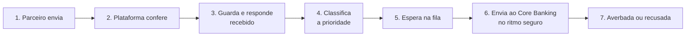
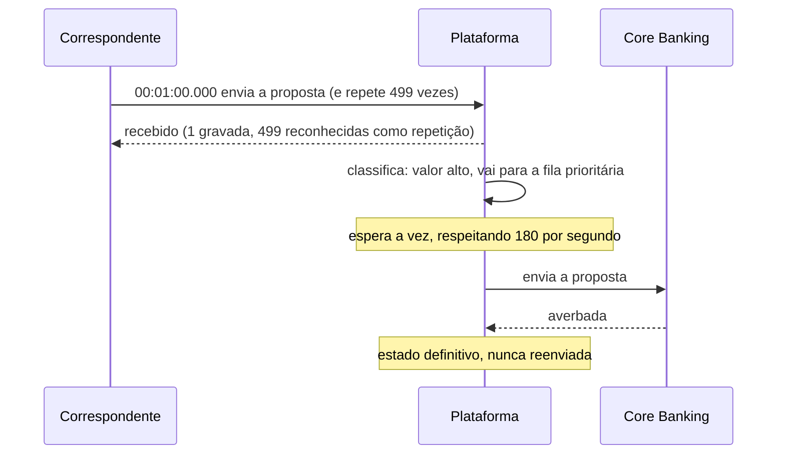

# A jornada de uma proposta na virada de folha

Este documento acompanha, passo a passo, o caminho de uma proposta de crédito consignado desde o momento em que o parceiro a envia até a averbação no Core Banking. Ele é escrito para quem conhece o negócio e não precisa saber como o sistema foi construído.

> Para a visão técnica de cada componente, veja o [README do projeto](../README.md).

---

## Os personagens

| Quem | Papel na jornada |
|---|---|
| **Dona Maria**, aposentada do INSS | fez a simulação na véspera e quer o empréstimo |
| **Correspondente bancário** (parceiro) | envia a proposta da Dona Maria por um robô, que repete o envio várias vezes para não perder a margem |
| **Plataforma de absorção** (esta PoC) | recebe as propostas, guarda cada uma com segurança e organiza a fila |
| **Core Banking** | sistema legado que faz a averbação; aguenta no máximo **180 propostas por segundo** |

## O cenário: 00:01 do dia da virada

À meia-noite e um minuto, o INSS libera a margem consignável. Milhares de correspondentes disparam propostas ao mesmo tempo, e o volume salta de **50 para 10.000 propostas por segundo**.

Sem a plataforma, o Core Banking cai em menos de 3 segundos e fica fora do ar de 40 a 60 minutos. Com a plataforma, a jornada é a descrita a seguir.

---

## Passo 1 — O parceiro envia a proposta

O robô do correspondente envia a proposta da Dona Maria com três informações de controle:

- **a identificação do parceiro** (qual correspondente está enviando);
- **uma credencial de acesso** válida, emitida para esse parceiro;
- **um código único da proposta**, gerado pelo parceiro. É esse código que permite reconhecer a mesma proposta quando ela chega repetida.

Junto vão os dados do negócio: CPF, valor, convênio (INSS, por exemplo) e se a operação é uma portabilidade.

## Passo 2 — A plataforma confere a porta de entrada

Antes de aceitar qualquer coisa, a plataforma verifica:

| Verificação | Se falhar, o parceiro recebe |
|---|---|
| A credencial é válida e pertence ao parceiro que diz estar enviando | recusa por acesso não autorizado |
| A proposta está completa e no formato correto | recusa por dados inválidos, para corrigir e reenviar |
| O parceiro está dentro da sua **cota de envios por segundo** | pedido para tentar de novo em alguns instantes |

A cota por parceiro impede que um único correspondente, com um robô mais agressivo, ocupe a capacidade de todos os outros.

## Passo 3 — A proposta é guardada e o parceiro recebe "recebido"

Passada a conferência, a plataforma **grava a proposta de forma durável** e só então responde ao parceiro com um protocolo de **"recebido"**. Isso acontece em menos de 100 milissegundos.

Dois pontos importam para o negócio:

- **"Recebido" não é "aprovado".** A resposta garante que a proposta não será perdida e entrou na fila. A averbação acontece depois.
- **Repetições não viram propostas novas.** Se o robô enviar a mesma proposta 500 vezes no mesmo segundo, a plataforma grava **uma** e responde às outras 499 com "já recebido". Não há custo de processamento e não há risco de averbação dupla.

A resposta rápida acalma o robô: ele tem um protocolo oficial e não precisa continuar insistindo.

Os dados pessoais da Dona Maria são guardados cifrados, e o CPF não aparece em nenhuma resposta nem nos registros de operação do sistema (LGPD).

## Passo 4 — A plataforma classifica a prioridade

O Core Banking só averba 180 por segundo, e às 00:01 chegam milhares. Por isso, cada proposta recebe uma **pontuação de prioridade** com base no valor que ela tem para o negócio:

| Critério | Pontos |
|---|---|
| Parceiro estratégico (VIP) | 60 |
| Valor acima do limite configurado (padrão R$ 50.000) | 40 |
| Portabilidade | 30 |

Com **30 pontos ou mais**, a proposta vai para a **fila prioritária**. As demais vão para a **fila padrão**.

A portabilidade entra na fila prioritária por dois motivos: ela traz carteira do concorrente e tem prazo regulatório. Perder a janela significa perder o cliente.

## Passo 5 — A proposta espera na fila

As duas filas dividem a capacidade do Core Banking:

| Fila | Parte garantida da capacidade | Propostas por segundo |
|---|---|---|
| Prioritária | 70% | até 126 |
| Padrão | 30% | até 54 |

Os 70% são um **mínimo garantido**, não um limite. Se uma das filas esvazia, a outra usa a capacidade que sobrou. Ninguém fica parado enquanto há espaço livre.

Na prática, nos primeiros minutos da virada, quando a margem mais valiosa está disponível, as propostas de maior valor são averbadas primeiro, e as demais seguem andando em paralelo.

## Passo 6 — A plataforma envia ao Core Banking no ritmo seguro

A plataforma alimenta o Core Banking em um fluxo constante, **nunca acima de 180 por segundo**. O legado trabalha no limite da sua eficiência, sem sobressalto e sem cair.

Se o Core Banking ficar instável por um momento, a plataforma **pausa os envios** em vez de insistir. As propostas continuam guardadas e voltam a ser enviadas quando ele se recupera. Uma instabilidade do legado não transforma uma proposta boa em proposta recusada.

## Passo 7 — O resultado final

Cada proposta termina em um de dois estados definitivos:

| Estado | Significado |
|---|---|
| **Averbada** | o Core Banking confirmou a operação |
| **Recusada** | o Core Banking rejeitou a proposta por regra de negócio |

Esses estados são **definitivos**. Se, por qualquer motivo técnico, a mesma proposta chegar de novo ao final do caminho, a plataforma reconhece que ela já foi resolvida e **não chama o Core Banking outra vez**. Mesmo que um envio seja repetido, o Core Banking recebe o mesmo código único e devolve o resultado original em vez de averbar duas vezes.

Propostas que não conseguem ser concluídas depois de várias tentativas, por falha técnica persistente, vão para uma **fila de análise**, onde ficam disponíveis para tratamento pela operação. Nenhuma é descartada em silêncio.

---

## A jornada completa em uma linha do tempo

## O que o negócio ganha em cada passo

| Passo | Ganho |
|---|---|
| 2. Cota por parceiro | nenhum correspondente monopoliza a capacidade |
| 3. Gravar e responder "recebido" | nenhuma proposta perdida; o banco fica de pé enquanto concorrentes caem |
| 3. Reconhecer repetições | zero averbação dupla; conformidade com Febraban, ABBC, INSS e eSocial |
| 4 e 5. Prioridade 70/30 | mais volume financeiro (VGV) averbado nos primeiros minutos |
| 6. Ritmo seguro | o Core Banking não cai; sem acionamento de emergência de madrugada |
| 7. Estados definitivos | rastreabilidade completa de cada proposta |

## Como acompanhar a jornada ao vivo

Durante o teste de homologação, os painéis mostram:

- **quantas propostas a plataforma recebeu** por segundo e quantas eram repetições;
- **a linha do Core Banking**, que deve ficar reta em 180 por segundo, sem ultrapassar;
- **a divisão entre as filas**, com a prioritária recebendo pelo menos 70% sempre que as duas têm propostas esperando;
- **o volume financeiro averbado** ao longo do tempo;
- **o tempo estimado para esvaziar as filas** depois do pico.

## Limites desta PoC

- O Core Banking é **simulado**: ele imita a capacidade de 180 por segundo e recusa o excesso, servindo de juiz do experimento.
- A operação com **seguro acoplado** aparece nos objetivos de prioridade, mas ainda não entra na pontuação. Hoje contam apenas parceiro VIP, valor e portabilidade.
- Spread, CET e saldo devedor da portabilidade não fazem parte do contrato atual da proposta.
