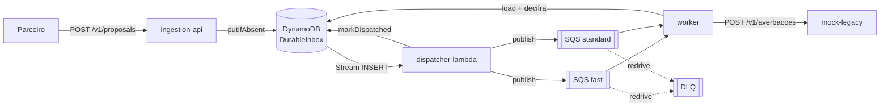
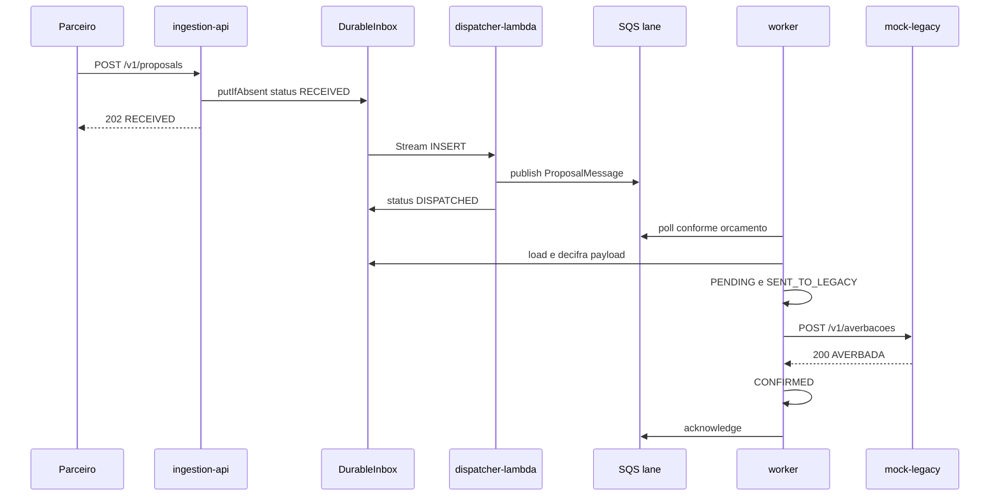
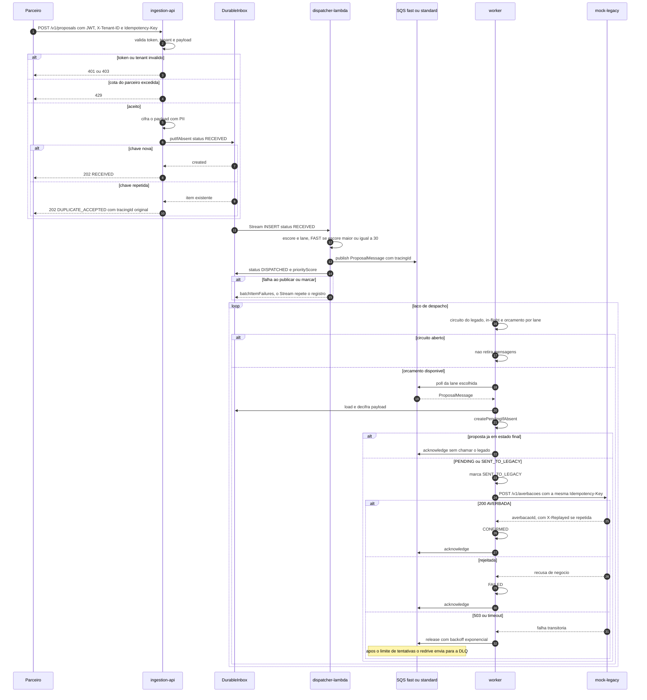

# Jornada entre os módulos da aplicação

Este documento descreve, do ponto de vista técnico, como uma proposta atravessa os módulos da plataforma: quem chama quem, por qual contrato, o que é gravado em cada etapa e como as falhas são tratadas. É a contraparte técnica de [jornada-da-proposta.md](jornada-da-proposta.md), que conta a mesma história para o negócio.

---

## 1. Mapa dos módulos

| Módulo | Tipo | Responsabilidade na jornada |
|---|---|---|
| `ingestion-api` | Spring Boot (HTTP) | Borda de absorção: autentica, aplica cota por parceiro, cifra o payload e grava no Inbox durável. Responde `202`. |
| `dispatcher-lambda` | AWS Lambda (DynamoDB Stream) | Lê inserções do Inbox, calcula o escore de prioridade, escolhe a lane e publica no SQS. |
| `worker` | Spring Boot (consumidor) | Retira mensagens das filas no ritmo que o legado aguenta e leva a proposta ao estado final. |
| `mock-legacy` | Spring Boot (HTTP) | Core Banking simulado: averbação idempotente com teto de capacidade e falhas configuráveis. |
| `shared` | Biblioteca | Contratos comuns: `IdempotencyKey`, `TenantId`, `Cpf`, `Money`, `Lane`, `ProposalMessage`, `InboxAttributes`, `PayloadEnvelope`. |
| `platform-starter` | Spring Boot starter | Padrões transversais: redação de PII em logs/JSON, `ProblemDetail`, política de tags de métricas por tenant. |
| `platform-aws` | Biblioteca | Integração com AWS, como o `KmsDataKeyProvider` para cifragem de payload. |

Texto alternativo: o parceiro chama a `ingestion-api`, que grava no `DurableInbox`. O Stream da tabela aciona o `dispatcher-lambda`, que publica em uma de duas filas SQS e marca o item como despachado. O `worker` consome as filas, relê o payload no Inbox e chama o `mock-legacy`. Mensagens que esgotam as tentativas vão para a DLQ.

---

## 2. Etapa 1 — `ingestion-api`: aceitar com durabilidade

**Entrada:** `POST /v1/proposals` ([ProposalController.java](../../applications/ingestion-api/src/main/java/br/com/consignado/platform/ingestion/infrastructure/adapter/in/web/ProposalController.java)).

| Header / corpo | Uso |
|---|---|
| `Authorization: Bearer <JWT>` | Autenticação; o claim de tenant precisa bater com `X-Tenant-ID` (senão `403`). |
| `X-Tenant-ID` | Parceiro que envia. |
| `Idempotency-Key` (UUID) | Chave da proposta em toda a jornada, até o legado. |
| Corpo | `customerCpf`, `convenioCode`, `isPortability`, `amount`, `installments`. |

**Caso de uso** ([AcceptProposalService.java](../../applications/ingestion-api/src/main/java/br/com/consignado/platform/ingestion/application/usecase/AcceptProposalService.java)):

1. `TenantQuotaPort.tryAcquire` — cota por parceiro; se estourar, `429`.
2. `PayloadProtectionPort.protect` — o payload com PII (CPF, parcelas etc.) é cifrado em envelope (`PayloadEnvelope`, chave local AES-256 ou KMS).
3. `DurableInboxPort.putIfAbsent` — escrita condicional atômica no `DurableInbox` com `status=RECEIVED`, `ttl` e `tracingId`.
4. Resposta `202`:
   - `RECEIVED` se o item foi criado;
   - `DUPLICATE_ACCEPTED` se a chave já existia, com o `tracingId` e o `receivedAt` **originais**.

A borda não chama o legado nem um banco relacional. Se o DynamoDB estiver indisponível, responde `503` para o parceiro repetir.

**Atributos gravados no Inbox** (`InboxAttributes`): `idempotencyKey`, `tenantId`, `convenioType`, `portability`, `amount`, `payload` (cifrado), `tracingId`, `status`, `createdAt`, `ttl`. Os campos de roteamento ficam em claro para que o Dispatcher não precise decifrar nada.

---

## 3. Etapa 2 — `dispatcher-lambda`: classificar e enfileirar

**Gatilho:** DynamoDB Stream da tabela `DurableInbox` → [InboxStreamHandler.java](../../applications/dispatcher-lambda/src/main/java/br/com/consignado/platform/dispatcher/lambda/InboxStreamHandler.java).

Para cada registro, o [DispatchService.java](../../applications/dispatcher-lambda/src/main/java/br/com/consignado/platform/dispatcher/dispatch/DispatchService.java):

1. Ignora o que não for `INSERT` com `status=RECEIVED` (por exemplo, a própria atualização para `DISPATCHED`).
2. Calcula o escore (`PriorityScorer`, limitado a 100):

   | Regra | Peso padrão |
   |---|---|
   | Portabilidade | 60 |
   | Parceiro VIP | 40 |
   | Valor ≥ limiar (padrão R$ 50.000,00) | 30 |

3. Escolhe a lane (`LaneRouter`): escore ≥ 30 → `FAST`; caso contrário, `STANDARD`.
4. Publica a `ProposalMessage` (chave, tenant, lane, escore) na fila da lane, enviando o identificador de correlação `tracingId` como atributo da mensagem; o contexto W3C completo ainda não é propagado.
5. Atualiza o item do Inbox para `DISPATCHED` com o `priorityScore`.

**Garantias:**

- Publicar antes de marcar resulta em entrega **ao menos uma vez**. Se a marcação falhar, a mensagem pode ser republicada; o Worker é idempotente.
- Falhas parciais voltam como `batchItemFailures`, e o Stream repete só os registros que falharam.
- Um registro malformado gera `IllegalArgumentException` e é tratado como "veneno", sem travar o lote.
- Métricas saem em formato EMF (CloudWatch).

**Configuração:** `DISPATCHER_FAST_QUEUE_URL`, `DISPATCHER_STANDARD_QUEUE_URL`, `DISPATCHER_INBOX_TABLE`.

---

## 4. Etapa 3 — `worker`: entregar ao legado no ritmo seguro

O Worker tem duas partes: o laço de despacho, que decide **quando** retirar uma mensagem, e o caso de uso de processamento, que decide **o que fazer** com ela.

### 4.1 Laço de despacho

[ProposalDispatchLoop.java](../../applications/worker/src/main/java/br/com/consignado/platform/worker/application/usecase/ProposalDispatchLoop.java), em cada passo:

1. **Back-pressure do legado** (`LegacyAvailabilityPort`, implementado pelo circuit breaker):
   - `AVAILABLE`: segue;
   - `PROBING`: permite só uma chamada de prova por vez;
   - `UNAVAILABLE`: não retira mensagens, e as entregas do SQS não são gastas.
2. **Concorrência**: um semáforo limita a `worker.max-in-flight` (padrão 360).
3. **Orçamento de vazão** (`ThroughputBudgetPort` + `LaneBudgetAllocator`): teto global de 180 TPS × margem de 0,98, dividido entre instâncias, com piso de 70% para `FAST` e 30% para `STANDARD`. Uma lane pode emprestar a folga da outra.
4. Retira uma mensagem da lane escolhida, consome o orçamento e processa em uma thread virtual.
5. Resultado:
   - `COMPLETED`: `acknowledge` (apaga a mensagem da fila);
   - `RETRY`, `UNPROCESSABLE` ou exceção: `release` com backoff exponencial (base de 5 s, teto de 60 s). O redrive do SQS limita as tentativas e envia a mensagem para a DLQ.

### 4.2 Processamento da proposta

[ProcessProposalService.java](../../applications/worker/src/main/java/br/com/consignado/platform/worker/application/usecase/ProcessProposalService.java):

1. `InboxReadPort.load` relê o item no `DurableInbox` e decifra o payload. Se o item não existir, o resultado é `UNPROCESSABLE`.
2. `createPendingIfAbsent` cria a proposta em `PENDING`, de forma idempotente. Se ela já estiver em estado final, retorna `COMPLETED` sem chamar o legado.
3. Marca `SENT_TO_LEGACY` e grava o evento com o número da tentativa.
4. `LegacyCorePort.submit` envia `POST /v1/averbacoes` com a **mesma** `Idempotency-Key`.
5. Resultado do legado:

   | Retorno | Estado final | Saída do laço |
   |---|---|---|
   | `Confirmed` | `CONFIRMED` (com `averbacaoId`) | `COMPLETED` |
   | `Rejected` | `FAILED` (com motivo) | `COMPLETED` |
   | `TransientFailure` (503, timeout) | continua `SENT_TO_LEGACY` | `RETRY` |

Máquina de estados: `PENDING → SENT_TO_LEGACY → CONFIRMED | FAILED`. Nenhuma chamada ao legado acontece depois de um estado terminal. Ao fim, o `BusinessObserver` registra as métricas de negócio, entre elas o tempo total desde o recebimento na borda.

**Adaptadores:** `SqsLaneQueueAdapter` ou `InMemoryLaneQueue`; `DynamoDbInboxReadAdapter` ou `InMemoryInboxReadAdapter`; `LegacyHttpAdapter`, envolvido por `CircuitBreakerAvailabilityAdapter` e `MeteredLegacyCorePort`; `InMemoryProposalRepository`, já que a persistência relacional fica em memória nesta fase.

---

## 5. Etapa 4 — `mock-legacy`: averbação

[AverbacaoController.java](../../applications/mock-legacy/src/main/java/br/com/consignado/platform/legacy/web/AverbacaoController.java):

1. Valida `X-Api-Key` e a `Idempotency-Key` (UUID).
2. `CapacityGate` aplica o teto de capacidade em janela de 1 s. Acima dele, responde `503` com `Retry-After: 1`.
3. Caos configurável: latência e taxa de erro, ambas respondendo `503`.
4. `AverbacaoLedger.register`: a primeira chamada gera o `averbacaoId`, e as repetições devolvem o mesmo valor com `X-Replayed: true`.

---

## 6. Linha do tempo de uma proposta

### 6.1 Sequência completa, com desvios

Texto alternativo: o parceiro envia a proposta. A `ingestion-api` recusa com 401, 403 ou 429, ou grava no Inbox e responde 202, seja `RECEIVED` ou `DUPLICATE_ACCEPTED`. O Stream aciona o Dispatcher, que publica na lane e marca `DISPATCHED`; quando algo falha, o registro é repetido. O Worker só retira mensagens com o circuito fechado e orçamento disponível, relê o Inbox, cria ou reaproveita a proposta e chama o legado com a mesma chave. Depois confirma, recusa ou devolve a mensagem à fila com backoff até a DLQ.

---

## 7. Contratos que atravessam módulos

| Contrato | Produtor → Consumidor | Definido em |
|---|---|---|
| `Idempotency-Key` | Parceiro → todos os módulos → legado | `shared` (`IdempotencyKey`, `HeaderNames`) |
| Item do `DurableInbox` | `ingestion-api` → `dispatcher-lambda` e `worker` | `shared` (`InboxAttributes`) |
| Payload cifrado | `ingestion-api` → `worker` | `shared` (`PayloadEnvelope`, `InboxPayloadCodec`); a chave precisa ser a mesma nos dois módulos |
| `ProposalMessage` | `dispatcher-lambda` → `worker` | `shared` (`ProposalMessage`, `ProposalMessageCodec`) |
| `tracingId` | API → Inbox → atributo SQS; não restaura contexto de span no worker | `SystemTracingIdAdapter`, `SqsQueuePublisher` |
| Requisição de averbação | `worker` → `mock-legacy` | `LegacyHttpAdapter` / `AverbacaoRequest` |

---

## 8. Idempotência e falhas, ponta a ponta

| Ponto | Duplicata ou falha | Proteção |
|---|---|---|
| Borda | Robô do parceiro reenvia | `putIfAbsent` responde `DUPLICATE_ACCEPTED` com os dados originais |
| Borda | DynamoDB fora | `503`; o parceiro repete com a mesma chave |
| Dispatcher | Falha entre publicar e marcar | Republicação inofensiva (Worker idempotente) |
| Dispatcher | Registro inválido | Tratado como veneno, sem bloquear o lote |
| Worker | Mensagem entregue duas vezes | `createPendingIfAbsent`; estado final não chama o legado |
| Worker | Queda depois de chamar o legado | Reenvio com a mesma chave; o legado responde `X-Replayed` |
| Worker | Legado lento ou fora | Circuit breaker para o consumo; backoff e DLQ |
| Legado | Pico acima da capacidade | `503` com `Retry-After`; o orçamento do Worker evita chegar nesse ponto |

---

## 9. Leituras relacionadas

- [jornada-da-proposta.md](jornada-da-proposta.md): a mesma jornada contada para o negócio.
- [pattern-borda-de-absorcao.md](../patterns/pattern-borda-de-absorcao.md): o padrão arquitetural aplicado.
- [manual-api-rest.md](../narrativas/manual-api-rest.md): contratos HTTP em detalhe.
