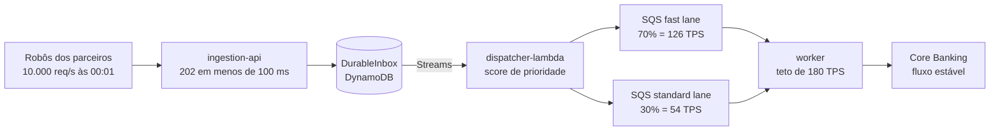

# Visão técnica da PoC

Arquitetura e decisões transferidas do README principal em 16/10/2026. Os limites numéricos são metas/configurações; consultar o [estado atual](../estado-atual.md) para distinguir implementação de homologação.

## A solução

Separar **aceitar** de **processar**.

A borda faz o mínimo para não perder a proposta — grava de forma durável e idempotente — e responde na hora. O Worker drena no ritmo que o legado suporta.

As duas filas existem porque, com fila única, uma proposta de alto valor entraria atrás de centenas de milhares de propostas pequenas. O orçamento é dividido com **piso** de 70% para a fast lane, e a lane ociosa empresta capacidade à outra: prioridade sem desperdício.

## Mecanismos e limites da implementação

| Garantia | Como é obtida | Onde provar |
|---|---|---|
| Durabilidade do aceite | escrita antes do `202`; DynamoDB na AWS, emulador em memória localmente | `ingestion-api` |
| Deduplicação de chave técnica | escrita condicional na Inbox + estados finais do worker; modo DynamoDB validado na S5, com limites no destino e nas métricas | `ingestion-api`, `worker` |
| Meta de proteção do legado | orçamento de vazão por janela, com margem entre instâncias | `worker`, `mock-legacy` |
| Prioridade para o alto valor | duas filas com piso de 70/30 e empréstimo | `dispatcher-lambda`, `worker` |

## Stack técnica

| Camada | Tecnologia |
|---|---|
| Linguagem | Java 25 LTS, com threads virtuais |
| Framework | Spring Boot 4.1.1 (starters modulares), Spring Security 7 (JWT/JWKS) |
| Build | Maven 3.9+, Spotless, Enforcer, JaCoCo (mínimo 80%), CycloneDX SBOM |
| AWS | SDK v2 2.55.12 — DynamoDB (+ Streams), SQS, Lambda, KMS |
| Resiliência | Resilience4j 2.4.0 (circuit breaker, rate limiter) + orçamento de vazão próprio |
| API | springdoc-openapi 3.1.1 (Swagger UI), Problem Details RFC 7807 |
| Testes | JUnit 5, AssertJ, jqwik 1.10.1 (propriedades), ArchUnit 1.5.1 |
| Observabilidade | Micrometer, Prometheus, Grafana, Jaeger (OTLP), CloudWatch EMF |
| Dev local | DynamoDB Local e ElasticMQ embarcados na JVM — **sem Docker** |

## Decisões de contexto

Quatro restrições moldaram o desenho e explicam escolhas que de outro modo pareceriam estranhas:

- **Java 25**, não 21 como nas narrativas. O código conta com o comportamento do Java 25 em `synchronized` sob threads virtuais (JEP 491).
- **Sem Docker** na máquina de desenvolvimento. Daí os emuladores embarcados em vez de Testcontainers.
- **Estado e histórico do worker em DynamoDB no fluxo local**, em vez do Aurora das narrativas. O padrão isolado continua `memory`. DynamoDB Local e ledger do mock rodam em memória: reiniciar o worker preservando os emuladores foi validado; reiniciar todo o ambiente perde os dados.
- **Custo de nuvem sob controle.** Nada de NAT Gateway permanente; o ambiente é criado e destruído em volta dos testes.

## Privacidade (LGPD)

A telemetria é construída para não vazar dado pessoal, em duas camadas: **minimização** (handlers de erro não registram mensagem nem stack trace de exceção) e uma **rede de proteção** que mascara CPF, cartão, telefone e e-mail em todo valor de texto do JSON de log, nos quatro serviços. O payload do cliente fica cifrado no DurableInbox. O CPF é decifrado para processamento e enviado ao legado, mas não é incluído na mensagem de fila nem deve aparecer na telemetria.

Detalhes e a implementação única: [platform-starter](../../applications/platform-starter/README.md).

## Especificação e processo

| Pasta | Conteúdo |
|---|---|
| [docs/sdd/](../sdd/) | especificação de origem: SDD, blueprint e as narrativas de negócio |
| [aidlc-docs/](../../aidlc-docs/) | requisitos, design, estado do workflow (`aidlc-state.md`) e trilha de auditoria |
| [docs/](../) | material de apoio e avaliações de métricas |
| [.claude/skills/](../../.claude/skills/) | regras do projeto por tema (LGPD, logs, métricas, testes, arquitetura) |

O desenvolvimento segue o workflow AI-DLC Lite descrito em `CLAUDE.md`. O estado atual, os riscos registrados e as aprovações pendentes estão em [aidlc-docs/aidlc-state.md](../../aidlc-docs/aidlc-state.md).

## Módulos e operação

- [Módulos, build e convenções](../../applications/README.md).
- [Jornada técnica entre módulos](../jornadas/jornada-entre-modulos.md).
- [Infraestrutura e observabilidade](../../infrastructure/README.md).
- [Dashboards e métricas](../../applications/observability/grafana/dashboards/README.md).
