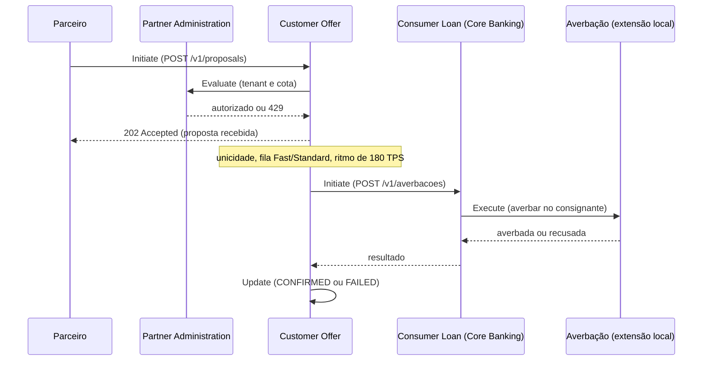

# Alinhamento da plataforma ao BIAN v14.0

Mapeamento da PoC de crédito consignado para a arquitetura de referência **BIAN v14.0**, feito com a skill `bian-architecture-skill`. Nomes de Service Domain (SD) seguem o [catálogo v14](../../.claude/skills/bian-architecture-skill/references/service-landscape-v14.md). O que não foi conferido no [portal oficial](https://bian.org/servicelandscape-14-0-0/) está marcado como **hipótese de trabalho**.

Documentos relacionados: [modelagem de serviços e ofertas (TOGAF)](modelagem-servicos-e-ofertas.md) e [visão técnica](../manuais/visao-tecnica.md).

---

## 1. Contexto e escopo

- **Evento de negócio:** recepção de propostas de consignado na virada de folha, com envio controlado ao Core Banking para averbação.
- **Atores:** correspondente bancário ou fintech (parceiro/tenant), cliente final, plataforma de absorção, Core Banking legado e órgão consignante (INSS, eSocial).
- **Versão:** BIAN v14.0 (fevereiro de 2026).
- **Dentro do escopo:** a jornada implementada hoje, `POST /v1/proposals` → inbox → dispatcher → filas Fast/Standard → worker → `POST /v1/averbacoes` no legado simulado.
- **Fora do escopo:** decisão de crédito, precificação, desembolso e comissão. Essas responsabilidades ficam no Core Banking ou ainda não existem na PoC. Elas aparecem na seção 2 apenas como SDs vizinhos.

---

## 2. Mapeamento para o Service Landscape

### SDs implementados (total ou parcialmente) pela plataforma

| Business Area | Business Domain | Service Domain | FP | Control Record | Papel no cenário | Componente atual |
|---|---|---|---|---|---|---|
| Sales and Service | Sales | **Customer Offer** | Process | Customer Offer Procedure | Recebe a proposta, garante a unicidade e conduz o pedido até o resultado do legado | `ingestion-api` (`AcceptProposalService`) + `worker` (`ProcessProposalService`, agregado `Proposal`) |
| Reference Data | External Agency | **Partner Administration** *(hipótese)* | — | — | Identifica o parceiro (tenant) e aplica a cota de envio | `TenantQuotaPort`, `SecurityConfig` (JWT por tenant) |

### SDs vizinhos (hoje no legado ou fora da PoC)

| Business Area | Business Domain | Service Domain | FP | Onde está hoje |
|---|---|---|---|---|
| Operations and Execution | Loans and Deposits | **Consumer Loan** | Fulfill | Core Banking (`mock-legacy`, recurso `/v1/averbacoes`) |
| Sales and Service | Sales | **Underwriting** | Assess | Core Banking (não modelado) |
| Sales and Service | Customer Management | **Customer Credit Rating** | Assess | Core Banking (não modelado) |
| Reference Data | Product Management | **Product Directory**, **Special Pricing Conditions** | Register / Agree Terms | Convênio vem só como código (`convenioCode`) |
| Reference Data | External Agency | **Partner Agreement**, **Partner Management** | Agree Terms / Manage | Fora da PoC |
| Sales and Service | Sales | **Commission Agreement**, **Commissions** | Agree Terms / Transact | Fora da PoC |
| Sales and Service | Customer Management | **Customer Consent** | Agree Terms | Fora da PoC (SD novo na v14) |
| Operations and Execution | Operational Services | **Disbursement** | Transact | Core Banking |
| Sales and Service | Customer Management | **Customer Event History** | Track | Parcial: `ProposalEvent` no worker, sem consulta exposta |

### O que **não** é Service Domain

O API Gateway, o inbox DynamoDB, o Business Fingerprint (idempotência), o dispatcher Lambda, as filas SQS Fast/Standard, o `LaneBudgetAllocator` (política 70/30), o `TokenBucket` (180 TPS), o circuit breaker e a stack de observabilidade são **mecanismos técnicos**. Eles implementam as Service Operations de Customer Offer e protegem a chamada a Consumer Loan. A política 70/30 é parâmetro comercial (veja a [modelagem TOGAF](modelagem-servicos-e-ofertas.md)), não um SD.

---

## 3. Cenário de negócio (Service Exchanges)



| # | Chamador → chamado | Action Term | Propósito | Status na PoC |
|---|---|---|---|---|
| 1 | Parceiro → Customer Offer | Initiate | Abrir a proposta | Implementado (`POST /v1/proposals`) |
| 2 | Customer Offer → Partner Administration | Evaluate | Validar tenant e cota | Implementado como filtro e porta interna |
| 3 | Customer Offer → Consumer Loan | Initiate | Criar o contrato e solicitar a averbação | Implementado (`LegacyCorePort` → `/v1/averbacoes`) |
| 4 | Consumer Loan → extensão de averbação | Execute | Averbar no órgão consignante | Simulado no `mock-legacy` |
| 5 | Customer Offer (interno) | Update | Registrar o desfecho | Implementado (`ProposalStatus`) |
| 6 | Parceiro → Customer Offer | Retrieve | Consultar a situação | **Não existe** |

---

## 4. Contratos e implementação

### Customer Offer

| Aspecto | Hoje | Alinhamento BIAN |
|---|---|---|
| Service Operation | `POST /v1/proposals` (create) | `Initiate` sobre o CR Customer Offer Procedure |
| Consulta | ausente | `Retrieve`: `GET /v1/proposals/{id}` |
| Estados | `PENDING → SENT_TO_LEGACY → CONFIRMED / FAILED` | Ciclo de vida do CR; os desfechos pedem `Update` e, no futuro, `Notify` (AsyncAPI) |
| Payload | `customerCpf`, `convenioCode`, `isPortability`, `amount`, `installments` | Derivar do BOM (Party, Loan, Product). Convênio e portabilidade entram como extensão nomeada |
| Hexagonal | `AcceptProposalUseCase` (in), `DurableInboxPort`, `BusinessFingerprintPort` (out) | Porta de entrada = Service Operation `Initiate`; agregado `Proposal` = Control Record |

**Problema de fronteira:** o CR Customer Offer está dividido em dois deployables. `ingestion-api` grava o inbox e `worker` mantém `Proposal`, com status próprio. É aceitável como decisão de escala (um SD em dois processos), mas o estado precisa ter **um único dono**. Recomendação: o `worker` é o dono do CR, e o inbox é só um buffer técnico de entrada. Registrar isso em ADR.

### Consumer Loan (no Core Banking)

- A chamada atual `POST /v1/averbacoes` mistura dois conceitos: a criação do contrato (Consumer Loan `Initiate`) e a averbação (extensão local).
- O `LegacyHttpAdapter` deve funcionar como **Anti-Corruption Layer**: o worker fala Consumer Loan, e o adapter traduz para o contrato do legado. Assim, o Core Banking pode ser trocado SD a SD (estratégia coreless).

### Extensões OpenAPI recomendadas

```yaml
paths:
  /v1/proposals:
    post:
      x-bian-version: "14.0"
      x-bian-service-domain: "CustomerOffer"
      x-bian-control-record: "CustomerOfferProcedure"
      x-bian-action-term: "Initiate"
```

Aplicar no `OpenApiConfig` da `ingestion-api`. As extensões `x-bian-*` são convenção do projeto, não do BIAN.

### Mapeamento para o código

| BIAN | Código atual | Ajuste sugerido |
|---|---|---|
| SD Customer Offer | módulos `ingestion` e `worker` | Manter, documentando que ambos pertencem ao mesmo SD |
| CR Customer Offer Procedure | `worker.domain.Proposal` | Nome do agregado pode continuar `Proposal`; registrar o vínculo |
| Service Operation Initiate | `AcceptProposalUseCase` | — |
| Service Exchange → Consumer Loan | `LegacyCorePort` | Renomear o contrato para refletir Consumer Loan `Initiate` |
| Partner Administration | `TenantQuotaPort` | Hipótese; manter como porta isolada |

---

## 5. Lacunas, desvios e riscos

| # | Item | Tipo | Tratamento |
|---|---|---|---|
| 1 | **Averbação no órgão consignante** não tem SD no BIAN | Lacuna | Extensão local `ext.PayrollDeductionRegistration`, ligada a Consumer Loan e Financial Gateway. Registrar em ADR |
| 2 | Não existe `Retrieve` da proposta | Lacuna funcional | Criar `GET /v1/proposals/{id}`, o que reduz reenvio de robôs |
| 3 | CR Customer Offer dividido entre `ingestion-api` e `worker` | Desvio consciente | ADR definindo o `worker` como dono do estado |
| 4 | Payload sem derivação do BOM | Desvio | Mapear para Party e Loan no adapter; manter os nomes atuais na API física |
| 5 | `/v1/averbacoes` acopla contrato e averbação | Risco de acoplamento | Separar no ACL ao integrar um Core real |
| 6 | Partner Administration como dono de tenant e cota | Hipótese | Confirmar a definição do SD no portal |
| 7 | Customer Offer como FP Process / CR "Procedure" | Hipótese | Confirmar no portal antes de publicar o contrato |
| 8 | Nenhum SD obsoleto da v14 em uso | Conformidade | OK |

### Checklist de conformidade

- [x] Versão BIAN declarada (v14.0)
- [x] Componentes de negócio apontam para SDs oficiais com nome exato
- [ ] Cada CR com um único dono (item 3)
- [x] Nenhum SD obsoleto ou renomeado
- [x] Interações por operações, sem banco compartilhado entre plataforma e legado
- [ ] APIs com `x-bian-*` e payload derivado do BOM (itens 4 e extensões)
- [ ] Lacunas registradas como extensões em ADR (item 1)
- [x] Cenário documentado como sequência de Service Exchanges

**Próximos passos:** (1) ADRs dos itens 1 e 3; (2) incluir `x-bian-*` no OpenAPI; (3) criar o endpoint `Retrieve`; (4) validar as hipóteses 6 e 7 no portal.
