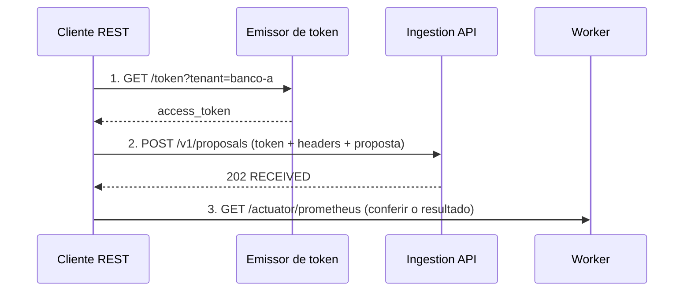

# Manual da API — enviando propostas por um cliente REST

Este manual mostra como enviar propostas para a plataforma usando um cliente REST (Postman, Insomnia, Bruno, `curl` ou PowerShell) no ambiente local. Ele é escrito para quem integra ou testa a API e não precisa conhecer o código.

> Para entender o que acontece com a proposta depois do envio, leia [A jornada de uma proposta](../jornadas/jornada-da-proposta.md).

---

## 1. Antes de começar

O ambiente local precisa estar no ar. Na pasta `applications`, rode no PowerShell:

```powershell
mvn install -DskipTests
.\scripts\local-up.ps1
```

A subida leva alguns minutos. Quando terminar, o script imprime os endereços e a chave do legado simulado.

| Serviço | Endereço | Para que serve |
|---|---|---|
| Emissor de token | `http://127.0.0.1:8082` | gera o token de acesso do parceiro |
| Ingestion API | `http://127.0.0.1:8080` | **onde as propostas são enviadas** |
| Mock legacy | `http://127.0.0.1:8081` | Core Banking simulado (opcional, para conferência) |
| Worker | `http://127.0.0.1:8083` | métricas do processamento |

Para encerrar o ambiente: `.\scripts\local-down.ps1`.

## 2. O fluxo em três chamadas



---

## 3. Passo 1 — Obter o token de acesso

```http
GET http://127.0.0.1:8082/token?tenant=banco-a
```

| Parâmetro | Obrigatório | Descrição |
|---|---|---|
| `tenant` | sim | identificador do parceiro, como `banco-a` |
| `ttl` | não | validade do token em segundos (padrão 3600) |

Resposta:

```json
{ "access_token": "eyJraWQiOi...", "token_type": "Bearer", "expires_in": 3600 }
```

Guarde o valor de `access_token`. Ele vale **apenas para o parceiro informado**: um token de `banco-a` não serve para enviar como `banco-b`.

> No Postman ou Insomnia, salve o token numa variável de ambiente (por exemplo, `{{token}}`) com um script de pós-requisição, para não copiar e colar a cada hora.

## 4. Passo 2 — Enviar a proposta

```http
POST http://127.0.0.1:8080/v1/proposals
Authorization: Bearer {{token}}
X-Tenant-ID: banco-a
Idempotency-Key: 8b0d515e-ee43-48c1-931f-253372e6e583
Content-Type: application/json

{
  "customerCpf": "52998224725",
  "convenioCode": "INSS",
  "isPortability": false,
  "amount": 15000.50,
  "installments": 84
}
```

### Cabeçalhos

| Cabeçalho | Obrigatório | Regra |
|---|---|---|
| `Authorization` | sim | `Bearer` seguido do token do passo 1 |
| `X-Tenant-ID` | sim | o mesmo parceiro do token |
| `Idempotency-Key` | sim | um **UUID** gerado por você, **um por proposta** |
| `Content-Type` | sim | `application/json` |

O `Idempotency-Key` é a identidade da proposta. Reenviar com o mesmo valor **não cria outra proposta**: a plataforma reconhece a repetição. Para uma proposta nova, gere um UUID novo. No Postman, use `{{$guid}}`; no Insomnia, a tag *UUID*; no PowerShell, `[guid]::NewGuid()`.

### Corpo

| Campo | Tipo | Obrigatório | Regra |
|---|---|---|---|
| `customerCpf` | texto | sim | CPF válido, com ou sem pontuação (`52998224725` ou `529.982.247-25`) |
| `convenioCode` | texto | sim | `INSS`, `ESOCIAL_CLT` ou `SIAPE_PUBLICO` |
| `isPortability` | booleano | não | `true` para portabilidade; ausente vale `false` |
| `amount` | número | sim | maior que zero, no máximo 2 casas decimais |
| `installments` | inteiro | sim | de 1 a 120 |

O corpo pode ter no máximo 16 KB.

### Resposta de sucesso — `202 Accepted`

```json
{
  "status": "RECEIVED",
  "idempotencyKey": "8b0d515e-ee43-48c1-931f-253372e6e583",
  "tracingId": "73eadf4d-9cf9-42a0-8ea7-090a17f44a14",
  "receivedAt": 1791565413
}
```

| Campo | Significado |
|---|---|
| `status` | `RECEIVED` na primeira vez; `DUPLICATE_ACCEPTED` quando a mesma chave já tinha sido recebida |
| `idempotencyKey` | a chave que você enviou |
| `tracingId` | código de rastreio; também volta no cabeçalho `X-Trace-ID`. Informe-o ao suporte |
| `receivedAt` | momento do recebimento, em segundos desde 1970 (Unix epoch) |

**`202` significa "recebido e guardado", não "averbado".** A averbação acontece depois, em segundo plano (veja o passo 3).

A resposta nunca devolve o CPF.

## 5. Respostas de erro

Todos os erros vêm no formato `application/problem+json`, sem detalhes internos:

```json
{ "title": "Bad Request", "status": 400, "detail": "Campo invalido: Idempotency-Key", "instance": "/v1/proposals" }
```

| Código | Causa | O que fazer |
|---|---|---|
| `400` | campo ou cabeçalho inválido (o `detail` diz qual) | corrigir e reenviar |
| `401` | token ausente, inválido ou vencido | pedir um token novo (passo 1) |
| `403` | `X-Tenant-ID` diferente do parceiro do token | usar o token do parceiro certo |
| `413` | corpo acima de 16 KB | reduzir o corpo |
| `429` | cota de envios do parceiro excedida | esperar o tempo do cabeçalho `Retry-After` e reenviar |
| `503` | armazenamento indisponível no momento | **reenviar com a mesma `Idempotency-Key`** |

### Por que reenviar com a mesma chave

Um `503` não garante que a proposta deixou de ser gravada. A gravação pode ter terminado logo depois do tempo limite. Isso acontece, por exemplo, na **primeira chamada depois de subir o ambiente**, enquanto os serviços aquecem.

Reenviar com a **mesma** chave é sempre seguro: se a proposta já estava gravada, a resposta é `202 DUPLICATE_ACCEPTED`. Se o reenvio usar uma chave **nova**, a mesma proposta pode ficar registrada duas vezes.

### Cota por parceiro

Cada parceiro pode enviar, por padrão, **100 propostas por segundo**. Acima disso a resposta é `429`. A cota pode ser ajustada por parceiro com a variável `INGESTION_QUOTA_TENANTS_<PARCEIRO>`, por exemplo `INGESTION_QUOTA_TENANTS_BANCO-A=500`.

## 6. Passo 3 — Conferir o resultado

A API de propostas não tem consulta de status nesta PoC. O resultado é conferido pelas métricas, que mostram totais e não propostas individuais:

```http
GET http://127.0.0.1:8083/actuator/prometheus
```

Procure as linhas `worker_proposals`:

```text
worker_proposals{status="CONFIRMED"} 1.0     # averbadas
worker_proposals{status="FAILED"} 0.0        # recusadas pelo Core Banking
worker_proposals{status="PENDING"} 0.0       # aguardando envio
worker_proposals{status="SENT_TO_LEGACY"} 0.0 # enviadas, aguardando resposta
```

No Core Banking simulado, `GET http://127.0.0.1:8081/actuator/prometheus`, linhas `legacy_averbacoes_total`:

```text
legacy_averbacoes_total{kind="unique"} 1.0     # averbações feitas
legacy_averbacoes_total{kind="duplicate"} 0.0  # averbações repetidas: deve ser sempre zero
```

## 7. Roteiros de teste prontos

| Cenário | Como montar | Resultado esperado |
|---|---|---|
| Proposta nova | chave nova | `202 RECEIVED` |
| Repetição (robô insistindo) | reenviar a mesma requisição | `202 DUPLICATE_ACCEPTED`; `legacy_averbacoes_total{kind="duplicate"}` continua 0 |
| Fila prioritária por valor | `amount` acima de 50000 | proposta vai para a fast lane |
| Fila prioritária por portabilidade | `isPortability: true` | proposta vai para a fast lane |
| Parceiro errado | token de `banco-a` com `X-Tenant-ID: banco-b` | `403` |
| Sem token | remover `Authorization` | `401` |
| Chave inválida | `Idempotency-Key: abc` | `400` com `Campo invalido: Idempotency-Key` |
| Convênio inexistente | `convenioCode: "XYZ"` | `400` |
| Parcelas fora do limite | `installments: 121` | `400` |

## 8. Exemplos de linha de comando

### PowerShell

```powershell
$token = (Invoke-RestMethod "http://127.0.0.1:8082/token?tenant=banco-a").access_token
$headers = @{
    Authorization     = "Bearer $token"
    'X-Tenant-ID'     = 'banco-a'
    'Idempotency-Key' = [guid]::NewGuid().ToString()
}
$body = @{
    customerCpf   = '52998224725'
    convenioCode  = 'INSS'
    isPortability = $false
    amount        = 15000.50
    installments  = 84
} | ConvertTo-Json

Invoke-RestMethod -Method Post -Uri http://127.0.0.1:8080/v1/proposals `
    -Headers $headers -ContentType 'application/json' -Body $body
```

### curl (Git Bash)

```bash
TOKEN=$(curl -s "http://127.0.0.1:8082/token?tenant=banco-a" | sed -E 's/.*"access_token":"([^"]+)".*/\1/')
KEY=$(powershell -c "[guid]::NewGuid().ToString()" | tr -d '\r')

curl -i -X POST http://127.0.0.1:8080/v1/proposals \
  -H "Authorization: Bearer $TOKEN" \
  -H "X-Tenant-ID: banco-a" \
  -H "Idempotency-Key: $KEY" \
  -H "Content-Type: application/json" \
  -d '{"customerCpf":"52998224725","convenioCode":"INSS","isPortability":false,"amount":15000.50,"installments":84}'
```

## 9. Swagger UI

No ambiente local, a documentação interativa fica ligada:

- Ingestion API: `http://127.0.0.1:8080/swagger-ui.html`. Clique em **Authorize** e cole o token do passo 1.
- Mock legacy: `http://127.0.0.1:8081/swagger-ui.html`. Use no cabeçalho `X-Api-Key` a chave que o `local-up.ps1` imprime.

O contrato OpenAPI pode ser importado direto no Postman ou no Insomnia a partir de `http://127.0.0.1:8080/v3/api-docs`.

## 10. Chamar o Core Banking simulado diretamente (opcional)

Útil para ver a proteção de capacidade isolada. Em uso normal, quem chama o legado é o Worker.

```http
POST http://127.0.0.1:8081/v1/averbacoes
X-Api-Key: <chave impressa pelo local-up.ps1>
Idempotency-Key: <UUID>
Content-Type: application/json

{ "cpf": "52998224725", "convenio": "INSS", "amount": 15000.50, "installments": 84 }
```

| Código | Significado |
|---|---|
| `200` | averbada; repetições da mesma chave voltam com o cabeçalho `X-Replayed: true` e o mesmo resultado |
| `401` | `X-Api-Key` ausente ou errada |
| `503` | acima de 180 por segundo; esperar o `Retry-After` |

---

## Observações

- Os tokens e as chaves do ambiente local são gerados a cada subida e não valem em nenhum outro ambiente.
- Use apenas CPFs de teste. O CPF dos exemplos (`529.982.247-25`) é um número de teste válido.
