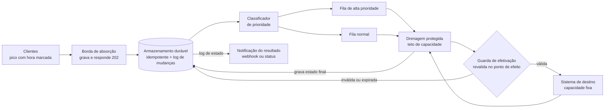

# Pattern: Borda de Absorção com Desacoplamento Temporal

> *Absorbing Edge* ou *Storage-First Ingestion with Protected Drain*
>
> **Status: pattern candidato.** A solução tem uma implementação de referência (este repositório) e usos conhecidos que sustentam partes dela (seção "Usos conhecidos"). Pela regra de três da comunidade de patterns, a combinação completa ainda precisa de três usos independentes documentados para deixar de ser candidata.
>
> **Versão 2 (09/10/2026).** Revisão adversarial registrada em [melhoria-proposta.md](melhoria-proposta.md), seção 0.

Este documento descreve a arquitetura desta PoC como um pattern reutilizável, independente do crédito consignado. Foi escrito para arquitetos e times que enfrentam picos de demanda contra sistemas de capacidade fixa.

Implementação de referência: este repositório. Veja o [README do projeto](../README.md).

---

## Contexto

Um evento com **hora marcada** gera um pico de demanda muito acima da capacidade de um sistema de destino. Esse sistema, em geral um legado, **não pode ser reescrito nem escalado** no prazo ou no custo disponível. O cliente precisa de uma resposta imediata, mas aceita que o resultado final chegue depois.

## Problema

Como aceitar todo o pico:

- **sem derrubar** o sistema de destino;
- **sem perder** nenhuma requisição;
- **sem produzir nenhum efeito duas vezes**?

## Forças

| Força | Tensão |
|---|---|
| Resposta imediata | o cliente exige resposta em milissegundos, mas o destino leva muito mais e aguenta pouco |
| Repetição | clientes automatizados repetem a mesma operação, às vezes **com outra chave**, mas o negócio exige **efeito único** |
| Capacidade escassa | a capacidade do destino é fixa, e nem toda requisição vale o mesmo |
| **Frescor contra absorção** | quanto mais o pico é absorvido, mais tempo a requisição espera; tudo o que foi validado no aceite **envelhece** até o efeito |
| **Prioridade contra equidade** | priorizar por valor maximiza o resultado, mas pode deixar sistematicamente para trás quem vale menos; em setores regulados isso pode conflitar com regras de tratamento justo ao cliente |
| Custo | escalar o destino para o pico custaria muito e ficaria ocioso no resto do tempo |
| Conformidade | duplicidade ou perda geram sanção regulatória ou litígio; decisões precisam ser explicáveis depois |

## Solução

Separar **aceitar** de **efetivar**.

1. **Borda de absorção.** Faz o mínimo para não perder a requisição: autentica, valida o formato, aplica cota por cliente, **grava de forma durável e idempotente** e responde `202 Accepted` com um protocolo e uma estimativa de espera.
2. **Classificação de prioridade.** O log de mudanças do armazenamento alimenta o classificador. Cada requisição recebe uma pontuação pelo valor de negócio e vai para a fila de alta prioridade ou para a fila normal.
3. **Drenagem protegida.** Consome as filas no ritmo que o destino suporta, nunca acima do teto, com piso de capacidade por prioridade.
4. **Guarda de efetivação.** Imediatamente antes de chamar o destino, revalida o que pode ter mudado desde o aceite. Registra a decisão com os insumos que a fundamentaram.
5. **Publicação do resultado.** O estado final é gravado no armazenamento, e o **mesmo log de mudanças** publica o resultado para o cliente.

### Regras que fazem o pattern funcionar

**1. Escrita única + log de mudanças.** A borda faz uma única escrita durável, e tudo o que vem depois é alimentado pelo log de mudanças dessa escrita. Não há dual-write, ou seja, gravar e publicar em dois lugares sem atomicidade. As implementações típicas são:
- armazenamento com stream nativo (por exemplo, DynamoDB Streams);
- banco relacional com Transactional Outbox + CDC (por exemplo, Debezium lendo o WAL).

**2. Idempotência em duas identidades, antes da fila.**
- **Identidade técnica:** a chave enviada pelo cliente, com escopo de cliente/tenant. Captura o retry.
- **Identidade de negócio:** um fingerprint da operação (por exemplo, HMAC dos campos que definem a operação), com janela de validade. Captura a mesma operação reenviada com outra chave.
- A mesma chave técnica com conteúdo diferente é **rejeitada**, não aceita como duplicata.
- As duplicatas morrem no ponto mais barato do caminho. É barato, mas não é de graça: a escrita condicional rejeitada também consome capacidade de escrita.

**3. QoS com piso e empréstimo.** A alta prioridade tem uma fatia mínima garantida da capacidade (70% na PoC), e a fila normal também tem um piso, então nenhuma passa fome. Se uma fila esvazia, a outra usa a sobra.

**4. Revalidar no ponto de efeito.** Tudo o que foi validado no aceite pode ter envelhecido. Uma checagem feita no aceite não enxerga um evento que acontece durante a espera: é o problema clássico de TOCTOU, em que a condição verificada já mudou quando é usada. Por isso a decisão que vale acontece **imediatamente antes do destino**. Requisições inválidas ou fora da validade de negócio terminam em estado final próprio (`REJEITADA`, `EXPIRADA`) sem tocar o destino.

**5. Resultado desconhecido não é falha transitória.**
- Se a falha aconteceu **antes** de a requisição chegar ao destino (conexão recusada, circuito aberto), é seguro repetir.
- Se aconteceu **depois** (timeout de leitura, erro após o envio), o resultado é **desconhecido**. A drenagem **consulta o destino antes de reenviar** e nunca repete às cegas.

**6. Estados finais absorventes, com exclusão entre drenadores.** Uma requisição concluída nunca volta a chamar o destino. A posse de uma requisição em processamento é obtida por lease condicional no armazenamento, com fencing token: um número de versão que impede um drenador que perdeu o lease de gravar resultado.

**7. O resultado sai do log de estado.** A drenagem grava o estado final. A notificação ao cliente (webhook, status) é produzida a partir do log de mudanças, nunca por uma chamada direta da drenagem, porque isso seria um novo dual-write.

**8. Espera anunciada, consulta controlada.**
- O `202` traz o protocolo, uma URL de status e um `Retry-After` estimado a partir do backlog e da taxa de drenagem da fila da requisição.
- O canal preferido é a notificação (push). A consulta de status também tem cota por cliente.
- Sem essa regra, o polling de centenas de milhares de requisições pendentes derruba a camada de leitura, mesmo com a escrita absorvida.

**9. Decisões auditáveis no ponto de efeito.**
- A borda registra o **contexto da intenção**: quando chegou, de quem, sob qual versão de contrato.
- A guarda de efetivação registra a **decisão**: motivo, versão da regra e o snapshot dos insumos.
- Os dois registros formam um envelope de proveniência imutável. O `202` nunca carrega decisão, porque no aceite ela ainda não existe.

**10. Falha transitória não vira erro de negócio.** Com circuit breaker, a drenagem pausa quando o destino está instável. As mensagens voltam à fila com backoff e, depois do limite de tentativas, vão para uma fila de análise (DLQ). Nada é descartado em silêncio.
- **Pausar é parar de retirar da fila.** Com o circuito aberto, a drenagem não consome mensagens. Uma recusa local do circuito não pode contar como tentativa de entrega; senão, uma instabilidade curta esgota as tentativas e leva requisições válidas para a DLQ. Com o circuito semi-aberto, sai uma requisição de prova por vez.

### Contrato mínimo do destino

A garantia de **efeito único** depende do destino oferecer **pelo menos uma** destas capacidades:

- **idempotência por chave:** repetir a chamada com a mesma chave devolve o resultado original; ou
- **consulta por chave:** é possível perguntar se a operação com aquela chave já foi efetivada.

Se o destino não oferece nenhuma das duas, efeito único é **impossível** por construção. O pattern continua entregando absorção e proteção do destino, mas os casos de resultado desconhecido passam para **revisão manual**, com reconciliação periódica. Essa é uma pré-condição a negociar com o dono do destino, não um detalhe de implementação.

### Sinais invariantes

O pattern é operado por estes sinais, independentemente da ferramenta de observabilidade:

| Sinal | Pergunta que responde |
|---|---|
| Idade do backlog (por fila) | quanto tempo espera a requisição mais antiga? |
| Razão entre ingestão e drenagem | o backlog está crescendo ou esvaziando? |
| Tempo do aceite ao efeito | quanto o cliente realmente espera? Esse tempo cabe na validade de negócio? |
| Taxa de duplicatas por identidade | quanto as identidades técnica e de negócio estão absorvendo? |
| Aderência ao teto | o pico por janela ficou abaixo da capacidade do destino? |
| Resultados desconhecidos e revisões manuais | quantas vezes a garantia de efeito único dependeu de consulta ou de pessoas? |

## Variantes

| Variante | Quando usar | Cuidado |
|---|---|---|
| **Log nativo ou Outbox + CDC** (regra 1) | conforme o armazenamento da borda | no CDC por WAL, acúmulo de log se o leitor parar |
| **Guarda de ingestão** (rejeição antecipada na borda) | para recusar no clique casos já conhecidos (cliente bloqueado) e poupar capacidade | é heurística e **falha aberta** (deixa passar se não conseguir checar); nunca substitui a guarda de efetivação |
| **Drenador único com standby** | quando o teto do destino cabe em uma instância | failover de alguns segundos |
| **Drenadores concorrentes com orçamento distribuído** | quando o teto exige várias instâncias | coordenação do orçamento entre instâncias |
| **Teto fixo ou adaptativo** | adaptativo quando a capacidade real do destino varia | o teto fixo continua como limite rígido |
| **Mais de dois níveis de prioridade** | quando há mais de duas classes de valor | pisos que somam 100% e regra de empréstimo explícita |

## Consequências

### Ganhos

- **Disponibilidade no pico:** a borda continua respondendo enquanto o destino trabalha no próprio ritmo.
- **Efeito único:** idempotência na entrada, exclusão na drenagem e consulta antes do reenvio, desde que o contrato mínimo do destino seja atendido.
- **Destino protegido:** fluxo estável, sem sobressalto.
- **Valor primeiro, sem fome:** a capacidade escassa vai para o que mais importa, com piso para o resto.
- **Decisões explicáveis:** cada efetivação ou recusa tem motivo e insumos registrados.

### Custos

- **Consistência eventual.** "Recebido" chega antes de "concluído". O cliente precisa aceitar um protocolo, e o resultado final vem depois.
- **Envelhecimento.** O aceite não garante o efeito. Parte das requisições aceitas termina recusada ou expirada na revalidação, e o cliente precisa ser avisado disso.
- **Backlog a operar.** É preciso medir a fila e o tempo para esvaziá-la, e anunciar a espera.
- **Canal de resultado.** É preciso uma consulta de status com cota ou uma notificação ativa. Sem isso, o polling vira um segundo pico.
- **Mais componentes.** Armazenamento, log, filas, classificador e drenagem exigem observabilidade e operação próprias.
- **Chave e identidade obrigatórias.** O cliente precisa gerar uma chave estável por operação, e o negócio precisa definir o que é "a mesma operação".

## Quando não usar

- **O cliente precisa da resposta final de forma síncrona,** por exemplo uma autorização de pagamento no caixa.
- **O backlog acumulado não cabe na janela de negócio.** Se o tempo do aceite ao efeito passa da validade da operação, o problema é de capacidade e não de absorção.
- **O destino já escala horizontalmente** a um custo aceitável.
- **O pico não é previsível nem relevante.** O custo de operar o pattern não se paga.
- **Efeito único é inegociável e o destino não atende o contrato mínimo.** Sem idempotência nem consulta, resolva o contrato antes.

## Patterns irmãos

**Sala de Espera Virtual** (*Virtual Waiting Room*) resolve o mesmo problema por outro caminho. Ela **segura o cliente antes de aceitar**, admitindo-o no ritmo do destino. A Borda de Absorção **aceita e guarda primeiro**, e drena depois.

| | Sala de Espera Virtual | Borda de Absorção |
|---|---|---|
| O que o cliente recebe no pico | uma posição na fila, sem compromisso | um protocolo: a requisição está guardada |
| Onde fica o estado de espera | na sessão do cliente | no armazenamento durável |
| Bom para | interação humana em navegador (ingressos, flash sales) | integrações máquina a máquina e robôs |
| Idempotência | menos crítica: o cliente ainda não enviou a operação | central: a operação já foi enviada |

**Strangler Fig não é este pattern.** O Strangler Fig redireciona rotas de um sistema antigo para um novo até desativá-lo. A Borda de Absorção pode ser um passo dentro de uma migração Strangler, mas resolve um problema diferente.

## Onde o mesmo problema aparece

Todos os casos abaixo têm pico com hora marcada e destino com capacidade fixa:

- **Crédito consignado,** na virada de folha (caso desta PoC)
- **Varejo,** na Black Friday e em flash sales
- **Eventos,** na abertura da venda de ingressos
- **Governo,** no último dia da declaração do Imposto de Renda e nas inscrições do Enem e do Sisu
- **Programas sociais,** na liberação de benefícios

## Usos conhecidos

| Uso | O que sustenta | O que não sustenta |
|---|---|---|
| **SeatGeek**, sala de espera virtual com DynamoDB + Lambda ([AWS Architecture Blog](https://aws.amazon.com/blogs/architecture/build-a-virtual-waiting-room-with-amazon-dynamodb-and-aws-lambda-at-seatgeek/)), depois generalizada na solução de referência [Virtual Waiting Room on AWS](https://docs.aws.amazon.com/solutions/latest/aws-virtual-waiting-room/welcome.html) | problema (pico com hora marcada) e drenagem protegida | aceite durável antes da fila (é o pattern irmão) |
| **Shopify**, proteção do checkout em flash sales ([parte I](https://shopify.engineering/surviving-flashes-of-high-write-traffic-using-scriptable-load-balancers-part-i), [parte II](https://shopify.engineering/surviving-flashes-of-high-write-traffic-using-scriptable-load-balancers-part-ii)) e fila justa em alto throughput ([Strange Loop 2022](https://thestrangeloop.com/2022/a-commerce-centric-approach-to-queuing-fairly-at-high-throughput.html)) | problema, teto de capacidade e a força prioridade contra equidade | aceite durável antes da fila |
| **Implementação de referência** (este repositório) | a combinação completa | ainda não é um uso em produção |

**Pendência:** encontrar usos documentados de *aceite durável + drenagem protegida* em produção (por exemplo, órgãos públicos em prazos de declaração ou bancos em janelas de originação) para cumprir a regra de três.

## Patterns que o compõem

| Pattern | Papel na composição | Catálogo |
|---|---|---|
| Queue-Based Load Leveling | a fila absorve o pico e o destino recebe ritmo constante | [Azure Architecture Center](https://learn.microsoft.com/en-us/azure/architecture/patterns/queue-based-load-leveling) |
| Asynchronous Request-Reply | `202` com protocolo e resultado posterior | [Azure Architecture Center](https://learn.microsoft.com/en-us/azure/architecture/patterns/async-request-reply) |
| Storage-First API | gravar antes de processar | AWS Serverless Patterns |
| Idempotent Receiver | repetições sem efeito duplicado | Enterprise Integration Patterns |
| Priority Queue | separação por valor de negócio | [Azure Architecture Center](https://learn.microsoft.com/en-us/azure/architecture/patterns/priority-queue) |
| Competing Consumers | drenagem paralela das filas | Enterprise Integration Patterns |
| Throttling / Rate Limiting | teto de capacidade do destino | Azure Architecture Center |
| Circuit Breaker | pausa quando o destino falha | Release It! (Nygard) |
| Transactional Outbox / CDC | escrita única com log de mudanças (regra 1) | microservices.io |
| Dead Letter Channel | falhas persistentes isoladas para análise | Enterprise Integration Patterns |

**O que este pattern acrescenta** é a combinação e quatro regras que não aparecem prontas nos catálogos:
- idempotência em duas identidades antes da fila;
- QoS com piso e empréstimo;
- revalidação no ponto de efeito;
- o contrato mínimo do destino para efeito único.

## Mapeamento na implementação de referência

| Elemento do pattern | Nesta PoC | Situação |
|---|---|---|
| Borda de absorção | [ingestion-api](../applications/ingestion-api/README.md) | implementado |
| Armazenamento + log de mudanças | DynamoDB (DurableInbox) + DynamoDB Streams | implementado |
| Idempotência técnica | escrita condicional `attribute_not_exists` | implementado; falta escopo por tenant e rejeição de conteúdo divergente (M1) |
| Idempotência de negócio | fingerprint HMAC em transação | proposto (M1) |
| Classificador de prioridade | [dispatcher-lambda](../applications/dispatcher-lambda/README.md) | implementado |
| Filas | SQS fast lane e standard lane | implementado |
| Drenagem protegida | [worker](../applications/worker/README.md) | implementado; teto estático por instância (M4) |
| Pausa com circuito aberto (regra 10) | back-pressure no laço de despacho (`LegacyAvailabilityPort`) | implementado em 09/10/2026; antes, o circuito aberto levava requisições válidas à DLQ |
| Exclusão entre drenadores | lease condicional no DynamoDB | proposto (M3) |
| Resultado desconhecido | estado `UNKNOWN` + consulta ao destino | proposto (M2) |
| Guarda de efetivação e auditoria | `EligibilityPort` antes do legado | proposto (M5) |
| Espera anunciada e resultado pelo log | `Retry-After`, status com cota, notificação via Streams | proposto (M9) |
| Sistema de destino | [mock-legacy](../applications/mock-legacy/README.md), 180 TPS | implementado; falta o modo adversarial (M2) |

Os itens M1–M9 estão descritos em [melhoria-proposta.md](melhoria-proposta.md).

Números da PoC: 10.000 req/s na borda, p95 do `202` abaixo de 100 ms, 180 TPS no destino e QoS 70/30. São **metas** até a publicação das evidências de carga.

## Caminho para torná-lo reutilizável

1. **Separar o genérico do negócio.** O consignado entra como plugin de três peças:
   - o **score de prioridade** (hoje: parceiro VIP, valor e portabilidade);
   - o **contrato do payload e a identidade de negócio** (CPF, convênio, valor e parcelas);
   - as **regras da guarda de efetivação** (validade e restrições).

   Borda, armazenamento, filas e drenagem viram plataforma.
2. **Manter este documento** com as variantes conforme forem surgindo.
3. **Publicar a evidência.** Os números do teste de carga entram como prova do pattern.
4. **Cumprir a regra de três** e então retirar o status de candidato.

## Referências

- Microsoft. [Queue-Based Load Leveling pattern](https://learn.microsoft.com/en-us/azure/architecture/patterns/queue-based-load-leveling), [Asynchronous Request-Reply pattern](https://learn.microsoft.com/en-us/azure/architecture/patterns/async-request-reply), [Priority Queue pattern](https://learn.microsoft.com/en-us/azure/architecture/patterns/priority-queue). Azure Architecture Center.
- IETF HTTPAPI WG. [The Idempotency-Key HTTP Header Field](https://datatracker.ietf.org/doc/draft-ietf-httpapi-idempotency-key-header/) (Internet-Draft).
- Leach, Brandur. [Implementing Stripe-like Idempotency Keys in Postgres](https://brandur.org/idempotency-keys).
- AWS. [Build a virtual waiting room with Amazon DynamoDB and AWS Lambda at SeatGeek](https://aws.amazon.com/blogs/architecture/build-a-virtual-waiting-room-with-amazon-dynamodb-and-aws-lambda-at-seatgeek/); [Virtual Waiting Room on AWS](https://docs.aws.amazon.com/solutions/latest/aws-virtual-waiting-room/welcome.html).
- Shopify Engineering. [Surviving Flashes of High-Write Traffic Using Scriptable Load Balancers, parte I](https://shopify.engineering/surviving-flashes-of-high-write-traffic-using-scriptable-load-balancers-part-i) e [parte II](https://shopify.engineering/surviving-flashes-of-high-write-traffic-using-scriptable-load-balancers-part-ii).
- Strange Loop 2022. [A Commerce-Centric Approach to Queuing Fairly at High Throughput](https://thestrangeloop.com/2022/a-commerce-centric-approach-to-queuing-fairly-at-high-throughput.html).
- Hohpe, G.; Woolf, B. *Enterprise Integration Patterns*. Addison-Wesley, 2003.
- Nygard, M. *Release It!*. Pragmatic Bookshelf, 2ª ed., 2018.
