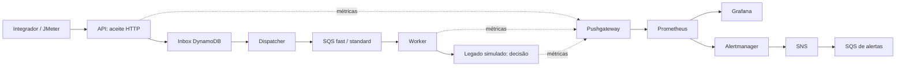

# SRE da PoC de consignado

Revisão: 17/10/2026. Este guia reúne a observabilidade existente, os dashboards Grafana versionados e o contrato inicial de confiabilidade. O inventário foi conferido no repositório; não é uma verificação do estado atual da EC2.

O [plano de implementação](plano-implementacao.md) transforma a [avaliação do brainstorming](../brainstorming/SRE/rascunho-plano-evolucao-sre-sli-slo-sla.md) em entregas incrementais. As metas abaixo são candidatas a validação na PoC, sem SLA externo estabelecido.

Primeiro incremento técnico: [contrato v1](contrato-medicao.md), [relatório](relatorio-local.md) e [captura automática local](captura-local.md) de JTL/Inbox/worker, habilitada explicitamente para experimentos controlados. O relatório distingue cobertura incompleta, atraso e proposta presa. Projeção persistida e operação contínua permanecem pendentes.

## Documentação de SRE

| Documento | O que encontrar |
|---|---|
| [Fechamento da PoC](fechamento-poc-sre-observabilidade.md) | Conclusão formal, entregas, evidências, limites e backlog para evolução. |
| [Artigo v2: O seu SRE mostra o quê?](artigo-o-seu-sre-mostra-o-que-v2.md) | Versão atual para publicação: jornada, proteção do negócio, resultados e limites das evidências. |
| [README de alertas](alertas/README.md) | Catálogo, condições de disparo, fluxo SNS/SQS, investigação, validação e evidências. |
| [Plano AI-DLC: falha e recuperação](../../aidlc-docs/inception/sre-resilience/plans/execution-plan.md) | R0 validado, L1 executado; próximos cenários: timeout, circuito, DLQ, carga progressiva e resposta a incidente. |
| [Preparação de falhas do legado — R0](preparacao-falhas-legado.md) | Controle local com prazo, autenticação, restauração sem reinício e manifest sanitizado. |
| [Exercício L1 de falha do legado](exercicio-falha-legado-l1.md) | Cinco propostas recuperadas, retry 503→200 no Jaeger, filas vazias e limites da amostra. |
| [Ensaio L3 de circuit breaker](exercicio-circuit-breaker-l3.md) | Proteção, sondagem automática, recuperação local e lacuna do alerta OPEN/HALF_OPEN. |
| [Exercício L2 de timeout](exercicio-falha-legado-l2.md) | Hipótese de commit tardio, tentativa não comprovada e repetição controlada; conferir o estado no relato. |
| [Roteiro da apresentação](apresentacao/README.md) | Preparação, falas, telas, comandos, resultados esperados e encerramento da demonstração. |
| [Exercício real de falha do worker](exercicio-falha-worker.md) | Evidências da pausa controlada, alerta real, SNS, recuperação das dez propostas e traces. |
| [Plano de implementação](plano-implementacao.md) | Incrementos, dependências, estado das entregas e critérios de validação. |
| [Contrato de medição](contrato-medicao.md) | Definições dos SLIs A/B/C, elegibilidade, identidade, janelas, prazos e cobertura. |
| [Captura local](captura-local.md) | Integração JMeter/Inbox/worker, controles de sessão e coleta das evidências. |
| [Relatório local](relatorio-local.md) | Execução do avaliador, publicação explícita e totais de negócio conciliados por experimento. |

Guias complementares:

| Documento | O que encontrar |
|---|---|
| [Dashboards Grafana](../../applications/observability/grafana/dashboards/README.md) | Painéis versionados, tags, consultas, filtros, precisão e cores. |
| [Alertas e runbooks](../../infrastructure/Configuration/observability/ALERTAS.md) | Sete regras, diagnóstico, rota SNS/SQS e teste controlado de notificações. |
| [Tracing local](../manuais/tracing-local.md) | Instrumentação, propagação W3C e jornadas verificadas no Jaeger. |
| [Diagnóstico de tracing](../../infrastructure/Configuration/observability/TRACING_TROUBLESHOOTING.md) | Verificação do backend, exportação OTLP e investigação de falhas de tracing. |

## Jornada e ferramentas

Na topologia versionada, as aplicações locais enviam métricas ao Pushgateway e o Prometheus coleta o gateway. Os serviços também expõem `/actuator/prometheus`, que permite coleta direta quando configurada e alcançável. Logs estruturados e traces complementam a investigação.

| Ferramenta/componente | Papel | Fonte de configuração ou guia |
|---|---|---|
| Micrometer / Actuator | Contadores, histogramas e gauges dos serviços Java. | [Starter da plataforma](../../applications/platform-starter/README.md). |
| Pushgateway | Transporte das métricas da aplicação local para a stack de observabilidade. | [Ambiente local](../manuais/ambiente-local.md). |
| Prometheus | Coleta, histórico, consultas e avaliação das regras. | [Configuração](../../infrastructure/Configuration/observability/config/prometheus/prometheus.yml). |
| Grafana | Painéis de negócio e diagnóstico. | [Dashboards e provisionamento](../../applications/observability/grafana/dashboards/README.md). |
| Alertmanager → SNS → SQS | Agrupamento e entrega de alertas e recuperações. | [Runbooks e integração](../../infrastructure/Configuration/observability/ALERTAS.md). |
| OpenTelemetry / Jaeger | Contexto W3C, spans e investigação distribuída. | [Tracing local](../manuais/tracing-local.md). |
| JMeter | Carga e observação da experiência HTTP do cliente. | [Plano versionado](../../jMetter/consignado/Thread%20Group.jmx) e [iniciador Java 21](../../jMetter/consignado/abrir-jmeter-java21.cmd). |

HTTP 202 representa aceite, não confirmação financeira. `CONFIRMED` nesta PoC representa resposta do legado simulado, sem comprovar averbação em órgão pagador real.

## Dashboards criados no Grafana

Os seis arquivos abaixo são a fonte versionada dos painéis. Foram sincronizados na EC2 em 17/10/2026, incluindo os dois novos painéis SRE; carregamento, datasource e 108 consultas foram validados via API. Acessar o Grafana do ambiente na porta 3000 e procurar pelo título. O endereço público pode mudar após iniciar a EC2; não fixar o IP neste guia. Nenhum acesso ou credencial é armazenado aqui.

| Dashboard | JSON / UID | Gráficos e indicadores |
|---|---|---|
| **Consignado - Saude da Ingestao** | [ingestion-health.json](../../applications/observability/grafana/dashboards/ingestion-health.json) · `consignado-ingestion-health` | Requisições/s, p50/p95/p99, aceites por resultado, 429/503, erros 5xx, novas propostas, valor recebido/s, heap e GC. |
| **Consignado - Protecao Downstream** | [downstream-protection.json](../../applications/observability/grafana/dashboards/downstream-protection.json) · `consignado-downstream-protection` | Vazão e pico no legado, referência de 180 TPS, despachos por lane, chamadas por resultado, latência, circuito, in-flight, respostas e replays idempotentes. |
| **Consignado - Backlog e Drenagem** | [backlog-drain.json](../../applications/observability/grafana/dashboards/backlog-drain.json) · `consignado-backlog-drain` | Profundidade por lane, chegada versus processamento, drenagem estimada, estados, resultados, tempo dos finalizados, valor finalizado/s e primeira passagem. |
| **Consignado - Negocio** | [business-overview.json](../../applications/observability/grafana/dashboards/business-overview.json) · `consignado-business-overview` | Novas propostas, confirmações/rejeições, valores, tickets médios, taxa de confirmação dos finalizados, fluxo por segundo, resultado por convênio e valor por lane. |
| **Consignado - SRE - Operacao** | [sre-overview.json](../../applications/observability/grafana/dashboards/sre-overview.json) · `consignado-sre-overview` | HTTP observado, percentis, frescor, filas, finalizados, circuito, concorrência e proteção do legado. |
| **Consignado - SRE - Experimentos** | [sre-experiments.json](../../applications/observability/grafana/dashboards/sre-experiments.json) · `consignado-sre-experiments` | Resultado e cobertura, SLIs A/B/C, metas, bons/ruins, orçamento e pendências; quantidades, valores e tickets conciliados da execução, com janela e corte explícitos. |

O caminho estável de navegação é `/d/<UID>` dentro do Grafana. Os JSON usam o datasource `prometheus`. Negócio possui filtros `env`, `instance`, `convenio` e `portability`; os três painéis originais de diagnóstico têm somente `instance`. Os dois novos painéis SRE possuem ambiente/instância; o de experimentos seleciona uma origem por vez para não combinar relatórios diferentes.

### Como interpretar os gráficos

- **Recebido:** somente proposta nova aceita. Duplicata aceita não acrescenta outro valor ou outra proposta nova.
- **Confirmado/rejeitado:** resultado terminal observado no processamento; entrada e finalização podem cair em períodos diferentes.
- **Taxa de confirmação:** confirmados divididos pelos finalizados; não é disponibilidade técnica nem conversão de toda a coorte recebida.
- **Ticket:** valor dividido por quantidade da respectiva população. Diferença entre tickets não comprova perda de propostas.
- **Laranja no negócio:** confirmado menor que recebido na comparação do período, com a precisão exibida. Rejeições e mistura de coortes também produzem essa diferença.
- **70/30:** piso de serviço quando ambas as lanes têm trabalho. Empréstimo de capacidade quando uma fica vazia é comportamento previsto.
- **Drenagem:** `Q / μ`, estimativa sem novas chegadas. Não é idade de mensagem, prazo individual ou acordo contratual.
- **Tempo até decisão:** o painel de backlog foi atualizado na EC2 em 17/10/2026 para explicitar que usa somente propostas finalizadas, nos buckets de 30/60/300 s. Não mede o SLO ponta a ponta nem as propostas presas.
- **Duplicatas no legado:** o contador do mock registra replays que recuperam o resultado existente. Replay não significa necessariamente segundo efeito financeiro.

As quantidades calculadas com `increase()` são estimativas entre coletas, com tratamento de resets por série. Os valores operacionais não substituem a conciliação por registros de negócio. A [documentação dos dashboards](../../applications/observability/grafana/dashboards/README.md) detalha filtros, fórmulas, duas casas decimais e cores.

## Catálogo das métricas atuais

Nomes abaixo são as séries usadas nas consultas versionadas ou os nomes esperados pela instrumentação encontrada. A exposição no ambiente precisa ser conferida ao validar cada entrega; não houve consulta à stack nesta revisão.

| Família / série | O que mede | Uso e cuidado |
|---|---|---|
| `http_server_requests_seconds_count`, `_bucket`, `_sum` | Tráfego e duração HTTP. | Usar método/rota/ambiente coerentes. Não observa falha antes de chegar ao servidor. |
| `ingestion_accepted_total{outcome}` | Aceites novos ou recuperados por idempotência. | `received` e `duplicate_accepted` não são o rótulo HTTP `outcome`. |
| `ingestion_deduplicated_total{kind}` | Duplicação detectada, técnica ou semântica. | Não informa quantas duplicatas escaparam. Semântica depende da ativação da v2. |
| `ingestion_idempotency_mismatch_total` | Conflito entre chave e conteúdo. | Separar de rejeição comercial e falha transitória. |
| `ingestion_throttled_tenant_total` | Proteção de cota por tenant permitido na política de tags. | 429 dentro da cota acordada não pode ser excluído silenciosamente de um futuro SLI. |
| `business_vgv_received_brl_count`, `_sum` | Quantidade e valor das novas propostas aceitas. | Não somar recebido com confirmado: são etapas da mesma operação. |
| `business_vgv_brl_count`, `_sum` com `outcome` | Quantidade e valor finalizados como `confirmed` ou `rejected`. | Fluxo temporal, não saldo exato de pendências da coorte. |
| `business_time_to_settle_seconds_bucket`, `_count`, `_sum` | Tempo do aceite original à decisão observada, por lane. | Somente finalizados; buckets configurados: 30, 60, 300, 900 e 1800 s. |
| `business_first_pass_total{result}` | Confirmados em primeira tentativa ou após retries. | Denominador atual é de confirmados, não de todas as entradas. |
| `worker_dispatched_total`, `worker_processed_total`, `worker_processing_failed_total` | Despachos, resultados e falhas de processamento. | Contam tentativas/mensagens; não representam sempre propostas canônicas únicas. |
| `worker_proposals{status}` | Estado das propostas conhecidas pelo worker. | Repositório atual em memória; não cobre automaticamente Inbox ainda não despachada. |
| `worker_queue_depth` | Profundidade amostrada por lane. | Pode representar a mesma fila vista por várias réplicas; não somar cegamente. |
| `worker_arrival_rate`, `worker_processing_rate`, `net_backlog_growth` | Estimativas de chegada, saída e crescimento. | Derivadas de amostras; saída observada pode incluir reentrega já terminal. |
| `effective_drain_time_seconds` | Profundidade dividida por taxa de processamento. | Pode ser infinita com backlog e saída zero; não prevê novas chegadas. |
| `worker_in_flight`, `worker_in_flight_max` | Concorrência ocupada e limite. | Saturação explica gargalos; não é um SLO de usuário isoladamente. |
| `worker_legacy_circuit_state` | Estado do circuito: 0 fechado, 1 semiaberto, 2 aberto. | Codificação própria do projeto. |
| `worker_legacy_call_seconds_*` | Duração/quantidade de chamadas ao legado. | Inclui tentativas, não apenas operações únicas. |
| `legacy_request_throughput`, `legacy_peak_window` | Janela atual e pico do gate do mock legado. | Medem admissão no gate durante a vida do processo; observar também tentativas rejeitadas. |
| `legacy_requests_total{outcome}`, `legacy_averbacoes_total{kind}` | Resultado no destino e registro único/replay. | Distinguir capacidade excedida, caos e replay idempotente. |
| `legacy_request_latency_seconds_*` | Latência interna do mock legado. | Complementa a latência observada pelo worker. |
| `up`, `push_time_seconds` | Sucesso de coleta e frescor do último envio. | Gateway acessível não prova aplicação viva; séries persistem após parada. |
| `jvm_memory_used_bytes`, `jvm_gc_pause_seconds_*` | Memória e GC. | Diagnóstico e capacidade. |

Os quatro sinais operacionais estão representados: **tráfego, latência, erros e saturação**. A evolução concentra-se em completar a visão da jornada, evitando acrescentar métricas sem uma decisão que dependa delas.

## SLIs, SLOs e SLA

O [contrato v1](contrato-medicao.md) define precisamente a medição offline. A tabela abaixo resume os objetivos; a projeção operacional no Prometheus permanece pendente.

SLI é o indicador medido; SLO é a meta para população e janela definidas; SLA é o compromisso externo com consequências pelo descumprimento. Nesta PoC há métricas e hipóteses de SLO; não há evidência de SLA externo acordado. [Referência: Google SRE](https://sre.google/sre-book/service-level-objectives/).

| Indicador proposto | Eventos bons / elegíveis | Meta candidata | Estado da medição |
|---|---|---|---|
| **A — aceite correto** | Tentativas elegíveis com 202 recebido e aceite íntegro / tentativas elegíveis. Duplicata recuperada corretamente é boa. | 99,9% por experimento declarado. | Relatório local reconcilia JTL e Inbox; projeção contínua pendente. |
| **B — aceite rápido** | Tentativas elegíveis com aceite correto e duração até o limite / tentativas elegíveis. | 95% até 100 ms e 99% até 200 ms. | Relatório usa duração/elegibilidade do cliente; histogramas operacionais e buckets explícitos pendentes. |
| **C — decisão no prazo** | Propostas únicas com decisão correta até o vencimento / propostas únicas cujo prazo venceu na janela. | Hipóteses: fast 95% até 2 min; standard 90% até 45 min, conforme envelope viável. | Captura local concilia snapshot do worker e pendências; falta projeção persistida e avaliador contínuo. |

Decisão correta pode ser confirmação ou rejeição comercial válida. Falha técnica, DLQ e pendência vencida são ruins no SLI C. Resultado tardio resolve a pendência sem apagar a violação do prazo original.

Chamadas inválidas, sem autenticação válida ou acima da cota só podem ser excluídas segundo contrato explícito. Falhas de dependência não deixam de ser impacto para o usuário. Testes sintéticos ficam identificados e separados do tráfego real.

**Janela inicial:** execução da PoC, seguida de observação até vencer o último prazo. Sem demanda é “sem eventos elegíveis”; coleta incompleta é “medição incompleta”. Não preencher nenhuma dessas situações com 100%.

**Viabilidade:** 10.000 propostas novas/s por cinco minutos somam três milhões. A 180 conclusões/s, o mínimo ideal é aproximadamente 4h38 desde o início. Logo, as metas de 2/45 min não estão aprovadas para essa carga; é necessário declarar duplicatas, mistura de lanes, duração do pico e retries.

**Orçamento por eventos:** `N × (1 − SLO)`. Consumo: `eventos ruins / orçamento`. Uma meta de 99,9% sobre um milhão de chamadas permite mil ruins. Orçamento de disponibilidade não autoriza efeito financeiro duplicado: integridade é um critério separado de aprovação.

Uma futura janela móvel de 30 dias exige coleta contínua e retenção compatível; o Compose hoje define 15 dias por padrão. Não declarar disponibilidade mensal a partir de um teste curto.

## Alertas existentes e resposta

As regras atuais são estáticas, não alertas por consumo de orçamento de erro. Definições e comandos de validação permanecem no [manual de alertas](../../infrastructure/Configuration/observability/ALERTAS.md).

| Alerta | Sinal principal | Limitação relevante |
|---|---|---|
| `ConsignadoScrapeDown` | Alvo com coleta indisponível. | Não detecta a perda total do próprio Prometheus/host sem observador externo. |
| `ConsignadoPushMissing` | Push ausente ou envelhecido. | Inventário por job não cobre toda réplica que nunca enviou métricas. |
| `ConsignadoIngestionErrors` | Mais de 5% de 5xx, com piso de 100 chamadas/5 min. | Pouco tráfego pode não disparar. |
| `ConsignadoIngestionLatency` | p95 acima de 500 ms, com piso de tráfego. | Limiar de alerta não equivale à meta candidata de 100 ms. |
| `ConsignadoWorkerStalled` | Fila com saída zero. | Amostras aproximadas, sem visão completa de pendências na Inbox. |
| `ConsignadoBacklogDelayed` | Drenagem estimada acima do limiar. | Não mede prazo individual vencido. |
| `ConsignadoLegacyUnavailable` | Circuito aberto com trabalho pendente. | Diagnóstico de dependência, não taxa ponta a ponta. |

O caminho é **Alertmanager → SNS → SQS**, sem Lambda nessa rota. O consumidor da fila, reconhecimento humano e escalonamento ainda precisam de definição e validação. Entrega em SQS não é atendimento do incidente.

Silêncios planejados afetam notificações, não o resultado medido do serviço. Nunca limpar métricas, purgar fila ou excluir intervalos ruins para demonstrar cumprimento de objetivo.

O [exercício real de falha do worker](exercicio-falha-worker.md), em 17/10/2026, verificou o
alerta de ausência de push, disparo e recuperação até o SNS, dez propostas confirmadas após
retomar o consumidor e dez jornadas completas no Jaeger. A pausa preservou o processo; não
comprova recuperação após reinício. O documento registra artefatos e estado do encerramento.

## Logs, traces e privacidade

Logs usam JSON/ECS e correlação no starter. Manter eventos técnicos úteis, sem payloads, CPF, tokens ou segredos. Mascaramento não substitui minimização nem validação de retenção e acesso. A centralização de logs deve ter necessidade e procedimento explícitos.

Tracing W3C está implementado na jornada API → Inbox → dispatcher → SQS → worker → legado. Em 17/10/2026, uma jornada real com dispatcher local foi verificada no Jaeger: 13 spans, quatro serviços e duas tentativas do worker, com erro inicial no cliente do legado e HTTP 200 na tentativa seguinte. O [guia local](../manuais/tracing-local.md) registra o trace ID, vínculos, tempos e limites; o [roteiro de Jaeger](../../infrastructure/Configuration/observability/TRACING_TROUBLESHOOTING.md) orienta os próximos exercícios controlados e a validação do runtime AWS.

`tracingId`/`X-Trace-ID` de aceitação são independentes do trace OpenTelemetry. Não derivar identidade comercial de trace ID. Traces amostrados servem para diagnóstico, não para totalizar o denominador do SLI. IDs e fingerprints não devem virar labels do Prometheus.

## Como manter este guia

Ao alterar uma métrica, atualizar sua instrumentação, consultas afetadas e catálogo. Ao alterar uma regra ou painel, validar o arquivo e registrar a evidência do teste. Atualizar o estado de um SLO somente quando sua população, medição e resultado tiverem evidências reproduzíveis.

Usar o [plano de implementação](plano-implementacao.md) para acompanhar entregas e o [estado atual](../estado-atual.md) para evidências gerais. A crítica detalhada permanece no brainstorming; este README é o ponto de entrada de SRE.

## Obstáculos e pendências

- Metas e envelope de tráfego ainda precisam de validação; não há SLA externo estabelecido.
- Estado terminal do worker e ledger do mock possuem limitações de persistência; o processo local de DynamoDB também usa memória.
- A captura local não substitui acompanhamento durável de pendências, avaliação contínua por vencimento e cobertura operacional do avaliador.
- As consultas de três dashboards ainda precisam de isolamento por ambiente; o painel de tempo dos finalizados não é um SLO completo.
- Os novos painéis SRE e a correção de backlog aguardam sincronização e validação no Grafana. O painel de experimentos depende de publicação explícita; capturar localmente não envia resultados.
- Retenção de 15 dias, stack única e operação intermitente não sustentam uma alegação mensal contínua sem mudanças.
- Exportação de traces no Jaeger e atendimento dos alertas entregues em SQS ainda precisam de validação.
