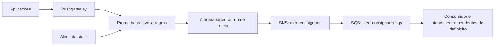

# Alertas da PoC de consignado

Revisão: 18/10/2026. Este guia explica os alertas versionados, como as notificações chegam ao destino e quais evidências já existem. O ambiente está desligado após a pausa dos testes; este documento não representa uma consulta ao estado atual da stack.

O objetivo é detectar perda de observabilidade, falhas na entrada e interrupções no processamento de propostas, oferecendo contexto para investigação. Os limites são iniciais da PoC: não constituem SLA nem alertas por consumo de orçamento de erro.

## Como funciona



O Prometheus identifica a condição. O Alertmanager controla agrupamento, repetições, inibições e silêncios, publicando no SNS pelo receiver nativo. O SNS encaminha à fila por assinatura. Não há Lambda nessa rota de alertas SRE.

- **SNS:** `arn:aws:sns:sa-east-1:247755251743:alert-consignado`.
- **SQS:** `arn:aws:sqs:sa-east-1:247755251743:alert-consignado-sqs`.
- **Autenticação SNS:** credenciais temporárias do Instance Profile da EC2, com permissão `sns:Publish` no tópico.

Os sete alertas usam `notification=sre`. Eles não acionam o orquestrador de self-healing, cuja rota é separada. A rota padrão `blackhole` descarta notificações que não correspondem às rotas configuradas. Receber uma mensagem na fila ainda exige um consumidor, um responsável e um procedimento de resposta.

## Quais alertas temos

As condições abaixo resumem a [fonte das sete regras](../../../infrastructure/Configuration/observability/config/prometheus/rules/consignado-sre.yml). A coluna de persistência corresponde ao `for`: a expressão precisa continuar verdadeira durante esse período.

| Alerta | O que significa / condição | Persistência | Severidade | Primeira ação |
|---|---|---|---|---|
| `ConsignadoScrapeDown` | Um alvo monitorado da stack apresenta `up=0`. | 2 min | critical | Consultar `/targets`, erro de coleta, rede e logs do alvo. |
| `ConsignadoPushMissing` | Último push acima de 120 s ou ausência de um dos jobs esperados: API, worker e mock legado; exige Pushgateway acessível. | 1 min | critical | Conferir processo Java, exportador e conexão com o Pushgateway. |
| `ConsignadoIngestionErrors` | Mais de 5% de 5xx em 5 min, com pelo menos 100 POSTs nessa janela. | 5 min | critical | Investigar DynamoDB/Inbox, timeouts e traces de aceite. |
| `ConsignadoIngestionLatency` | p95 acima de 500 ms em 5 min, com pelo menos 100 POSTs nessa janela. | 10 min | warning | Investigar banco, aquecimento e saturação da máquina. |
| `ConsignadoWorkerStalled` | Há fila pendente e a taxa amostrada de processamento é zero. | 5 min | critical | Conferir consumidores, acesso às filas, legado e circuito. |
| `ConsignadoBacklogDelayed` | Drenagem estimada acima de 300 s, com fila pendente. | 10 min | warning | Comparar chegada, saída e capacidade disponível. |
| `ConsignadoLegacyUnavailable` | Circuit breaker aberto (`2`), com fila pendente. | 2 min | critical | Investigar falha, latência e capacidade do legado. |

Os alertas HTTP consideram `POST /v1/proposals` da `ingestion-api`. A regra de erros usa somente 5xx; 4xx, inclusive 429, ficam fora do numerador nesta versão. Isso não define sua elegibilidade em um futuro SLI.

API e processamento exigem push recente, com idade menor que 120 s. Com métricas antigas, a ausência de alertas de processamento não comprova saúde: verificar `ConsignadoPushMissing`. A profundidade, taxa e drenagem do worker são amostras aproximadas. Drenagem é uma estimativa sem novas chegadas, não a idade da mensagem nem o prazo individual da proposta.

Cada alerta aponta para um [runbook detalhado](../../../infrastructure/Configuration/observability/ALERTAS.md), com diagnóstico por nome da regra.

## Quando a notificação chega

O ciclo observado é: condição verdadeira → `pending` → persistência atendida → `firing` → agrupamento e publicação. Quando a condição deixa de ser verdadeira, o alerta deixa de estar ativo; o receiver envia também a recuperação (`send_resolved=true`).

| Configuração | Valor atual | Efeito |
|---|---|---|
| Coleta e avaliação do Prometheus | 15 s cada | Acrescentam tempo até observar e avaliar a condição. |
| `group_by` | `alertname`, `env`, `service`, `job` | Agrupa notificações com os mesmos valores; pode reunir instâncias diferentes. |
| `group_wait` | 30 s | Espera inicial de um grupo novo. |
| `group_interval` | 5 min | Intervalo para atualizações do grupo, incluindo recuperação. |
| `repeat_interval`, critical | 1 h | Repetição enquanto o alerta permanece ativo. |
| `repeat_interval`, demais alertas SRE | 4 h | Repetição herdada, incluindo warning. |

Exemplo: um push envelhecido precisa ultrapassar 120 s e permanecer nessa condição por mais 1 min. A detecção ocorre aproximadamente após 3 min desde o último push, acrescidos dos intervalos de coleta/avaliação; um grupo novo ainda espera 30 s para notificar. Ausência total de job tem outro ponto de início, pois não há último push a envelhecer. Esses tempos não são garantia de entrega.

As inibições reduzem notificações redundantes para o mesmo ambiente, serviço e instância:

- Erros de ingestão inibem o aviso de latência.
- Legado indisponível inibe worker parado e drenagem elevada.
- Worker parado inibe drenagem elevada.

Inibição e silêncio afetam notificações, não a condição avaliada nem o resultado do serviço. Em manutenção, usar silêncio restrito e com expiração. Não apagar métricas ou filas para encerrar um alerta.

## O que chega na mensagem

O [template SNS](../../../infrastructure/Configuration/observability/config/alertmanager/templates/consignado-sns.tmpl) produz JSON com `schemaVersion`, status do grupo e uma lista de alertas. Cada item contém status, labels, annotations, horários e fingerprint.

As annotations incluem resumo, descrição, runbook e `dashboard_path`. Alertas de API e worker também informam serviço e operação para busca no Jaeger. Resolver os caminhos relativos com o endereço atual do ambiente; o IP público pode mudar ao iniciar a EC2.

Um grupo pode conter itens disparados e resolvidos: o consumidor deve interpretar o status de cada alerta. Correlacionar fingerprint, status e início do episódio, tolerando entregas repetidas. A fingerprint de alerta não é o Business Fingerprint de uma proposta.

Com `RawMessageDelivery=false`, o corpo SQS contém o envelope SNS e o JSON do Alertmanager fica no campo `Message`. Com `true`, chega diretamente no corpo. Conferir a configuração efetiva da assinatura antes de implementar o consumidor.

## Como investigar e comprovar recuperação

1. Identificar alerta, ambiente, serviço, instância e início do episódio no Prometheus/Alertmanager.
2. Abrir o runbook e o dashboard indicado; conferir o frescor da telemetria.
3. Correlacionar logs e traces no período. Preservar identidade e idempotência nas retentativas.
4. Restaurar o componente e verificar as propostas afetadas: decisões, pendências, filas e DLQ. Fila vazia isoladamente não comprova sucesso de negócio.
5. Conferir resolução da regra e publicação de recuperação. Validar recepção no destino separadamente.
6. Registrar horários observados, ações, resultados e limitações. Responsável, reconhecimento humano e escalonamento ainda precisam ser definidos.

O aceite HTTP 202 não comprova confirmação no legado. Um replay idempotente pode recuperar um resultado existente sem representar novo efeito de negócio.

## Como validar

### Arquivos e regras, sem envio

No diretório `infrastructure/Configuration/observability`, com as ferramentas disponíveis:

```sh
promtool check config config/prometheus/prometheus.yml
promtool check rules config/prometheus/rules/consignado-sre.yml
promtool test rules config/prometheus/tests/consignado-sre.test.yml
amtool check-config config/alertmanager/alertmanager.yml
```

O arquivo do Alertmanager referencia templates em `/etc/alertmanager/templates/`; executar sua validação no contexto com esse caminho montado. Os testes das regras não param aplicações nem publicam notificações. O manual técnico descreve também o teste do template JSON e das rotas.

### Canal de notificação

A partir da raiz, preparar um payload sem enviar:

```powershell
powershell.exe -NoProfile -ExecutionPolicy Bypass -File applications/scripts/test-alert-notification.ps1 `
  -AlertmanagerUrl 'http://<IP_ATUAL>:9093' `
  -OutputDirectory applications/.local/alert-test-preparado-001 -PrepareOnly
```

O diretório deve ser novo. Para um teste de envio autorizado com o ambiente disponível, executar sem `-PrepareOnly`, usando outro diretório novo. O alerta sintético `ConsignadoNotificationTest` expira em 180 s por padrão e não comprova detecção de falha real.

Separar as evidências: HTTP 200 comprova entrada no Alertmanager; contadores/logs da integração ajudam a comprovar publicação SNS; recepção SQS e atendimento do incidente exigem verificações próprias. Preservar a situação inicial e correlacionar o episódio para não atribuir envios concorrentes ao teste.

### Evidências existentes

| Escopo | Evidência registrada | Limite |
|---|---|---|
| Sete regras | 14 cenários / 98 verificações offline aprovados, registrados em 17/10/2026. | Não comprova disparo integrado de todas as regras. |
| Configuração e canal | Regras ativas saudáveis, rotas, template JSON e ciclo sintético firing/resolved até SNS verificados em 17/10. | A fila não foi inspecionada nessa rodada. |
| Falha real do worker | Pausa controlada gerou `ConsignadoPushMissing`; retomada recuperou dez propostas e foram observados disparo e resolução até SNS. | Pausa preservou o processo; não demonstra recuperação após crash. |
| SNS → SQS | O manual registra validação anterior de entrega na fila. | Não equivale a nova validação nos exercícios de 17/10, nem a reconhecimento humano. |

Consultar o [relato da falha real do worker](../exercicio-falha-worker.md) e o [manual técnico](../../../infrastructure/Configuration/observability/ALERTAS.md) para datas, artefatos e limites. Os exercícios L1/L2 de falha curta não comprovam disparo de alerta: suas durações podem ser inferiores ao `for` das regras.

## Lacunas e próximos incrementos

- Definir consumidor da fila, responsável, reconhecimento e escalonamento.
- Validar detecção com pouco tráfego: o piso de 100 chamadas pode ocultar falhas de baixa demanda.
- Testar continuidade do alerta de legado: transições OPEN/HALF_OPEN podem reiniciar os 2 min exigidos, mesmo com dependência instável.
- Instrumentar idade da mensagem, DLQ e frescor do amostrador antes de criar alertas sobre esses sinais.
- Prever observador externo para queda da EC2 ou do próprio Prometheus; a stack não avisa sua própria perda total.
- Evoluir para alertas por consumo de orçamento de erro quando houver medição contínua, cobertura e SLOs validados. Relatórios de experimentos não substituem essa medição.

## Fontes e manutenção

- [Índice SRE](../README.md): métricas, SLIs/SLOs, dashboards e exercícios.
- [Manual e runbooks](../../../infrastructure/Configuration/observability/ALERTAS.md): procedimentos técnicos canônicos.
- [Regras Prometheus](../../../infrastructure/Configuration/observability/config/prometheus/rules/consignado-sre.yml) e [testes](../../../infrastructure/Configuration/observability/config/prometheus/tests/consignado-sre.test.yml).
- [Prometheus](../../../infrastructure/Configuration/observability/config/prometheus/prometheus.yml) e [Alertmanager](../../../infrastructure/Configuration/observability/config/alertmanager/alertmanager.yml): intervalos, receivers e inibições.
- [Roteiro de apresentação](../apresentacao/README.md): demonstração de detecção e recuperação.

Ao alterar regras ou rotas, atualizar este resumo e o manual, validar a camada alterada e registrar separadamente a sincronização e a comprovação remota.
