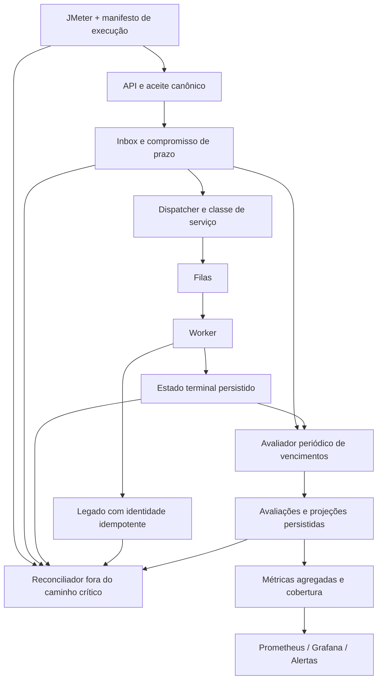

# DDA: plano de implementação da evolução SRE

**Plano histórico do primeiro ciclo (17–18/10).** Os itens e próximos passos abaixo descrevem aquele momento. O plano ativo é [S0–S7](../../aidlc-docs/inception/sre-evolucao/workflow-plan.md): S0–S5 validadas; S6 com homologação pendente. Persistência do worker, avaliador e burn rate já receberam entregas nesse incremento.

**Revisão:** 17/10/2026. **Estado:** contrato, avaliador e captura local opt-in das fontes implementados; persistência e operação contínua pendentes. Seis dashboards sincronizados na EC2, com datasource e 108 expressões validados. Um relatório de experimento real foi publicado explicitamente; isso não representa projeção contínua.

O objetivo é demonstrar aceite correto e decisão no prazo com denominadores verificáveis, inclusive quando há falhas e propostas pendentes. O plano parte dos serviços existentes, do [README SRE](README.md) e da [análise crítica](../brainstorming/Fase-01/SRE/rascunho-plano-evolucao-sre-sli-slo-sla.md), preservando o contrato HTTP e a proteção do legado durante a evolução.

## 1. Visão geral e objetivos de negócio

Entregar três famílias de SLIs: aceite correto, aceite rápido e decisão correta no prazo. Integridade — ausência de efeito financeiro adicional para a mesma proposta e recuperação dos aceites — é um critério independente de aprovação.

O primeiro resultado será um relatório local reproduzível. Depois, a mesma especificação alimentará métricas e painéis operacionais. A abordagem permite encontrar erros de contagem antes de criar alertas baseados neles, conforme a distinção entre especificação e implementação de SLI do [Google SRE Workbook](https://sre.google/workbook/implementing-slos/).

### Escopo e premissas de execução

- Implementar primeiro no ambiente local; validar posteriormente exportadores e provisionamento na EC2. Não depender de Docker na estação.
- Manter a aplicação no JDK declarado no parent Maven e o JMeter no Java 21, pelo iniciador versionado.
- Usar instantes UTC e relógio injetável para regras de prazo; aguardar o fim da cauda do teste antes de encerrar a avaliação.
- Preservar as respostas atuais de idempotência e a flag de Business Fingerprint; testar os dois modos explicitamente, sem habilitar a v2 implicitamente.
- Não aprovar 10.000 propostas novas/s com prazo geral de 45 min e saída de 180/s. Registrar um envelope experimental viável antes de elevar a carga.
- Preferir o DynamoDB já utilizado para o primeiro adaptador durável, com configuração explícita e contrato testado. A escolha definitiva do esquema será registrada antes da codificação do incremento de persistência.
- Não prometer exatamente uma chamada remota. Reentregas são esperadas; o efeito no legado depende de idempotência também no destino.

### Backlog de implementação

| ID | Entrega | Estado nesta revisão | Depende de | Conclusão verificável |
|---|---|---|---|---|
| SRE-00 | README central, plano, referências nos índices. | Concluído documentalmente. | — | Links locais válidos e inventário correspondente aos quatro JSON. |
| SRE-01 | Contrato versionado de medição e cenários de teste. | Implementado e testado localmente: [contrato v1](contrato-medicao.md). | SRE-00. | Elegibilidade, identidade, população, prazo, exclusões e qualidade da coleta testáveis. |
| SRE-02 | Relatório local de execução e reconciliação. | Avaliador e captura automática local implementados para experimento isolado e uma JVM. Ver [captura](captura-local.md). | SRE-01. | Massa conhecida produz contagens exatas; pendência não some; artefatos protegidos e reproduzíveis. |
| SRE-03 | Estado durável do worker e interfaces desacopladas. | Pendente. | SRE-01; validação com SRE-02. | Reinício e concorrência não regridem estado nem duplicam o resultado contabilizado. |
| SRE-04 | Registro de prazo desde o aceite e avaliador recuperável. | Pendente. | SRE-03. | Toda proposta aceita recebe avaliação, mesmo sem dispatcher/worker ou em DLQ. |
| SRE-05 | Métricas do contrato e cobertura da telemetria. | Gauges do relatório offline entregues; captura/projeção contínua pendente. | SRE-02; SLI C contínuo depende de SRE-04. | Exposição real validada; reset, ausência e replay não geram sucesso fictício. |
| SRE-06 | Revisão dos quatro dashboards e novos painéis de confiabilidade. | Seis dashboards sincronizados na EC2; UIDs, datasource, 108 expressões e séries reais do relatório verificados. Visão contínua de C depende de SRE-04/05. | SRE-05; correções de clareza podem antecipar. | Consultas coerentes com relatório, filtros de ambiente e ausência explícita. |
| SRE-07 | Alertas de impacto e resposta SNS/SQS. | Sete regras com contexto de dashboard/Jaeger; 14 cenários e 98 verificações aprovados. Ciclo sintético firing/resolved verificado até o SNS em 17/10/2026. SQS e reconhecimento pelo consumidor não inspecionados nesta rodada. | SRE-05/06; SLO contínuo depende de fontes contínuas. | Firing/resolved, rota, entrega e reconhecimento demonstrados em teste controlado. |
| SRE-08 | Exercícios progressivos, Jaeger e publicação validada. | Primeiro [exercício real de pausa do worker](exercicio-falha-worker.md) concluído: alerta, SNS, dez propostas recuperadas e dez traces completos. Demais cenários e carga progressiva pendentes. | Incrementos correspondentes. | Pacote de evidências por ambiente, configuração e cenário. |

Os IDs são incrementos revisáveis, não precisam representar um único commit. O usuário mantém o controle dos commits. Cada entrega atualiza o README e seu estado; pendência não vira concluída por existir arquivo de configuração.

## 2. Arquitetura de sistema e fluxo de dados



O fluxo contínuo acima é o destino da evolução. Inicialmente, o reconciliador pode executar após uma massa pequena controlada, sem adicionar um serviço permanente.

### SRE-01 — Fixar o contrato antes da instrumentação

Criar `docs/sre/contrato-medicao.md` no incremento, com versão de política e exemplos bons/ruins. Extrair do README as definições de A/B/C para esse contrato detalhado, mantendo o README como resumo e evitando duas especificações divergentes.

Definir:

1. Tentativa HTTP versus proposta canônica; duplicata técnica versus semântica; identidade da aceitação independente do trace.
2. Requisições elegíveis, 429 dentro/fora da cota, falha anterior ao servidor e timeout após gravação.
3. Duração medida pelo cliente versus duração interna da API. Aceite rápido precisa ser também correto.
4. Decisão comercial válida versus erro técnico. O estado atual `FAILED` não basta para inferir essa diferença sem classificação adicional.
5. Prazo global para não roteadas, prazo por lane, instante inicial e regra de mudança de classe. Preservar o histórico da política aplicada.
6. Resultado sem demanda, coleta incompleta, atraso de evento, timestamp inválido e critérios para revisão de uma avaliação.

**Metas para experimentar:** A 99,9%; B 95%/100 ms e 99%/200 ms; C fast 95%/2 min e standard 90%/45 min apenas em envelope compatível. O prazo global de não roteadas deve ser definido no contrato antes de ativar C; não escolher um valor silenciosamente no código.

**Aceitação:** exemplos calculados manualmente e casos determinísticos de teste, incluindo um aceite HTTP ruim cuja proposta foi persistida e posteriormente recuperada por retry. A tentativa HTTP permanece ruim; a proposta continua única.

### SRE-02 — Produzir o primeiro relatório confiável

Ponto de partida da carga: [Thread Group.jmx](../../jMetter/consignado/Thread%20Group.jmx), dentro do repositório. Revisar extratores e formato JTL antes de alterar a massa. Não depender exclusivamente de uma cópia externa ao projeto.

Implementar um comando local de avaliação em `applications/scripts`, apoiado por código de aplicação/ports quando necessário. Evitar script que replique regras de domínio ou faça carga/scan pesado em ambiente remoto por padrão.

- Ler manifesto e observações do cliente; distinguir sucessos HTTP, falhas e retries.
- Comparar aceites únicos com resultados e pendências da mesma coorte.
- No primeiro incremento, capturar resultados do processo local e declarar a limitação de reinício. O relatório já deve detectar falta de evidência; comprovação de recuperação fica para SRE-03/04.
- Emitir JSON legível por ferramenta e resumo Markdown, com cobertura e causas de inconsistência.
- Usar diretório de resultados ignorado pelo Git; manter no repositório somente schemas, fixtures sintéticas e instruções.
- Não exigir igualdade entre o inteiro reconciliado e um `increase()` estimado pelo Prometheus.

**Aceitação:** fixture sintética com novas, repetidas, conflitos, rejeições válidas, erros técnicos, atrasos e pendências produz resultado esperado; falha de leitura de uma fonte gera “incompleto”, nunca relatório aprovado.

### SRE-03 — Persistir estado e remover dependência do adaptador em memória

Implementar um adaptador DynamoDB para `ProposalRepositoryPort`, mantendo o modo em memória para testes isolados. Ajustar `WorkerConfig` para selecionar o adaptador explicitamente e fazer falha de configuração visível.

O `WorkerMetrics` atual recebe `InMemoryProposalRepository` diretamente. Extrair uma porta de consulta/projeção de estado para não manter métricas acopladas ao adaptador antigo e não fazer scan completo no scrape. Testar que a troca de persistência não altera o contrato HTTP ou a política de consumo.

Persistir criação, transição e eventos de forma consistente; usar versão/condições contra atualização concorrente e proteger estados terminais. Uma resposta vazia de `save()` hoje não informa se uma gravação ganhou a disputa: revisar a interface para o caso de uso emitir observação de negócio somente quando a transição foi efetivamente aplicada.

Se usar transações DynamoDB, respeitar os limites do serviço e não tentar atualizar duas vezes o mesmo item na mesma transação. A documentação oficial orienta a atomicidade entre itens, mas ela não engloba a chamada HTTP ao legado. [AWS — DynamoDB Transactions](https://docs.aws.amazon.com/amazondynamodb/latest/developerguide/transaction-apis.html).

**Concorrência e ambiguidade:** impedir regressão local não torna a chamada remota exatamente uma vez. Manter a mesma identidade no legado, testar timeout após efeito e replay. Se houver lease de processamento, definir expiração/fencing e teste de corrida; não usar lease como substituto de idempotência no destino.

**Ambiente local:** hoje `LocalDynamoDb` usa `-inMemory`. Acrescentar modo persistente opt-in, com diretório dedicado e ciclo de vida documentado, para o teste de reinício do armazenamento. Separar restart do worker, restart do emulador e limpeza completa; testes temporários continuam isolados. O ledger do mock também é em memória: se reiniciar o mock, o relatório deve declarar a limitação ou usar fixture de ledger persistente para comprovar esse cenário.

**Aceitação:** testes de contrato rodados nos dois adaptadores; duas instâncias disputam a mesma proposta; restart preserva estado; não se duplica a transição terminal observada. Uma queda entre decisão persistida e métrica não pode perder a evidência de conciliação.

### SRE-04 — Avaliar pendências, inclusive fora do worker

Registrar o compromisso inicial junto ao aceite durável, não somente quando o worker cria `PENDING`. Caso contrário, interrupção de Streams/dispatcher excluiria justamente as propostas mais importantes do denominador.

Planejar a gravação atomicamente com o aceite existente, inclusive no caminho transacional da v2, ou derivar o compromisso da Inbox com reconciliação que cubra falhas do projetor. Não criar uma segunda gravação independente seguida de 202 sem resolver a possibilidade de compromisso ausente.

Usar índice particionado por faixa temporal/shard para buscar vencimentos em lotes limitados. Guardar checkpoint e retomar após falha; complementar com reconciliação. Índice eventualmente consistente não pode ser tratado como prova de ausência definitiva. TTL serve à retenção, não como agendador pontual de vencimento.

O avaliador aplica a política pelo horário do prazo, com atraso de execução registrado separadamente. Cada proposta recebe uma avaliação por versão de política e compromisso. Decisão após prazo não muda `bad` para `good`; correção de evidência atrasada tem regra explícita e histórico.

**Aceitação:** proposta nunca despachada vence e conta como ruim; DLQ continua aberta; duplicata não cria outro prazo; reiniciar avaliador não duplica classificação; atraso de coleta não é confundido com atraso de negócio. Falha do avaliador é detectável por frescor/checkpoint.

### SRE-05 — Expor métricas e cobertura verificáveis

Reaproveitar as métricas atuais para diagnóstico e introduzir somente o necessário para o contrato. Nomes novos na seção 3 são propostas, não séries já disponíveis.

- Buckets HTTP nos limites 100/200 ms, com testes do conteúdo exposto e sem duplicar a instrumentação HTTP do framework.
- Buckets 120/2700 s para finalizados, se as metas C permanecerem; não usar esses buckets como único denominador de C.
- Avaliações agregadas por política/SLI/lane/veredito, com valores de enumeração limitados.
- Pendências, pendências vencidas, maior idade desde aceite e idade da amostra de fila.
- Tamanho/idade da DLQ e sucesso da coleta desses dados, para não manter gauge antigo como se fosse atual.
- Identificação das instâncias esperadas e isolamento por ambiente.

Não incrementar um contador volátil após gravar no banco e chamá-lo de total durável. Escolher e testar a projeção: publicação com consumidor idempotente e reconciliação, ou agregados persistidos por período. Se expostos como gauges de agregados por período, consultar diretamente esses períodos, sem aplicar `rate()` como se fossem counters. Um counter reconstruído exige fronteira de reset e propriedade da série definidas, inclusive com réplicas.

**Aceitação:** duplicação de eventos, reinício do exportador, troca de líder/réplica, ausência de amostra e falta de tráfego são verificáveis sem falsear o resultado. Conferir realmente `/actuator/prometheus` e o caminho Pushgateway/Prometheus antes de usar novas séries em painel.

### SRE-06 — Atualizar Grafana sem mudar a semântica do negócio

Revisar os quatro JSON existentes. Foram criados `sre-overview.json` para os sinais existentes e `sre-experiments.json` para gauges do relatório offline. Os seis arquivos foram sincronizados e verificados na EC2 em 17/10/2026, preservando backup da configuração anterior. SLO operacional contínuo ainda depende de fontes persistidas e não deve ser confundido com snapshot experimental.

| Painel | Mudança prevista | Verificação |
|---|---|---|
| Ingestão | Filtrar exatamente `POST /v1/proposals` quando o indicador se referir à ingestão; adicionar ambiente; distinguir diagnóstico e SLI. | Consultas atuais incluem rotas além do POST apesar do título; comparar dados da mesma população. |
| Downstream | Isolar ambiente, explicar replay, revisar agregações multi-instância de in-flight/limites e filas. | Não apresentar limite global como maior limite de uma única réplica nem duplicar profundidade da mesma fila. |
| Backlog | Renomear “SLO” dos finalizados; mostrar buckets como diagnóstico; retirar preenchimento artificial de razão sem eventos; acrescentar vencidos quando existir fonte. | Proposta pendente degrada indicador de prazo mesmo com finalizados rápidos. |
| Negócio | Preservar cálculos e cores solicitados; melhorar explicação de coortes e distinguir fluxo de conciliação. | Duas casas monetárias, zero denominador sem dados e duplicatas sem novo VGV. |
| SRE — novo | Bons/ruins/elegíveis, valor do SLI, alvo, orçamento, burn rate quando aplicável e estado da medição. | Exibir “sem eventos” e “incompleto”, sem verde/100% por falta de séries. |

Não adicionar ID de execução como label permanente para filtrar testes; delimitar janela/ambiente/instâncias no painel e manter identificação detalhada no relatório. Preservar UIDs existentes e publicar os JSON pelo provisionamento, sem depender de edições manuais na interface.

### SRE-07 — Alertas e procedimento de resposta

Manter as sete regras atuais e testar a convivência com alertas de pendência vencida, DLQ e falta de cobertura. No primeiro ciclo local, usar conclusão de experimento e vencimento como sinais principais; burn rate de 30 dias exige histórico e operação contínua compatíveis.

Para cada regra nova: escrever o runbook, testar firing/resolved, baixo tráfego, falta de séries, reset e manutenção planejada. Manter a rota `notification=sre`, validar agrupamento/inibição e verificar que alertas não caem no receiver padrão `blackhole`.

O destino continua SNS → SQS. Definir o consumidor/atendimento antes de declarar notificação humana. Testes offline de regras não enviam alertas reais. O exercício integrado deve usar um alerta identificado como teste, preservar o resolved e verificar entrega/ack sem purgar a fila.

### SRE-08 — Validar e publicar progressivamente

Ordem de comprovação: testes determinísticos → integração local → smoke HTTP → falha controlada → carga progressiva → ambiente EC2/Jaeger. A configuração local aprovada acompanha os artefatos; o resultado remoto é uma nova evidência, não herda automaticamente a aprovação local.

Antes de publicar, guardar configuração anterior, validar regras/providers/datasource e preparar reversão. Mudança de esquema deve permitir leitura de registros antigos ou ter migração explicitamente testada. Se um novo componente falhar, mostrar medição incompleta; não retroceder silenciosamente para números aparentemente saudáveis.

## 3. Modelo de dados e interfaces de API

### Contratos existentes preservados

O endpoint `POST /v1/proposals` continua aceitando propostas conforme o contrato atual e recuperando duplicatas por `DUPLICATE_ACCEPTED`. Não criar endpoint público de auditoria apenas para facilitar o teste; o relatório usa portas, adaptadores e acesso controlado às fontes.

O agregado `Proposal` já contém identidade, tenant, lane, estado, tentativas e instantes. O aceite original vem da Inbox. Não usar `createdAt` do worker como início da jornada: ele começa depois da espera anterior ao consumo.

### Esquemas propostos a detalhar em SRE-01/03/04

| Registro | Campos mínimos propostos | Regra |
|---|---|---|
| Manifesto do experimento | Versão de schema, revisão do código, início/fim, ambiente, instâncias, modo de idempotência, carga, mistura e política de prazo. | Evidência por execução, sem segredo nem payload pessoal. |
| Observação HTTP | Identificador técnico do caso/tentativa, duração, status/erro, resultado esperado e aceitação correlacionada quando disponível. | Distinguir tentativa de proposta canônica. IDs só em artefato protegido, não labels. |
| Estado persistido | Chave canônica, estado, versão, lane, tentativas e instantes; resultado classificado e eventos. | Condição de concorrência, terminal absorvente e trilha de transições. |
| Compromisso de prazo | Chave canônica, aceite original, classe/prioridade, prazo global/da lane e versão da política. | Criado/derivado desde o aceite, sem lacuna para não roteadas. |
| Avaliação | Chave do compromisso, vencimento, horário de avaliação, evidência de decisão, `good`/`bad` e motivo categórico. | Unicidade; atualização excepcional auditada; evidência tardia com regra explícita. |
| Projeção agregada | Ambiente, intervalo fechado, política/SLI/lane, boas, ruins e cobertura. | Fonte da consulta é documentada; não confundir gauge periódico com counter. |

Uma proposta pode ter compromissos distintos de roteamento e decisão; não misturar esses denominadores. A avaliação C por lane usa a classe definida pela política; o controle de não roteadas garante que itens sem classificação não desapareçam. Congelar essa regra antes de produzir um total global de C.

Valores financeiros usados para conciliação vêm da mesma base monetária e coorte. Somar em centavos inteiros ou `BigDecimal`, com estados mutuamente exclusivos; aplicar a política de acesso/retenção. Não duplicar valores e PII no estado técnico só para montar uma métrica.

### Métricas propostas e cardinalidade

| Família lógica proposta | Tipo a definir pela projeção | Dimensões permitidas |
|---|---|---|
| Resultado de avaliação de SLI | Counter de pipeline idempotente ou agregado periódico persistido; decidir em SRE-05. | `env`, `service`, `sli`, `lane`, `verdict`, versão limitada de política. |
| Pendências e vencidas | Gauge de projeção reconciliada. | `env`, `lane`, estado categórico limitado. |
| Maior idade e atraso de avaliação | Gauge em segundos. | `env`, `lane` quando aplicável. |
| Última coleta válida de fila/DLQ | Timestamp/idade e contagem de falha técnica. | `env`, fila lógica, serviço. |
| Saúde da cobertura | Gauge/estado enumerado e frescor. | `env`, componente esperado. |

O nome Prometheus final e a consulta só serão fixados após escolha da fonte. Sem CPF, IDs, chaves de idempotência, fingerprint, mensagens de exceção ou rótulo de execução por teste. Versões antigas de política precisam de retenção e orçamento de séries definidos.

### Regras de cálculo

```text
A = aceites corretos / tentativas elegíveis
B(T) = aceites corretos e rápidos até T / tentativas elegíveis
C = decisões corretas até o prazo / compromissos cujo prazo venceu na janela

Orçamento = elegíveis × (1 − alvo)
Consumo = ruins / orçamento
Burn rate = (ruins / elegíveis) / (1 − alvo)
```

Zero elegíveis e cobertura incompleta são estados explícitos. Não usar `clamp_min` para produzir cumprimento artificial. O avaliador deve conhecer aceites não concluídos; só observar eventos do caminho feliz não produz um denominador completo.

## 4. Estratégia de qualidade e testes

### Q1/Q2 — unidade e componentes

- Classificador de elegibilidade, resultados comerciais/técnicos e prazo com relógio controlado.
- Contagens de tentativa/proposta, duplicata e replay; conflito de payload; timestamps ausentes/negativos.
- Máquina de estados, retorno da transição aplicada e evento observado uma única vez.
- Repositório em memória e DynamoDB submetidos ao mesmo contrato de persistência.
- Avaliação no limite do prazo, após o prazo e com evidência atrasada; política estável durante retry/promoção.
- Serialização do relatório, minimização de dados e falha de fonte resultando em incompleto.

### Q3/Q4 — integração, operação e performance

- Duas réplicas e mensagens repetidas; timeout depois do efeito e retomada após queda.
- Queda do dispatcher antes/depois de publicar; aceite que nunca chega ao worker.
- Reinício separado de worker, emulador, avaliador e mock; registrar o que cada teste realmente demonstra.
- Fila visível/in-flight, DLQ, reprocessamento e atraso de avaliação.
- Exportação de métricas, Pushgateway/Prometheus e amostra antiga com `up=1`.
- Consultas Grafana com filtro de ambiente, múltiplas instâncias, ausência, baixo tráfego e reset.
- Alerta sintético identificado, entrega SNS/SQS, reconhecimento e resolved; jornada Jaeger sem dados sensíveis.
- Carga crescente com gerador monitorado, taxa oferecida real, teto no destino e justiça sob backlog nas duas lanes.

### Verificações por entrega

Para documentação, executar a partir da raiz:

```powershell
powershell.exe -NoProfile -ExecutionPolicy Bypass -File .\applications\scripts\check-doc-links.ps1
git diff --check
```

Para incrementos Java, executar testes focados dos módulos alterados e suas integrações relevantes. Em `applications`, o build `mvn install -DskipTests` apenas gera/instala artefatos; não é evidência de testes aprovados. O perfil de integração deve ser limitado aos testes do incremento quando não se pretende rodar toda a suíte; registrar comandos e resultados exatos na entrega.

Para regras, quando implementadas e com as ferramentas disponíveis, usar os comandos do [manual de alertas](../../infrastructure/Configuration/observability/ALERTAS.md): `promtool check rules`, `promtool test rules` e validação do Alertmanager. Para dashboards, validar JSON e consultas no Prometheus/Grafana com uma massa conhecida; JSON válido sozinho não comprova a consulta.

### Critério para considerar a evolução entregue

- README corresponde ao código e às consultas publicadas.
- Relatório reconcilia a mesma coorte e distingue falta de evidência de evento ruim.
- Uma proposta não consumida degrada a medição de prazo; não fica invisível.
- Reinício e concorrência não apagam nem duplicam a classificação consolidada.
- A proteção do legado e a idempotência preservam seus contratos no escopo testado.
- Painéis e alertas mostram impacto e cobertura, com responsável e procedimento de resposta.
- Metas são apresentadas somente para o ambiente, a carga e o período comprovados.

## Obstáculos, decisões pendentes e alternativas

**Decisões de produto:** envelope de novas propostas, mistura de lanes, prazos por classe e para não roteadas, definição de rejeição comercial válida e eventual período de serviço contínuo. Podem ser exercitadas com políticas de teste explícitas; não devem virar valor de produção implícito.

**Riscos técnicos:** estado em memória, acoplamento das métricas ao adaptador, duplicação de observações após corrida, commit remoto ambíguo, projeção com atraso, DLQ fora do denominador, contadores reiniciados e mesma profundidade de fila reportada por várias réplicas. Cada risco possui teste no incremento correspondente.

**Dependências operacionais:** iniciar o ambiente para a comprovação remota, cobertura de retenção, conectividade OTLP, consumidor SNS/SQS e responsável pelo atendimento. O monitor externo da stack só se justifica junto ao escopo de operação contínua.

**Alternativas consideradas:** Aurora não é pré-requisito desta evolução; exige justificativa própria. Histograma somente de finalizados permanece como diagnóstico, sem representar C. Incrementar contador em memória após commit não substitui projeção recuperável. IDs de propostas em labels e limpeza de histórico para deixar painel verde são incompatíveis com o contrato de medição.

**Incrementos realizados:** contrato SRE-01, avaliador e captura controlada de SRE-02 integram JMeter, Inbox e worker, preservando o resultado incompleto quando fontes faltam ou a sessão muda. A fixture também demonstra 100% de aceite HTTP com apenas 33,33% de decisões no prazo. **Próximo incremento:** persistência e transições de SRE-03, antes de assumir recuperação após reinício ou avaliação contínua.
